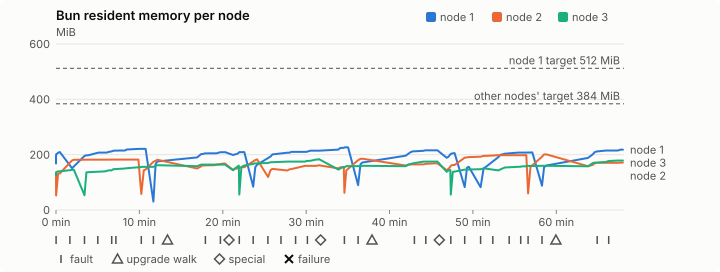
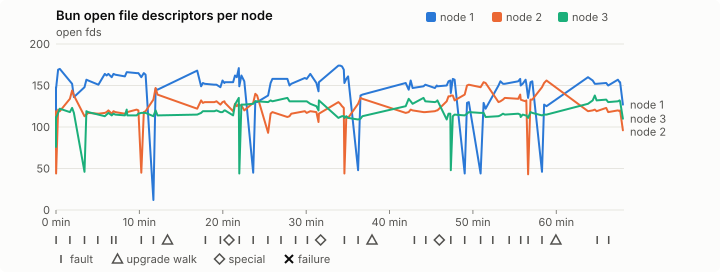
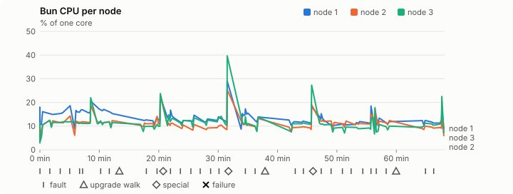
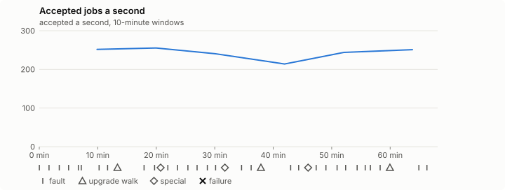

# Sustained soak (V02): PASS

20 November 2026. fast tier, compressed schedule, 1 h 08 min of soak on a three-node quickstart cluster.

**Fast tier: clean.** The iteration loop only, not acceptance: the V02 gate needs a clean final-tier run (8 h, full schedule) on the final candidate.

## Candidate and host

| | |
|---|---|
| Staged base URL | <https://github.com/reliaburger/reliaburger/releases/download/nightly-v0.3.0-44367330908-1> |
| `candidate.json` SHA-256 | `6756c1800123c7df382626735176bbf363b34a93649bef545a0e6b13b44aacc9` |
| Running versions | v0.3.0 x3 |
| Soak build | `bun-v0.3.0-soak.1`, SHA-256 `ca31cfc5d66d8c1e01edde542c9cc97729d45317e9d182e831d48c21c006542b` |
| Walks roll back to | 0.3.0 |
| Host | macOS 27.2, Apple M5 Max, 128 GiB |
| Lima | limactl version 2.2.1 |
| Guest | Ubuntu 26.04.1 LTS, kernel 7.0.0-34-generic |
| RELIABURGER_HOME | `/tmp/rbq.LaBHH6` |
| Evidence | `/Users/miko/github/rb-wt/gate-030-c4/qual/ev-v02-fast-2` |

## Configuration deviations

- Ubuntu's apt-daily and apt-daily-upgrade timers stopped and disabled in each guest, so unattended upgrades can't restart Bun during the soak (#1417)
- node.toml `[testing] allowed_operations` adds `provision_isolated_workloads` (quickstart allows only inject_workload_faults and alter_node_state), so the catalogue pulse can lease test namespaces
- node.toml `[logs]`/`[metrics]` export to file:///var/lib/reliaburger/soak-export every 60 s with max_storage_mb = 8 (the harness deletes a metrics export 30 minutes after its source has gone), `[storage.snapshots]` every 900 s (compressed: 120 s), retain 4, uploaded to the same directory
- node.toml `[ingress] tls_cert/tls_key` point at an operator pair from a soak CA, 45-minute leaves rotated by the harness
- Bun runs with auto/mixed; host jobs opt in to a single pinned BusyBox copy under /var/lib/reliaburger/soak-jobs, mount_isolation=false. The independent verifier listens on each private VM address, TCP 8189, with a separate run token
- node.toml `[node.labels] soak-volume` = "writer" on node 2 and "redis" on node 3, to pin the volume apps
- node.toml `[upgrades] external_signing_key` = a throwaway operator key the harness made for this run (`ed25519:ch8JE+CDR59RNN6RvtDZRrql1FwDHqi4yEETzJIkGEk=`); the soak build's `.sig` gets that key's external signature beside the release one (D2)
- node.toml `[security] leaf_lifetime_override_secs = 3600` (D1)
- apt-daily, apt-daily-upgrade and unattended-upgrades verified inactive on every node before the baseline, after waiting 0 s for any upgrade in progress (snapshots/upgrades-verified-N.txt)

## Timeline

- Started 2026-11-20 08:45:02 UTC, finished 2026-11-20 09:53:09 UTC
- Cycles completed: 6
- Fault and node choices: 26, from seed 692007971 (`--seed 692007971` repeats them)
- Teardown: `relish local destroy --yes` and `relish uninstall --yes` succeeded

## Faults and slots

| Class | Runs | Settled/ok | Failed | Skipped | Settle (median / max) |
|---|---|---|---|---|---|
| fault:bun-kill-follower | 6 | 6 | 0 | 0 | 34 s / 41 s |
| fault:bun-kill-leader | 6 | 6 | 0 | 0 | 32 s / 44 s |
| fault:chaos-cpu | 1 | 2 | 0 | 0 | 18 s / 18 s |
| fault:chaos-delay | 2 | 4 | 0 | 0 | 17 s / 17 s |
| fault:chaos-dns | 1 | 2 | 0 | 0 | 17 s / 17 s |
| fault:chaos-drop | 1 | 2 | 0 | 0 | 18 s / 18 s |
| fault:chaos-kill | 2 | 4 | 0 | 0 | 40 s / 40 s |
| fault:chaos-memory | 1 | 2 | 0 | 0 | 17 s / 17 s |
| fault:chaos-partition | 2 | 4 | 0 | 0 | 18 s / 18 s |
| fault:chaos-pause | 1 | 2 | 0 | 0 | 18 s / 18 s |
| fault:chaos-scenario | 1 | 2 | 0 | 0 | 32 s / 32 s |
| fault:deploy-kill | 3 | 3 | 0 | 0 | 36 s / 39 s |
| fault:power-off | 3 | 3 | 0 | 0 | 31 s / 50 s |
| pulse | 1 | 1 | 0 | 0 | n/a |
| pulse:settle | 0 | 1 | 0 | 0 | 16 s / 16 s |
| special:all-off | 1 | 1 | 0 | 0 | 29 s / 29 s |
| special:graceful-stop | 1 | 1 | 0 | 0 | 44 s / 44 s |
| special:quorum-back | 1 | 1 | 0 | 0 | n/a |
| special:quorum-loss | 1 | 1 | 0 | 0 | 42 s / 42 s |
| storage:offline-export | 3 | 3 | 0 | 0 | n/a |
| storage:registry-push | 6 | 0 | 0 | 0 | n/a |
| tls:invalid-expired | 3 | 3 | 0 | 0 | n/a |
| tls:invalid-torn | 6 | 6 | 0 | 0 | n/a |
| tls:reload | 32 | 32 | 0 | 0 | n/a |
| upgrade:rollback | 3 | 3 | 0 | 0 | n/a |
| upgrade:settle | 0 | 3 | 0 | 0 | 62 s / 65 s |
| upgrade:upgrade | 3 | 3 | 0 | 0 | n/a |

## Execution inventory (recorded, not gated)

What the run completed, from its events and kept bytes, against what its schedule owes. A fault counts once it was injected and the cluster settled after it.

| Item | Required | Completed | Verdict |
|---|---|---|---|
| candidate.json bytes match the qualified digest | 1 | 1 | ok |
| app workloads settled at the baseline | 1 | 1 | ok |
| upgrade walk (to the soak build and back) | 2 | 3 | ok |
| fault:bun-kill-follower | 1 | 6 | ok |
| fault:bun-kill-leader | 1 | 6 | ok |
| fault:deploy-kill | 1 | 3 | ok |
| fault:power-off | 1 | 3 | ok |
| fault:chaos-kill | 1 | 2 | ok |
| fault:chaos-delay | 1 | 2 | ok |
| fault:chaos-partition | 1 | 2 | ok |
| fault:chaos-scenario | 1 | 1 | ok |
| fault:chaos-pause | 1 | 1 | ok |
| fault:chaos-drop | 1 | 1 | ok |
| fault:chaos-dns | 1 | 1 | ok |
| fault:chaos-cpu | 1 | 1 | ok |
| special:graceful-stop | 1 | 1 | ok |
| special:quorum-loss | 1 | 1 | ok |
| special:all-off | 1 | 1 | ok |
| catalogue pulse | 1 | 1 | ok |
| offline export | 2 | 3 | ok |
| job campaign drained in its final two minutes | 1 | 1 | ok |

## Observed fault effects

What each injected fault was seen to do, read back from the node.

| Fault | Target | Observed |
|---|---|---|
| effect:bun-kill-follower | rb-4974e9125187-2 | MainPID 3500 -> 6184 |
| effect:bun-kill-leader | rb-4974e9125187-1 | MainPID 10014 -> 42885 |
| effect:deploy-kill | rb-4974e9125187-3 | MainPID 3225 -> 66715 |
| effect:power-off | rb-4974e9125187-3 | Lima status Stopped |
| effect:bun-kill-follower | rb-4974e9125187-2 | MainPID 6184 -> 217207 |
| effect:bun-kill-leader | rb-4974e9125187-1 | MainPID 42885 -> 254010 |
| effect:bun-kill-follower | rb-4974e9125187-3 | MainPID 1031 -> 21987 |
| effect:bun-kill-leader | rb-4974e9125187-1 | MainPID 1038 -> 48040 |
| effect:deploy-kill | rb-4974e9125187-2 | MainPID 1052 -> 80491 |
| effect:power-off | rb-4974e9125187-2 | Lima status Stopped |
| effect:bun-kill-follower | rb-4974e9125187-2 | MainPID 1038 -> 31006 |
| effect:bun-kill-leader | rb-4974e9125187-1 | MainPID 48040 -> 256020 |
| effect:bun-kill-follower | rb-4974e9125187-3 | MainPID 1039 -> 17667 |
| effect:bun-kill-leader | rb-4974e9125187-1 | MainPID 1046 -> 50575 |
| effect:deploy-kill | rb-4974e9125187-1 | MainPID 50575 -> 80508 |
| effect:power-off | rb-4974e9125187-3 | Lima status Stopped |
| effect:bun-kill-follower | rb-4974e9125187-2 | MainPID 1043 -> 192985 |
| effect:bun-kill-leader | rb-4974e9125187-1 | MainPID 80508 -> 201122 |

## Renewals and rotations

| Measure | Observed | Required | Verdict |
|---|---|---|---|
| workload identity rotations (soak-identity, per node) | 8 | ≥ 1 | PASS |
| node leaf renewals (per node) | 2 | ≥ 1 | PASS |
| operator ingress reloads (all nodes) | 32 | ≥ 12 | PASS |
| mixed job campaign and positive drain | 0 missing/failing checks | 0 | PASS |

## Latency SLOs

What a user should feel on a quiet three-node cluster (#1400). Every sample is taken outside fault windows and through a host forward that works; each p99 is the upper bound of its histogram bucket.

| SLO | p99 | Threshold | Samples | Mode | Verdict |
|---|---|---|---|---|---|
| API read p99 | 150 ms | ≤ 3,000 ms | 264 | gated | PASS |
| API write p99 | 700 ms | ≤ 3,000 ms | 8 | gated | PASS |
| App start p99 | 7,000 ms | ≤ 30,000 ms | 24 | gated | PASS |
| Rolling update p99 | 30,000 ms | ≤ 100,000 ms | 8 | gated | PASS |
| Job task start p99 | 2,048 ms | ≤ 256 ms | 20 | record only | too few samples |

- API read p99: `GET /v1/status?cluster=true` and `GET /v1/cluster/nodes` on every node, at every light check
- API write p99: `relish apply` of the soak workloads, from the call to the commit
- App start p99: each node's deploy of a new `soak-slo` instance, from its start until the instance passes its health check
- Rolling update p99: from `relish apply` returning to every node's `soak-slo` running the new spec
- Job task start p99: a job task's start lag on a pooled executor, from the job campaign's buckets, in runs no fault window overlapped
- Job task start p99 not judged: only 20 job task start samples, fewer than the 1,000 a p99 needs

## Jobs

| Runtime | Accepted successes | Retries | Last accepted progress |
|---|---|---|---|
| runc | 14774 | 1 | 1795168377 |
| shared-runc | 486789 | 1 | 1795168377 |
| process | 490105 | 4 | 1795168374 |

The bounded campaign shares the app soak's fault schedule. These counts are reliability evidence, not a saturation rate or a 100-million-per-day qualification.

- Independent verifier execution attempts: 24
- Explicit test-operator acknowledgements for known replay-safe fenced fixtures: 135

- rb-4974e9125187-1: latest complete job storage (KiB) {'instances': 292, 'job-state': 8, 'task-arrays': 6664}; free 4509948 KiB; live/peak owners 0/11; peak storage {'instances': 8568, 'job-state': 8, 'task-arrays': 16856}
- rb-4974e9125187-2: latest complete job storage (KiB) {'instances': 608, 'job-state': 8, 'task-arrays': 6500}; free 5624228 KiB; live/peak owners 0/8; peak storage {'instances': 8372, 'job-state': 8, 'task-arrays': 16320}
- rb-4974e9125187-3: latest complete job storage (KiB) {'instances': 2912, 'job-state': 8, 'task-arrays': 9788}; free 5595364 KiB; live/peak owners 0/8; peak storage {'instances': 7772, 'job-state': 8, 'task-arrays': 16060}

Instance storage limit: 64 MiB per node (data/instances, allocated, outside fault windows; #1418).

Complete disk inventories are recorded. Global retention bounds and the 12-hour job qualification remain #668; this gate cannot certify an unimplemented retention policy.

## Job qualification (D18-C)

Load: calibration; 3 nodes; accepted 243.0/s (calibration load: not gated).

The September plan set its targets for one 1M-task batch on a quiet cluster. A soak runs for hours with restarts, upgrades and apps, so its storage, Bun memory and Raft targets are restated (maintainer decision, 15 October 2026, [#668](https://github.com/reliaburger/reliaburger/issues/668)). Bun's steady state is the median RSS of each process once it has been seen for 10 minutes; the gated memory checks are unchanged (`leak-rss`, and Mayo's 70% `memory_high` alert through `wtf`).

| Measure (recorded, not gated) | Observed | Target |
|---|---|---|
| Wall time of a 1,048,576-task array (median / max of 0) | not measured / not measured | ≤ 600 s |
| p99 start lag, pooled executors | 4 ms (bucket upper bound) | < 1,000 ms |
| Raft entries per second, all cluster writes | 6.44 | recorded only; the batch target counts only task-array writes |
| Raft state of one run, largest seen | 43,699 B | ≤ 256 KiB per 1M tasks |
| Bun steady-state RSS per process, worst node against its target | rb-4974e9125187-1: 224.29 MiB steady, 226.71 MiB peak | ≤ 512 MiB (≤ 512 MiB on node 1, which serves the API) |
| Bun CPU, busiest node | 0.13 cores | ≤ 1 core (leader batch control) |
| Executor helper CPU, busiest node | 0.00 cores | ≤ 0.5 core |
| Node task-array storage per 1M accepted tasks (peaks summed) | 48.49 MiB | ≤ 64 MiB, deleted after retirement |
| Retained log volume, all nodes | 6.63 MB | ≤ 50 MB |

- Bun RSS on rb-4974e9125187-1 (serves the API, target ≤ 512 MiB): pid 10014: 209.72 MiB peak (seen for under 10 minutes); pid 42885: 220.98 MiB peak (seen for under 10 minutes); pid 254010: 175.54 MiB peak (seen for under 10 minutes); pid 294541: 209.23 MiB peak (seen for under 10 minutes); pid 1038: 209.14 MiB peak (seen for under 10 minutes); pid 48040: 224.29 MiB steady, 226.71 MiB peak; pid 256020: 171.85 MiB peak (seen for under 10 minutes); pid 256020: 215.95 MiB peak (seen for under 10 minutes); pid 1046: 205.75 MiB peak (seen for under 10 minutes); pid 50575: 155.97 MiB peak (seen for under 10 minutes); pid 80508: 208.31 MiB peak (seen for under 10 minutes); pid 201122: 160.75 MiB peak (seen for under 10 minutes); pid 201122: 218.10 MiB peak (seen for under 10 minutes)
- Bun RSS on rb-4974e9125187-2 (node, target ≤ 384 MiB): pid 3500: 133.89 MiB peak (seen for under 10 minutes); pid 6184: 182.11 MiB peak (seen for under 10 minutes); pid 217207: 181.27 MiB peak (seen for under 10 minutes); pid 217207: 168.13 MiB peak (seen for under 10 minutes); pid 1052: 182.77 MiB peak (seen for under 10 minutes); pid 80491: 148.68 MiB peak (seen for under 10 minutes); pid 1050: 161.65 MiB peak (seen for under 10 minutes); pid 1038: 156.27 MiB peak (seen for under 10 minutes); pid 31006: 185.28 MiB peak (seen for under 10 minutes); pid 31006: 168.87 MiB peak (seen for under 10 minutes); pid 1043: 198.34 MiB peak (seen for under 10 minutes); pid 192985: 200.84 MiB peak (seen for under 10 minutes); pid 1037: 171.51 MiB peak (seen for under 10 minutes)
- Bun RSS on rb-4974e9125187-3 (node, target ≤ 384 MiB): pid 3225: 145.27 MiB peak (seen for under 10 minutes); pid 66715: 136.80 MiB peak (seen for under 10 minutes); pid 1038: 161.90 MiB peak (seen for under 10 minutes); pid 1038: 164.27 MiB peak (seen for under 10 minutes); pid 1031: 160.54 MiB peak (seen for under 10 minutes); pid 21987: 184.03 MiB peak (seen for under 10 minutes); pid 1038: 159.64 MiB peak (seen for under 10 minutes); pid 1062: 175.14 MiB peak (seen for under 10 minutes); pid 1039: 144.43 MiB peak (seen for under 10 minutes); pid 17667: 149.50 MiB peak (seen for under 10 minutes); pid 1030: 159.67 MiB peak (seen for under 10 minutes); pid 1030: 178.96 MiB peak (seen for under 10 minutes)

- runc retry causes: exit_code 1, launch 0, signal 0, timeout 0, unknown 0, unrecorded 0
- shared-runc retry causes: exit_code 1, launch 0, signal 0, timeout 0, unknown 0, unrecorded 0
- process retry causes: exit_code 1, launch 3, signal 0, timeout 0, unknown 0, unrecorded 0
- Audited executions: 24; operator replay decisions: 135
- Chunks checked for exactly-once completion: 80, 4 of them re-granted (#1415)
- Job controller API fallbacks: rb-4974e9125187-1 missed 6; rb-4974e9125187-2 answered 6 (requests a node didn't answer, and the node that took them instead)

## Data

- Volume writer: highest ACK 29412 in the log view; the writer file checks (writer-lost, writer-regression) decide data loss, and `*-log-order` failures are about the order the log view returned lines in
- Redis counter: highest INCR 3157 in the log view
- Volume writer resumes: 7 starts, each checked against the highest ACK logged before it
- Redis client starts: 15, each checked against the highest INCR logged before it; counter regressions the client saw: 0
- Export rb-4974e9125187-1: 114 source files, 103 at the destination
- Export rb-4974e9125187-2: 138 source files, 138 at the destination
- Export rb-4974e9125187-3: 111 source files, 110 at the destination
- Registry images pushed and re-verified: 7
- Agent-loop turns over the 1 s budget: rb-4974e9125187-1 0, rb-4974e9125187-2 0, rb-4974e9125187-3 0
- Soak policies checked in force: 119 times, policy generation 39 at the last check
- Guest clock steps by Lima's guest agent: rb-4974e9125187-1 2, rb-4974e9125187-2 5, rb-4974e9125187-3 7
- Checks evaluated: 185 (heavy 17, light 66, settle 102)
- Last observed progress: redis-counter 3157, writer-ack 29412

## Council history (linearizability)

Every test-lease grant, renew, read and release the history client made, checked against a model of the council's leases. A write with no answer may or may not have happened; the check allows both.

- Operations checked: 21158 of 21158, in 2 namespaces; 948 writes had no answer
- Verdict: linearizable

## Leak-checker exposure (recorded, not gated)

How long each leak checker could judge each node's Bun. `leak-rss` arms at its warm sample: 60 minutes into one process in a final, and otherwise at the first heavy check where the log and metrics stores are each 90% full, between 60 minutes and 6 hours in (#1417). `leak-fd` arms after 50 minutes; a restart, kill or upgrade exec starts the warm-up again. A final needs each armed for 60 minutes on every node, with one unbroken window of 30 (#1062); its quiet tail gives them that.

| Node | Checker | Armed | Longest armed window | Evaluated samples | Processes armed | Verdict |
|---|---|---|---|---|---|---|
| rb-4974e9125187-1 | leak-rss | 0 min | 0 min | 0 | 0 | short |
| rb-4974e9125187-1 | leak-fd | 0 min | 0 min | 0 | 0 | short |
| rb-4974e9125187-2 | leak-rss | 0 min | 0 min | 0 | 0 | short |
| rb-4974e9125187-2 | leak-fd | 0 min | 0 min | 0 | 0 | short |
| rb-4974e9125187-3 | leak-rss | 0 min | 0 min | 0 | 0 | short |
| rb-4974e9125187-3 | leak-fd | 0 min | 0 min | 0 | 0 | short |


## Resource trends

| Node | Measure | First | Last | Max |
|---|---|---|---|---|
| rb-4974e9125187-1 | disk_kb data | 1382728 | 944596 | 1535364 |
| rb-4974e9125187-1 | disk_kb images | 346292 | 470476 | 470476 |
| rb-4974e9125187-1 | disk_kb logs | 44 | 2424 | 2424 |
| rb-4974e9125187-1 | disk_kb metrics | 92 | 4472 | 4472 |
| rb-4974e9125187-1 | disk_kb soak-export | 4 | 6272 | 6272 |
| rb-4974e9125187-1 | disk_kb volumes | 284 | 80 | 344 |
| rb-4974e9125187-1 | fd | 113 | 127 | 174 |
| rb-4974e9125187-1 | rss_anon_kb | 96512 | 139000 | 148324 |
| rb-4974e9125187-1 | rss_file_kb | 75696 | 84336 | 84976 |
| rb-4974e9125187-1 | rss_kb | 172208 | 223336 | 232148 |
| rb-4974e9125187-2 | disk_kb data | 71800 | 91600 | 566540 |
| rb-4974e9125187-2 | disk_kb images | 179196 | 346308 | 346308 |
| rb-4974e9125187-2 | disk_kb logs | 28 | 2244 | 2244 |
| rb-4974e9125187-2 | disk_kb metrics | 68 | 3200 | 3200 |
| rb-4974e9125187-2 | disk_kb soak-export | 4 | 6280 | 6280 |
| rb-4974e9125187-2 | disk_kb volumes | 16912 | 17540 | 17580 |
| rb-4974e9125187-2 | fd | 73 | 96 | 156 |
| rb-4974e9125187-2 | rss_anon_kb | 56292 | 89952 | 121452 |
| rb-4974e9125187-2 | rss_file_kb | 74416 | 85676 | 85676 |
| rb-4974e9125187-2 | rss_kb | 130708 | 175628 | 205656 |
| rb-4974e9125187-3 | disk_kb data | 234544 | 722652 | 732008 |
| rb-4974e9125187-3 | disk_kb images | 339124 | 339196 | 339196 |
| rb-4974e9125187-3 | disk_kb logs | 24 | 1808 | 1808 |
| rb-4974e9125187-3 | disk_kb metrics | 60 | 2896 | 2896 |
| rb-4974e9125187-3 | disk_kb soak-export | 4 | 6436 | 6436 |
| rb-4974e9125187-3 | disk_kb volumes | 16924 | 17412 | 17412 |
| rb-4974e9125187-3 | fd | 76 | 110 | 138 |
| rb-4974e9125187-3 | rss_anon_kb | 55204 | 97580 | 105068 |
| rb-4974e9125187-3 | rss_file_kb | 74032 | 85680 | 85680 |
| rb-4974e9125187-3 | rss_kb | 129236 | 183260 | 188444 |

## Bun memory by kind

From each node's `/proc/PID/smaps` at the settle and heavy checks (`memory.jsonl`, #1417). Sizes in MiB; arenas are glibc thread arenas, with the number of 64 MiB arena heaps in brackets. Time is h:mm since the node's first sample.

### rb-4974e9125187-1

| Time | Pid | RSS | Heap | Arenas | Stacks | Other anonymous | File | Threads |
|---|---|---|---|---|---|---|---|---|
| 0:00 | 10014 | 168.2 | 44.6 | 0.0 (0) | 0.8 | 45.1 | 77.7 | 46 |
| 1:04 | 201122 | 188.4 | 57.6 | 0.0 (0) | 0.9 | 46.8 | 83.1 | 51 |
| 1:08 | 201122 | 218.1 | 67.6 | 0.0 (0) | 0.9 | 63.5 | 86.1 | 51 |

- rb-4974e9125187-1: not enough data: the last Bun process (pid 201122) has no samples after its first hour.
- rb-4974e9125187-1: no 6-hour RSS slope: the last Bun process (pid 201122) ran for 0:09 h:mm.

### rb-4974e9125187-2

| Time | Pid | RSS | Heap | Arenas | Stacks | Other anonymous | File | Threads |
|---|---|---|---|---|---|---|---|---|
| 0:00 | 3500 | 127.6 | 33.7 | 0.0 (0) | 1.7 | 15.8 | 76.4 | 26 |
| 1:04 | 1037 | 158.3 | 28.5 | 0.0 (0) | 0.8 | 44.1 | 84.9 | 58 |
| 1:08 | 1037 | 171.5 | 36.5 | 0.0 (0) | 0.9 | 46.7 | 87.4 | 58 |

- rb-4974e9125187-2: not enough data: the last Bun process (pid 1037) has no samples after its first hour.
- rb-4974e9125187-2: no 6-hour RSS slope: the last Bun process (pid 1037) ran for 0:04 h:mm.

### rb-4974e9125187-3

| Time | Pid | RSS | Heap | Arenas | Stacks | Other anonymous | File | Threads |
|---|---|---|---|---|---|---|---|---|
| 0:00 | 3225 | 126.2 | 25.0 | 0.0 (0) | 1.1 | 24.0 | 76.1 | 33 |
| 1:04 | 1030 | 157.9 | 33.9 | 0.0 (0) | 1.6 | 35.3 | 87.2 | 39 |
| 1:08 | 1030 | 179.0 | 37.9 | 0.0 (0) | 1.8 | 51.9 | 87.4 | 64 |

- rb-4974e9125187-3: not enough data: the last Bun process (pid 1030) has no samples after its first hour.
- rb-4974e9125187-3: no 6-hour RSS slope: the last Bun process (pid 1030) ran for 0:14 h:mm.

### Log stores against RSS

Each node's `disk logs` and `disk metrics` and the Parquet files in its log store, from the same samples. RSS in MiB.

| Node | Time | RSS | Logs (KiB) | Log files | Metrics (KiB) |
|---|---|---|---|---|---|
| rb-4974e9125187-1 | 0:00 | 168.2 | 44 | 4 | 92 |
| rb-4974e9125187-1 | 1:04 | 188.4 | 2,356 | 48 | 4,284 |
| rb-4974e9125187-1 | 1:08 | 218.1 | 2,424 | 49 | 4,472 |
| rb-4974e9125187-2 | 0:00 | 127.6 | 28 | 3 | 68 |
| rb-4974e9125187-2 | 1:04 | 158.3 | 2,192 | 71 | 3,000 |
| rb-4974e9125187-2 | 1:08 | 171.5 | 2,244 | 76 | 3,200 |
| rb-4974e9125187-3 | 0:00 | 126.2 | 24 | 3 | 60 |
| rb-4974e9125187-3 | 1:04 | 157.9 | 1,488 | 47 | 2,600 |
| rb-4974e9125187-3 | 1:08 | 179.0 | 1,808 | 51 | 2,896 |

## Agent loop stalls

From the stall watchdog's journal blocks (`loop-stalls.jsonl`, #1707). Each snapshot lists every Bun thread; here are the stall line, threads in uninterruptible sleep and the thread that ran the loop.

- Stalls: rb-4974e9125187-3 1

```
Nov 20 09:38:04 lima-rb-4974e9125187-3 bun[1030]: bun: agent loop stalled 843 ms in health_tick, 343 ms past its turn deadline; thread snapshot (pid 1030, 15 threads):
Nov 20 09:38:04 lima-rb-4974e9125187-3 bun[1030]: bun:   tid 1095 tokio-rt-worker S wchan=futex_do_wait syscall=futex(0xfd2e6cc8f848, 0x80, 0x1) [ran the agent loop]
```

## Charts

Time runs from the start of the soak. The marks under each chart are its faults, upgrade walks, specials and recorded failures; the dashed lines are targets.









## Failures

None.

## Notes

- Unattended upgrades were off on every guest 1 s after they were asked to stop (snapshots/upgrades-stopped-N.txt)

Evidence: `/Users/miko/github/rb-wt/gate-030-c4/qual/ev-v02-fast-2` (events.jsonl, snapshots/, failures/<n>/).
