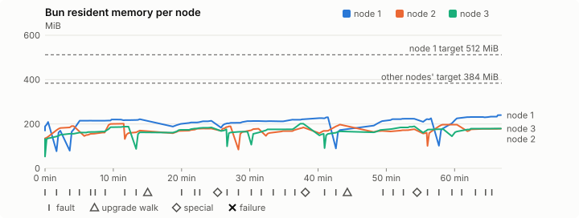
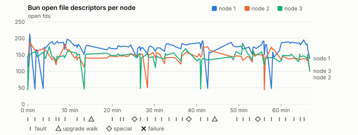
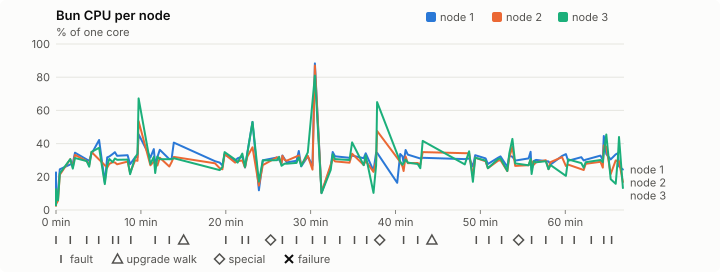
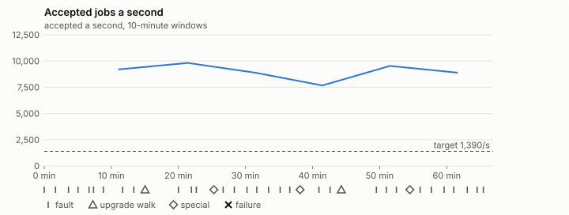

# Sustained soak (V02): PASS

21 November 2026. fast tier, compressed schedule, 1 h 06 min of soak on a three-node quickstart cluster.

**Fast tier: clean.** The iteration loop only, not acceptance: the V02 gate needs a clean final-tier run (8 h, full schedule) on the final candidate.

## Candidate and host

| | |
|---|---|
| Staged base URL | <https://github.com/reliaburger/reliaburger/releases/download/nightly-v0.3.1-44873141955-1> |
| `candidate.json` SHA-256 | `58d812b96598861fd04972622a66f57fe8b77046a6e52bed3a756f099079b59a` |
| Running versions | v0.3.1 x3 |
| Soak build | `bun-v0.3.1-soak.1`, SHA-256 `ed248cb00ca0b5a18a9d55854587c75313e1706a671de83e0c095071994223cc` |
| Walks roll back to | 0.3.1 |
| Host | macOS 27.2, Apple M5 Max, 128 GiB |
| Lima | limactl version 2.2.1 |
| Guest | Ubuntu 26.04.1 LTS, kernel 7.0.0-34-generic |
| RELIABURGER_HOME | `/tmp/rbq.95BEVK` |
| Evidence | `/Users/miko/github/rb-wt/gate-031/qual/ev-jobs-fast` |

## Configuration deviations

- Ubuntu's apt-daily and apt-daily-upgrade timers stopped and disabled in each guest, so unattended upgrades can't restart Bun during the soak (#1417)
- node.toml `[testing] allowed_operations` adds `provision_isolated_workloads` (quickstart allows only inject_workload_faults and alter_node_state), so the catalogue pulse can lease test namespaces
- node.toml `[logs]`/`[metrics]` export to file:///var/lib/reliaburger/soak-export every 60 s with max_storage_mb = 8 (the harness deletes a metrics export 30 minutes after its source has gone), `[storage.snapshots]` every 900 s (compressed: 120 s), retain 4, uploaded to the same directory
- node.toml `[ingress] tls_cert/tls_key` point at an operator pair from a soak CA, 45-minute leaves rotated by the harness
- Bun runs with auto/mixed; host jobs opt in to a single pinned BusyBox copy under /var/lib/reliaburger/soak-jobs, mount_isolation=false. The independent verifier listens on each private VM address, TCP 8189, with a separate run token
- node.toml `[node.labels] soak-volume` = "writer" on node 2 and "redis" on node 3, to pin the volume apps
- node.toml `[upgrades] external_signing_key` = a throwaway operator key the harness made for this run (`ed25519:mwmKnBsc/jIHihZLMGqMXZlvMQtfqvlRxb36AGGdMvA=`); the soak build's `.sig` gets that key's external signature beside the release one (D2)
- node.toml `[security] leaf_lifetime_override_secs = 3600` (D1)
- apt-daily, apt-daily-upgrade and unattended-upgrades verified inactive on every node before the baseline, after waiting 0 s for any upgrade in progress (snapshots/upgrades-verified-N.txt)

## Timeline

- Started 2026-11-21 09:01:31 UTC, finished 2026-11-21 10:08:26 UTC
- Cycles completed: 5
- Fault and node choices: 27, from seed 2034828271 (`--seed 2034828271` repeats them)
- Teardown: `relish local destroy --yes` and `relish uninstall --yes` succeeded

## Faults and slots

| Class | Runs | Settled/ok | Failed | Skipped | Settle (median / max) |
|---|---|---|---|---|---|
| fault:bun-kill-follower | 5 | 5 | 0 | 0 | 36 s / 41 s |
| fault:bun-kill-leader | 5 | 5 | 0 | 0 | 39 s / 54 s |
| fault:chaos-cpu | 1 | 2 | 0 | 0 | 24 s / 24 s |
| fault:chaos-delay | 1 | 2 | 0 | 0 | 23 s / 23 s |
| fault:chaos-dns | 1 | 2 | 0 | 0 | 22 s / 22 s |
| fault:chaos-drop | 1 | 2 | 0 | 0 | 20 s / 20 s |
| fault:chaos-kill | 2 | 4 | 0 | 0 | 55 s / 55 s |
| fault:chaos-memory | 1 | 2 | 0 | 0 | 23 s / 23 s |
| fault:chaos-partition | 1 | 2 | 0 | 0 | 25 s / 25 s |
| fault:chaos-pause | 1 | 2 | 0 | 0 | 33 s / 33 s |
| fault:chaos-scenario | 1 | 2 | 0 | 0 | 42 s / 42 s |
| fault:deploy-kill | 3 | 3 | 0 | 0 | 52 s / 71 s |
| fault:node-delay | 2 | 2 | 0 | 0 | 56 s / 56 s |
| fault:node-disk-full | 2 | 2 | 0 | 0 | 72 s / 72 s |
| fault:node-slow-fsync | 1 | 1 | 0 | 0 | 26 s / 26 s |
| fault:power-off | 3 | 3 | 0 | 0 | 37 s / 37 s |
| pulse | 1 | 1 | 0 | 0 | n/a |
| pulse:settle | 0 | 1 | 0 | 0 | 33 s / 33 s |
| special:all-off | 1 | 1 | 0 | 0 | 37 s / 37 s |
| special:graceful-stop | 1 | 1 | 0 | 0 | 52 s / 52 s |
| special:quorum-back | 1 | 1 | 0 | 0 | n/a |
| special:quorum-loss | 1 | 1 | 0 | 0 | 44 s / 44 s |
| storage:offline-export | 2 | 2 | 0 | 0 | n/a |
| storage:registry-push | 5 | 0 | 0 | 0 | n/a |
| tls:invalid-expired | 3 | 3 | 0 | 0 | n/a |
| tls:invalid-torn | 3 | 3 | 0 | 0 | n/a |
| tls:reload | 32 | 32 | 0 | 0 | n/a |
| upgrade:rollback | 2 | 2 | 0 | 0 | n/a |
| upgrade:settle | 0 | 2 | 0 | 0 | 80 s / 80 s |
| upgrade:upgrade | 2 | 2 | 0 | 0 | n/a |

## Execution inventory (recorded, not gated)

What the run completed, from its events and kept bytes, against what its schedule owes. A fault counts once it was injected and the cluster settled after it.

| Item | Required | Completed | Verdict |
|---|---|---|---|
| candidate.json bytes match the qualified digest | 1 | 1 | ok |
| app workloads settled at the baseline | 1 | 1 | ok |
| upgrade walk (to the soak build and back) | 2 | 2 | ok |
| fault:bun-kill-follower | 1 | 5 | ok |
| fault:bun-kill-leader | 1 | 5 | ok |
| fault:deploy-kill | 1 | 3 | ok |
| fault:power-off | 1 | 3 | ok |
| fault:chaos-kill | 1 | 2 | ok |
| fault:chaos-delay | 1 | 1 | ok |
| fault:chaos-partition | 1 | 1 | ok |
| fault:chaos-scenario | 1 | 1 | ok |
| fault:chaos-pause | 1 | 1 | ok |
| fault:chaos-drop | 1 | 1 | ok |
| fault:chaos-dns | 1 | 1 | ok |
| fault:chaos-cpu | 1 | 1 | ok |
| fault:node-delay | 1 | 2 | ok |
| fault:node-disk-full | 1 | 2 | ok |
| fault:node-slow-fsync | 1 | 1 | ok |
| special:graceful-stop | 1 | 1 | ok |
| special:quorum-loss | 1 | 1 | ok |
| special:all-off | 1 | 1 | ok |
| catalogue pulse | 1 | 1 | ok |
| offline export | 2 | 2 | ok |
| job campaign drained in its final two minutes | 1 | 1 | ok |

## Observed fault effects

What each injected fault was seen to do, read back from the node.

| Fault | Target | Observed |
|---|---|---|
| effect:bun-kill-follower | rb-56e91261981d-3 | MainPID 3278 -> 5244 |
| effect:bun-kill-leader | rb-56e91261981d-1 | MainPID 9867 -> 280643 |
| effect:deploy-kill | rb-56e91261981d-1 | MainPID 280643 -> 652212 |
| effect:power-off | rb-56e91261981d-2 | Lima status Stopped |
| effect:node-delay | rb-56e91261981d-1 | netem 8001: root refcnt 2 limit 1000 delay 200ms  50ms seed 12780324952852736885  |
| effect:bun-kill-follower | rb-56e91261981d-2 | MainPID 1038 -> 1432722 |
| effect:bun-kill-leader | rb-56e91261981d-3 | MainPID 5244 -> 3134926 |
| effect:node-disk-full | rb-56e91261981d-2 | available 67006464 bytes  |
| effect:bun-kill-follower | rb-56e91261981d-3 | MainPID 1043 -> 223524 |
| effect:bun-kill-leader | rb-56e91261981d-2 | MainPID 1040 -> 598160 |
| effect:deploy-kill | rb-56e91261981d-3 | MainPID 223524 -> 1029378 |
| effect:power-off | rb-56e91261981d-2 | Lima status Stopped |
| effect:node-slow-fsync | rb-56e91261981d-3 | IOWriteBandwidthMax=/dev/vda 1000000 IOWriteIOPSMax=/dev/vda 20  |
| effect:bun-kill-follower | rb-56e91261981d-3 | MainPID 1047 -> 190863 |
| effect:bun-kill-leader | rb-56e91261981d-1 | MainPID 1044 -> 3445264 |
| effect:node-delay | rb-56e91261981d-2 | netem 8001: root refcnt 2 limit 1000 delay 200ms  50ms seed 1205730201710965011  |
| effect:bun-kill-follower | rb-56e91261981d-2 | MainPID 1042 -> 197172 |
| effect:bun-kill-leader | rb-56e91261981d-1 | MainPID 1046 -> 554040 |
| effect:deploy-kill | rb-56e91261981d-3 | MainPID 1045 -> 1007431 |
| effect:power-off | rb-56e91261981d-2 | Lima status Stopped |
| effect:node-disk-full | rb-56e91261981d-3 | available 67133440 bytes  |

## Renewals and rotations

| Measure | Observed | Required | Verdict |
|---|---|---|---|
| workload identity rotations (soak-identity, per node) | 6 | ≥ 1 | PASS |
| node leaf renewals (per node) | 2 | ≥ 1 | PASS |
| operator ingress reloads (all nodes) | 32 | ≥ 12 | PASS |
| mixed job campaign and positive drain | 0 missing/failing checks | 0 | PASS |

## Latency SLOs

What a user should feel on a quiet three-node cluster (#1400). Every sample is taken outside fault windows and through a host forward that works; each p99 is the upper bound of its histogram bucket.

| SLO | p99 | Threshold | Samples | Mode | Verdict |
|---|---|---|---|---|---|
| API read p99 | 200 ms | ≤ 3,000 ms | 198 | gated | PASS |
| API write p99 | 1,500 ms | ≤ 3,000 ms | 7 | gated | PASS |
| App start p99 | 7,000 ms | ≤ 30,000 ms | 21 | gated | PASS |
| Rolling update p99 | 50,000 ms | ≤ 100,000 ms | 7 | gated | PASS |
| Job task start p99 | 64 ms | ≤ 256 ms | 140,745 | gated | PASS |

- API read p99: `GET /v1/status?cluster=true` and `GET /v1/cluster/nodes` on every node, at every light check
- API write p99: `relish apply` of the soak workloads, from the call to the commit
- App start p99: each node's deploy of a new `soak-slo` instance, from its start until the instance passes its health check
- Rolling update p99: from `relish apply` returning to every node's `soak-slo` running the new spec
- Job task start p99: a job task's start lag on a pooled executor, from the job campaign's buckets, in runs no fault window overlapped

## Jobs

| Runtime | Accepted successes | Retries | Last accepted progress |
|---|---|---|---|
| runc | 7492 | 2 | 1795255695 |
| shared-runc | 4759715 | 1 | 1795255695 |
| process | 31599053 | 1 | 1795255695 |

The bounded campaign shares the app soak's fault schedule. These counts are reliability evidence, not a saturation rate or a 100-million-per-day qualification.

- Independent verifier execution attempts: 24
- Explicit test-operator acknowledgements for known replay-safe fenced fixtures: 110

- rb-56e91261981d-1: latest complete job storage (KiB) {'instances': 2180, 'job-state': 8, 'task-arrays': 14544}; free 4477832 KiB; live/peak owners 0/27; peak storage {'instances': 22144, 'job-state': 8, 'task-arrays': 42820}
- rb-56e91261981d-2: latest complete job storage (KiB) {'instances': 448, 'job-state': 8, 'task-arrays': 23396}; free 5582264 KiB; live/peak owners 0/29; peak storage {'instances': 20384, 'job-state': 8, 'task-arrays': 42792}
- rb-56e91261981d-3: latest complete job storage (KiB) {'instances': 800, 'job-state': 8, 'task-arrays': 21800}; free 5620776 KiB; live/peak owners 0/29; peak storage {'instances': 21596, 'job-state': 8, 'task-arrays': 45820}

Instance storage limit: 64 MiB per node (data/instances, allocated, outside fault windows; #1418).

Complete disk inventories are recorded. Global retention bounds and the 12-hour job qualification remain #668; this gate cannot certify an unimplemented retention policy.

## Job qualification (D18-C)

Load: target; 3 nodes; accepted 9,066.6/s against a 1390.0/s target: PASS.

The September plan set its targets for one 1M-task batch on a quiet cluster. A soak runs for hours with restarts, upgrades and apps, so its storage, Bun memory and Raft targets are restated (maintainer decision, 15 October 2026, [#668](https://github.com/reliaburger/reliaburger/issues/668)). Bun's steady state is the median RSS of each process once it has been seen for 10 minutes; the gated memory checks are unchanged (`leak-rss`, and Mayo's 70% `memory_high` alert through `wtf`).

| Measure (recorded, not gated) | Observed | Target |
|---|---|---|
| Wall time of a 1,048,576-task array (median / max of 40) | 121 s / 927 s | ≤ 600 s |
| p99 start lag, pooled executors | 64 ms (bucket upper bound) | < 1,000 ms |
| Raft entries per second, all cluster writes | 5.19 | recorded only; the batch target counts only task-array writes |
| Raft state of one run, largest seen | 8,145 B | ≤ 256 KiB per 1M tasks |
| Bun steady-state RSS per process, worst node against its target | rb-56e91261981d-3: 187.86 MiB steady, 201.17 MiB peak | ≤ 384 MiB (≤ 512 MiB on node 1, which serves the API) |
| Bun CPU, busiest node | 0.30 cores | ≤ 1 core (leader batch control) |
| Executor helper CPU, busiest node | 0.08 cores | ≤ 0.5 core |
| Node task-array storage per 1M accepted tasks (peaks summed) | 3.53 MiB | ≤ 64 MiB, deleted after retirement |
| Retained log volume, all nodes | 5.90 MB | ≤ 50 MB |

- Bun RSS on rb-56e91261981d-1 (serves the API, target ≤ 512 MiB): pid 9867: 208.96 MiB peak (seen for under 10 minutes); pid 280643: 169.48 MiB peak (seen for under 10 minutes); pid 652212: 219.99 MiB steady, 221.74 MiB peak; pid 652212: 214.48 MiB peak (seen for under 10 minutes); pid 1044: 225.49 MiB steady, 230.17 MiB peak; pid 3445264: 172.48 MiB peak (seen for under 10 minutes); pid 3445264: 223.61 MiB peak (seen for under 10 minutes); pid 1046: 225.67 MiB peak (seen for under 10 minutes); pid 554040: 239.88 MiB peak (seen for under 10 minutes)
- Bun RSS on rb-56e91261981d-2 (node, target ≤ 384 MiB): pid 3465: 190.54 MiB peak (seen for under 10 minutes); pid 1038: 201.40 MiB peak (seen for under 10 minutes); pid 1432722: 170.17 MiB peak (seen for under 10 minutes); pid 1432722: 179.19 MiB peak (seen for under 10 minutes); pid 1040: 189.32 MiB peak (seen for under 10 minutes); pid 598160: 178.64 MiB peak (seen for under 10 minutes); pid 1034: 184.65 MiB peak (seen for under 10 minutes); pid 1048: 197.50 MiB peak (seen for under 10 minutes); pid 1044: 176.39 MiB peak (seen for under 10 minutes); pid 1042: 160.48 MiB peak (seen for under 10 minutes); pid 197172: 197.05 MiB peak (seen for under 10 minutes); pid 1044: 178.41 MiB peak (seen for under 10 minutes)
- Bun RSS on rb-56e91261981d-3 (node, target ≤ 384 MiB): pid 3278: 131.84 MiB peak (seen for under 10 minutes); pid 5244: 187.86 MiB steady, 187.86 MiB peak; pid 3134926: 162.29 MiB peak (seen for under 10 minutes); pid 3760749: 184.49 MiB peak (seen for under 10 minutes); pid 1043: 176.00 MiB peak (seen for under 10 minutes); pid 223524: 165.26 MiB peak (seen for under 10 minutes); pid 1029378: 201.17 MiB peak (seen for under 10 minutes); pid 1047: 155.36 MiB peak (seen for under 10 minutes); pid 190863: 166.64 MiB peak (seen for under 10 minutes); pid 190863: 189.37 MiB peak (seen for under 10 minutes); pid 1045: 178.34 MiB peak (seen for under 10 minutes); pid 1007431: 179.34 MiB peak (seen for under 10 minutes)

- runc retry causes: exit_code 1, launch 0, signal 0, timeout 0, unknown 0, unrecorded 1
- shared-runc retry causes: exit_code 1, launch 0, signal 0, timeout 0, unknown 0, unrecorded 0
- process retry causes: exit_code 1, launch 0, signal 0, timeout 0, unknown 0, unrecorded 0
- Audited executions: 24; operator replay decisions: 110
- Chunks checked for exactly-once completion: 328, 3 of them re-granted (#1415)
- Job controller API fallbacks: rb-56e91261981d-1 missed 142, rb-56e91261981d-2 missed 13; rb-56e91261981d-2 answered 129, rb-56e91261981d-3 answered 13 (requests a node didn't answer, and the node that took them instead)

## Data

- Volume writer: highest ACK 20551 in the log view; the writer file checks (writer-lost, writer-regression) decide data loss, and `*-log-order` failures are about the order the log view returned lines in
- Redis counter: highest INCR 3044 in the log view
- Volume writer resumes: 8 starts, each checked against the highest ACK logged before it
- Redis client starts: 10, each checked against the highest INCR logged before it; counter regressions the client saw: 0
- Export rb-56e91261981d-1: 137 source files, 132 at the destination
- Export rb-56e91261981d-2: 138 source files, 138 at the destination
- Export rb-56e91261981d-3: 107 source files, 105 at the destination
- Registry images pushed and re-verified: 6
- Agent-loop turns over the 1 s budget: rb-56e91261981d-1 0, rb-56e91261981d-2 0, rb-56e91261981d-3 0
- Soak policies checked in force: 113 times, policy generation 36 at the last check
- Guest clock steps by Lima's guest agent: rb-56e91261981d-1 3, rb-56e91261981d-2 8, rb-56e91261981d-3 3
- Checks evaluated: 166 (heavy 17, light 53, settle 96)
- Last observed progress: redis-counter 3044, writer-ack 20551

## Council history (linearizability)

Every test-lease grant, renew, read and release the history client made, checked against a model of the council's leases. A write with no answer may or may not have happened; the check allows both.

- Operations checked: 20415 of 20415, in 2 namespaces; 1116 writes had no answer
- Verdict: linearizable

## Leak-checker exposure (recorded, not gated)

How long each leak checker could judge each node's Bun. `leak-rss` arms at its warm sample: 60 minutes into one process in a final, and otherwise at the first heavy check where the log and metrics stores are each 90% full, between 60 minutes and 6 hours in (#1417). `leak-fd` arms after 50 minutes; a restart, kill or upgrade exec starts the warm-up again. A final needs each armed for 60 minutes on every node, with one unbroken window of 30 (#1062); its quiet tail gives them that.

| Node | Checker | Armed | Longest armed window | Evaluated samples | Processes armed | Verdict |
|---|---|---|---|---|---|---|
| rb-56e91261981d-1 | leak-rss | 0 min | 0 min | 0 | 0 | short |
| rb-56e91261981d-1 | leak-fd | 0 min | 0 min | 0 | 0 | short |
| rb-56e91261981d-2 | leak-rss | 0 min | 0 min | 0 | 0 | short |
| rb-56e91261981d-2 | leak-fd | 0 min | 0 min | 0 | 0 | short |
| rb-56e91261981d-3 | leak-rss | 0 min | 0 min | 0 | 0 | short |
| rb-56e91261981d-3 | leak-fd | 0 min | 0 min | 0 | 0 | short |


## Resource trends

| Node | Measure | First | Last | Max |
|---|---|---|---|---|
| rb-56e91261981d-1 | disk_kb data | 1382704 | 1308912 | 1517928 |
| rb-56e91261981d-1 | disk_kb images | 346292 | 470504 | 470504 |
| rb-56e91261981d-1 | disk_kb logs | 32 | 4244 | 4244 |
| rb-56e91261981d-1 | disk_kb metrics | 84 | 5296 | 5296 |
| rb-56e91261981d-1 | disk_kb soak-export | 4 | 9112 | 9112 |
| rb-56e91261981d-1 | disk_kb volumes | 284 | 260 | 316 |
| rb-56e91261981d-1 | fd | 110 | 139 | 213 |
| rb-56e91261981d-1 | rss_anon_kb | 99072 | 163160 | 163160 |
| rb-56e91261981d-1 | rss_file_kb | 75248 | 82480 | 84144 |
| rb-56e91261981d-1 | rss_kb | 174320 | 245640 | 245640 |
| rb-56e91261981d-2 | disk_kb data | 71788 | 56876 | 325284 |
| rb-56e91261981d-2 | disk_kb images | 172188 | 346292 | 346292 |
| rb-56e91261981d-2 | disk_kb logs | 24 | 664 | 664 |
| rb-56e91261981d-2 | disk_kb metrics | 64 | 3136 | 3136 |
| rb-56e91261981d-2 | disk_kb soak-export | 4 | 4152 | 4152 |
| rb-56e91261981d-2 | disk_kb volumes | 16912 | 17428 | 17428 |
| rb-56e91261981d-2 | fd | 74 | 100 | 188 |
| rb-56e91261981d-2 | rss_anon_kb | 56788 | 98936 | 122924 |
| rb-56e91261981d-2 | rss_file_kb | 73832 | 83760 | 85664 |
| rb-56e91261981d-2 | rss_kb | 130620 | 182696 | 206236 |
| rb-56e91261981d-3 | disk_kb data | 234536 | 450292 | 608728 |
| rb-56e91261981d-3 | disk_kb images | 339124 | 346288 | 346288 |
| rb-56e91261981d-3 | disk_kb logs | 24 | 852 | 852 |
| rb-56e91261981d-3 | disk_kb metrics | 28 | 3332 | 3332 |
| rb-56e91261981d-3 | disk_kb soak-export | 4 | 4888 | 4888 |
| rb-56e91261981d-3 | disk_kb volumes | 16924 | 17276 | 17312 |
| rb-56e91261981d-3 | fd | 73 | 101 | 185 |
| rb-56e91261981d-3 | rss_anon_kb | 53600 | 100332 | 121472 |
| rb-56e91261981d-3 | rss_file_kb | 73372 | 83312 | 84524 |
| rb-56e91261981d-3 | rss_kb | 126972 | 183644 | 206000 |

## Bun memory by kind

From each node's `/proc/PID/smaps` at the settle and heavy checks (`memory.jsonl`, #1417). Sizes in MiB; arenas are glibc thread arenas, with the number of 64 MiB arena heaps in brackets. Time is h:mm since the node's first sample.

### rb-56e91261981d-1

| Time | Pid | RSS | Heap | Arenas | Stacks | Other anonymous | File | Threads |
|---|---|---|---|---|---|---|---|---|
| 0:00 | 9867 | 170.2 | 46.6 | 0.0 (0) | 1.1 | 45.3 | 77.2 | 55 |
| 1:00 | 554040 | 203.2 | 59.3 | 0.0 (0) | 1.0 | 58.5 | 84.4 | 78 |
| 1:07 | 554040 | 239.9 | 85.3 | 0.0 (0) | 1.0 | 69.3 | 84.3 | 84 |

- rb-56e91261981d-1: not enough data: the last Bun process (pid 554040) has no samples after its first hour.
- rb-56e91261981d-1: no 6-hour RSS slope: the last Bun process (pid 554040) ran for 0:09 h:mm.

### rb-56e91261981d-2

| Time | Pid | RSS | Heap | Arenas | Stacks | Other anonymous | File | Threads |
|---|---|---|---|---|---|---|---|---|
| 0:00 | 3465 | 127.6 | 25.4 | 0.0 (0) | 1.9 | 24.3 | 75.9 | 30 |
| 1:00 | 197172 | 196.9 | 51.5 | 0.0 (0) | 1.8 | 57.7 | 85.9 | 83 |
| 1:07 | 1044 | 178.4 | 40.9 | 0.0 (0) | 1.2 | 50.7 | 85.6 | 88 |

- rb-56e91261981d-2: not enough data: the last Bun process (pid 1044) has no samples after its first hour.
- rb-56e91261981d-2: no 6-hour RSS slope: the last Bun process (pid 1044) ran for 0:18 h:mm.

### rb-56e91261981d-3

| Time | Pid | RSS | Heap | Arenas | Stacks | Other anonymous | File | Threads |
|---|---|---|---|---|---|---|---|---|
| 0:00 | 3278 | 124.0 | 34.4 | 0.0 (0) | 1.0 | 13.2 | 75.4 | 30 |
| 1:00 | 1007431 | 144.5 | 40.2 | 0.0 (0) | 1.6 | 24.9 | 77.9 | 36 |
| 1:07 | 1007431 | 179.3 | 52.2 | 0.0 (0) | 2.7 | 39.3 | 85.1 | 57 |

- rb-56e91261981d-3: not enough data: the last Bun process (pid 1007431) has no samples after its first hour.
- rb-56e91261981d-3: no 6-hour RSS slope: the last Bun process (pid 1007431) ran for 0:07 h:mm.

### Log stores against RSS

Each node's `disk logs` and `disk metrics` and the Parquet files in its log store, from the same samples. RSS in MiB.

| Node | Time | RSS | Logs (KiB) | Log files | Metrics (KiB) |
|---|---|---|---|---|---|
| rb-56e91261981d-1 | 0:00 | 170.2 | 32 | 3 | 84 |
| rb-56e91261981d-1 | 1:00 | 203.2 | 3,668 | 62 | 4,664 |
| rb-56e91261981d-1 | 1:07 | 239.9 | 4,244 | 70 | 5,296 |
| rb-56e91261981d-2 | 0:00 | 127.6 | 24 | 3 | 64 |
| rb-56e91261981d-2 | 1:00 | 196.9 | 612 | 65 | 2,844 |
| rb-56e91261981d-2 | 1:07 | 178.4 | 664 | 72 | 3,136 |
| rb-56e91261981d-3 | 0:00 | 124.0 | 24 | 3 | 28 |
| rb-56e91261981d-3 | 1:00 | 144.5 | 824 | 39 | 2,992 |
| rb-56e91261981d-3 | 1:07 | 179.3 | 852 | 43 | 3,332 |

## Agent loop stalls

From the stall watchdog's journal blocks (`loop-stalls.jsonl`, #1707). Each snapshot lists every Bun thread; here are the stall line, threads in uninterruptible sleep and the thread that ran the loop.

- Stalls: rb-56e91261981d-3 1

```
Nov 21 09:46:00 lima-rb-56e91261981d-3 bun[190863]: bun: agent loop stalled 837 ms in follow_up, 337 ms past its turn deadline; thread snapshot (pid 190863, 54 threads):
Nov 21 09:46:00 lima-rb-56e91261981d-3 bun[190863]: bun:   tid 190866 tokio-rt-worker S wchan=ep_poll syscall=epoll_pwait(0x3, 0xab0106863780, 0x400) [ran the agent loop]
Nov 21 09:46:00 lima-rb-56e91261981d-3 bun[190863]: bun:   tid 191075 tokio-rt-worker D wchan=jbd2_log_wait_commit syscall=fdatasync(0x4a, 0x0, 0x0)
Nov 21 09:46:00 lima-rb-56e91261981d-3 bun[190863]: bun:   tid 191160 tokio-rt-worker D wchan=folio_wait_bit_common syscall=fdatasync(0x4e, 0x0, 0x0)
Nov 21 09:46:00 lima-rb-56e91261981d-3 bun[190863]: bun:   tid 191278 tokio-rt-worker D wchan=jbd2_log_wait_commit syscall=fdatasync(0x4b, 0x0, 0x0)
Nov 21 09:46:00 lima-rb-56e91261981d-3 bun[190863]: bun:   tid 559695 tokio-rt-worker D wchan=jbd2_log_wait_commit syscall=fsync(0x3a, 0x0, 0x0)
```

## Charts

Time runs from the start of the soak. The marks under each chart are its faults, upgrade walks, specials and recorded failures; the dashed lines are targets.









## Failures

None.

## Notes

- Unattended upgrades were off on every guest 0 s after they were asked to stop (snapshots/upgrades-stopped-N.txt)

Evidence: `/Users/miko/github/rb-wt/gate-031/qual/ev-jobs-fast` (events.jsonl, snapshots/, failures/<n>/).
