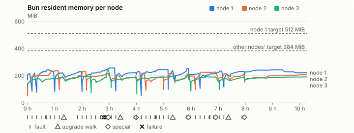
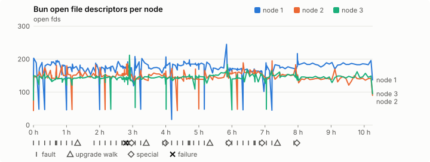
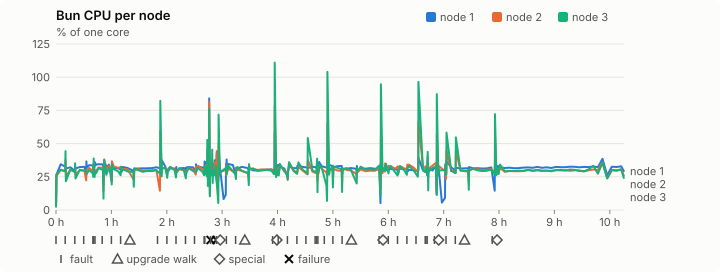
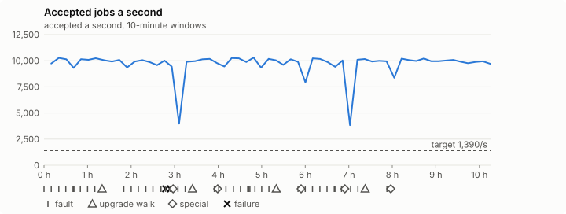

# Sustained soak (V02): FAIL

21 November 2026. final tier, full schedule, 10 h 15 min of soak on a three-node quickstart cluster.

**Final tier: not clean. The V02 gate does not pass.** A product fix means a fresh fast-tier run, then a fresh final-tier run. It is incomplete too: missing from the execution inventory: fault:chaos-pause, fault:chaos-drop.

## Candidate and host

| | |
|---|---|
| Staged base URL | <https://github.com/reliaburger/reliaburger/releases/download/nightly-v0.3.1-44873141955-1> |
| `candidate.json` SHA-256 | `58d812b96598861fd04972622a66f57fe8b77046a6e52bed3a756f099079b59a` |
| Running versions | v0.3.1 x3 |
| Soak build | `bun-v0.3.1-soak.1`, SHA-256 `ed248cb00ca0b5a18a9d55854587c75313e1706a671de83e0c095071994223cc` |
| Walks roll back to | 0.3.1 |
| Host | macOS 27.2, Apple M5 Max, 128 GiB |
| Lima | limactl version 2.2.1 |
| Guest | Ubuntu 26.04.1 LTS, kernel 7.0.0-34-generic |
| RELIABURGER_HOME | `/tmp/rbq.BiB8p8` |
| Evidence | `/Users/miko/github/rb-wt/gate-031/qual/ev-jobs-final` |

## Configuration deviations

- Ubuntu's apt-daily and apt-daily-upgrade timers stopped and disabled in each guest, so unattended upgrades can't restart Bun during the soak (#1417)
- node.toml `[testing] allowed_operations` adds `provision_isolated_workloads` (quickstart allows only inject_workload_faults and alter_node_state), so the catalogue pulse can lease test namespaces
- node.toml `[logs]`/`[metrics]` export to file:///var/lib/reliaburger/soak-export every 60 s with max_storage_mb = 8 (the harness deletes a metrics export 30 minutes after its source has gone), `[storage.snapshots]` every 900 s (compressed: 120 s), retain 4, uploaded to the same directory
- node.toml `[ingress] tls_cert/tls_key` point at an operator pair from a soak CA, 45-minute leaves rotated by the harness
- Bun runs with auto/mixed; host jobs opt in to a single pinned BusyBox copy under /var/lib/reliaburger/soak-jobs, mount_isolation=false. The independent verifier listens on each private VM address, TCP 8189, with a separate run token
- node.toml `[node.labels] soak-volume` = "writer" on node 2 and "redis" on node 3, to pin the volume apps
- node.toml `[upgrades] external_signing_key` = a throwaway operator key the harness made for this run (`ed25519:l2OeDJAAbGu3kHUhZe3btgV8U18MzJwhPrMvdVXkNlU=`); the soak build's `.sig` gets that key's external signature beside the release one (D2)
- node.toml `[security] leaf_lifetime_override_secs = 3600` (D1)
- apt-daily, apt-daily-upgrade and unattended-upgrades verified inactive on every node before the baseline, after waiting 0 s for any upgrade in progress (snapshots/upgrades-verified-N.txt)

## Timeline

- Started 2026-11-21 10:12:03 UTC, finished 2026-11-21 20:27:26 UTC
- Cycles completed: 8
- Fault and node choices: 35, from seed 1501068889 (`--seed 1501068889` repeats them)
- Teardown: `relish local destroy --yes` and `relish uninstall --yes` succeeded

## Faults and slots

| Class | Runs | Settled/ok | Failed | Skipped | Settle (median / max) |
|---|---|---|---|---|---|
| fault:bun-kill-follower | 8 | 8 | 0 | 0 | 40 s / 59 s |
| fault:bun-kill-leader | 8 | 8 | 0 | 0 | 45 s / 65 s |
| fault:chaos-cpu | 1 | 2 | 0 | 0 | 24 s / 24 s |
| fault:chaos-delay | 2 | 4 | 0 | 0 | 23 s / 23 s |
| fault:chaos-dns | 1 | 2 | 0 | 0 | 25 s / 25 s |
| fault:chaos-drop | 1 | 1 | 1 | 0 | 308 s / 308 s |
| fault:chaos-kill | 2 | 4 | 0 | 0 | 44 s / 44 s |
| fault:chaos-memory | 1 | 2 | 0 | 0 | 24 s / 24 s |
| fault:chaos-partition | 2 | 4 | 0 | 0 | 23 s / 23 s |
| fault:chaos-pause | 1 | 1 | 1 | 0 | 307 s / 307 s |
| fault:chaos-scenario | 1 | 2 | 0 | 0 | 44 s / 44 s |
| fault:deploy-kill | 4 | 4 | 0 | 0 | 42 s / 52 s |
| fault:node-delay | 3 | 3 | 0 | 0 | 41 s / 54 s |
| fault:node-disk-full | 3 | 3 | 0 | 0 | 25 s / 25 s |
| fault:node-slow-fsync | 2 | 2 | 0 | 0 | 23 s / 23 s |
| fault:power-off | 4 | 4 | 0 | 0 | 45 s / 60 s |
| pulse | 8 | 8 | 0 | 0 | n/a |
| pulse:settle | 0 | 8 | 0 | 0 | 24 s / 25 s |
| special:all-off | 1 | 1 | 0 | 0 | 54 s / 54 s |
| special:graceful-stop | 2 | 2 | 0 | 0 | 55 s / 55 s |
| special:quorum-back | 2 | 2 | 0 | 0 | n/a |
| special:quorum-loss | 2 | 2 | 0 | 0 | 70 s / 70 s |
| storage:offline-export | 1 | 1 | 0 | 0 | n/a |
| storage:registry-push | 8 | 0 | 0 | 0 | n/a |
| tls:invalid-expired | 15 | 15 | 0 | 0 | n/a |
| tls:invalid-torn | 13 | 13 | 0 | 0 | n/a |
| tls:reload | 117 | 117 | 0 | 0 | n/a |
| upgrade:rollback | 4 | 4 | 0 | 0 | n/a |
| upgrade:settle | 0 | 4 | 0 | 0 | 79 s / 82 s |
| upgrade:upgrade | 4 | 4 | 0 | 0 | n/a |

## Execution inventory (gated)

What the run completed, from its events and kept bytes, against what its schedule owes. A fault counts once it was injected and the cluster settled after it.

| Item | Required | Completed | Verdict |
|---|---|---|---|
| candidate.json bytes match the qualified digest | 1 | 1 | ok |
| app workloads settled at the baseline | 1 | 1 | ok |
| upgrade walk (to the soak build and back) | 4 | 4 | ok |
| fault:bun-kill-follower | 1 | 8 | ok |
| fault:bun-kill-leader | 1 | 8 | ok |
| fault:deploy-kill | 1 | 4 | ok |
| fault:power-off | 1 | 4 | ok |
| fault:chaos-kill | 1 | 2 | ok |
| fault:chaos-delay | 1 | 2 | ok |
| fault:chaos-partition | 1 | 2 | ok |
| fault:chaos-scenario | 1 | 1 | ok |
| fault:chaos-pause | 1 | 0 | MISSING |
| fault:chaos-drop | 1 | 0 | MISSING |
| fault:chaos-dns | 1 | 1 | ok |
| fault:chaos-cpu | 1 | 1 | ok |
| fault:chaos-memory | 1 | 1 | ok |
| fault:node-delay | 1 | 3 | ok |
| fault:node-disk-full | 1 | 3 | ok |
| fault:node-slow-fsync | 1 | 2 | ok |
| special:graceful-stop | 2 | 2 | ok |
| special:quorum-loss | 2 | 2 | ok |
| special:all-off | 1 | 1 | ok |
| catalogue pulse | 8 | 8 | ok |
| offline export | 1 | 1 | ok |
| quiet tail with no faults, walks or specials | 1 | 1 | ok |
| job campaign drained in its final two minutes | 1 | 1 | ok |

## Observed fault effects

What each injected fault was seen to do, read back from the node.

| Fault | Target | Observed |
|---|---|---|
| effect:bun-kill-follower | rb-a3663afd0f0e-2 | MainPID 3515 -> 6440 |
| effect:bun-kill-leader | rb-a3663afd0f0e-1 | MainPID 9985 -> 2159653 |
| effect:deploy-kill | rb-a3663afd0f0e-1 | MainPID 2159653 -> 314116 |
| effect:power-off | rb-a3663afd0f0e-3 | Lima status Stopped |
| effect:node-delay | rb-a3663afd0f0e-1 | netem 8001: root refcnt 2 limit 1000 delay 200ms  50ms seed 15951309937309904570  |
| effect:bun-kill-follower | rb-a3663afd0f0e-1 | MainPID 314116 -> 883290 |
| effect:bun-kill-leader | rb-a3663afd0f0e-2 | MainPID 6440 -> 4106000 |
| effect:node-disk-full | rb-a3663afd0f0e-2 | available 67002368 bytes  |
| effect:bun-kill-follower | rb-a3663afd0f0e-1 | MainPID 883290 -> 1825420 |
| effect:bun-kill-leader | rb-a3663afd0f0e-2 | MainPID 2362229 -> 679416 |
| effect:deploy-kill | rb-a3663afd0f0e-3 | MainPID 1036 -> 677246 |
| effect:power-off | rb-a3663afd0f0e-3 | Lima status Stopped |
| effect:node-slow-fsync | rb-a3663afd0f0e-3 | IOWriteBandwidthMax=/dev/vda 1000000 IOWriteIOPSMax=/dev/vda 20  |
| effect:bun-kill-follower | rb-a3663afd0f0e-3 | MainPID 1042 -> 159392 |
| effect:bun-kill-leader | rb-a3663afd0f0e-1 | MainPID 1825420 -> 370867 |
| effect:node-delay | rb-a3663afd0f0e-2 | netem 8001: root refcnt 2 limit 1000 delay 200ms  50ms seed 1170345332684647246  |
| effect:bun-kill-follower | rb-a3663afd0f0e-3 | MainPID 1035 -> 251852 |
| effect:bun-kill-leader | rb-a3663afd0f0e-1 | MainPID 1050 -> 2588438 |
| effect:deploy-kill | rb-a3663afd0f0e-2 | MainPID 1046 -> 910720 |
| effect:power-off | rb-a3663afd0f0e-2 | Lima status Stopped |
| effect:node-disk-full | rb-a3663afd0f0e-3 | available 67100672 bytes  |
| effect:bun-kill-follower | rb-a3663afd0f0e-2 | MainPID 1042 -> 2591253 |
| effect:bun-kill-leader | rb-a3663afd0f0e-1 | MainPID 2588438 -> 3801582 |
| effect:node-slow-fsync | rb-a3663afd0f0e-1 | IOWriteBandwidthMax=/dev/vda 1000000 IOWriteIOPSMax=/dev/vda 20  |
| effect:bun-kill-follower | rb-a3663afd0f0e-3 | MainPID 1033 -> 1019736 |
| effect:bun-kill-leader | rb-a3663afd0f0e-2 | MainPID 1044 -> 3302490 |
| effect:deploy-kill | rb-a3663afd0f0e-1 | MainPID 1043 -> 1547773 |
| effect:power-off | rb-a3663afd0f0e-1 | Lima status Stopped |
| effect:node-delay | rb-a3663afd0f0e-3 | netem 8001: root refcnt 2 limit 1000 delay 200ms  50ms seed 17627416688937120794  |
| effect:bun-kill-follower | rb-a3663afd0f0e-3 | MainPID 1049 -> 292139 |
| effect:bun-kill-leader | rb-a3663afd0f0e-1 | MainPID 1039 -> 3868478 |
| effect:node-disk-full | rb-a3663afd0f0e-1 | available 67031040 bytes  |

## Renewals and rotations

| Measure | Observed | Required | Verdict |
|---|---|---|---|
| workload identity rotations (soak-identity, per node) | 24 | ≥ 19 | PASS |
| node leaf renewals (per node) | 22 | ≥ 19 | PASS |
| operator ingress reloads (all nodes) | 117 | ≥ 40 | PASS |
| mixed job campaign and positive drain | 0 missing/failing checks | 0 | PASS |

## Latency SLOs

What a user should feel on a quiet three-node cluster (#1400). Every sample is taken outside fault windows and through a host forward that works; each p99 is the upper bound of its histogram bucket.

| SLO | p99 | Threshold | Samples | Mode | Verdict |
|---|---|---|---|---|---|
| API read p99 | 200 ms | ≤ 3,000 ms | 5,778 | gated | PASS |
| API write p99 | 1,000 ms | ≤ 3,000 ms | 20 | gated | PASS |
| App start p99 | 15,000 ms | ≤ 30,000 ms | 60 | gated | PASS |
| Rolling update p99 | 50,000 ms | ≤ 100,000 ms | 20 | gated | PASS |
| Job task start p99 | 64 ms | ≤ 256 ms | 235,992,626 | gated | PASS |

- API read p99: `GET /v1/status?cluster=true` and `GET /v1/cluster/nodes` on every node, at every light check
- API write p99: `relish apply` of the soak workloads, from the call to the commit
- App start p99: each node's deploy of a new `soak-slo` instance, from its start until the instance passes its health check
- Rolling update p99: from `relish apply` returning to every node's `soak-slo` running the new spec
- Job task start p99: a job task's start lag on a pooled executor, from the job campaign's buckets, in runs no fault window overlapped

## Jobs

| Runtime | Accepted successes | Retries | Last accepted progress |
|---|---|---|---|
| runc | 66234 | 1 | 1795292827 |
| shared-runc | 46206292 | 1 | 1795292827 |
| process | 311437530 | 1 | 1795292823 |

The bounded campaign shares the app soak's fault schedule. These counts are reliability evidence, not a saturation rate or a 100-million-per-day qualification.

- Independent verifier execution attempts: 24
- Explicit test-operator acknowledgements for known replay-safe fenced fixtures: 187

- rb-a3663afd0f0e-1: latest complete job storage (KiB) {'instances': 2360, 'job-state': 8, 'task-arrays': 16744}; free 4273956 KiB; live/peak owners 0/28; peak storage {'instances': 22004, 'job-state': 8, 'task-arrays': 46544}
- rb-a3663afd0f0e-2: latest complete job storage (KiB) {'instances': 892, 'job-state': 8, 'task-arrays': 17392}; free 5330060 KiB; live/peak owners 0/29; peak storage {'instances': 22256, 'job-state': 8, 'task-arrays': 46964}
- rb-a3663afd0f0e-3: latest complete job storage (KiB) {'instances': 1484, 'job-state': 8, 'task-arrays': 17784}; free 5392652 KiB; live/peak owners 0/29; peak storage {'instances': 22352, 'job-state': 8, 'task-arrays': 49876}

Instance storage limit: 64 MiB per node (data/instances, allocated, outside fault windows; #1418).

Complete disk inventories are recorded. Global retention bounds and the 12-hour job qualification remain #668; this gate cannot certify an unimplemented retention policy.

## Job qualification (D18-C)

Load: target; 3 nodes; accepted 9,691.2/s against a 1390.0/s target: PASS.

The September plan set its targets for one 1M-task batch on a quiet cluster. A soak runs for hours with restarts, upgrades and apps, so its storage, Bun memory and Raft targets are restated (maintainer decision, 15 October 2026, [#668](https://github.com/reliaburger/reliaburger/issues/668)). Bun's steady state is the median RSS of each process once it has been seen for 10 minutes; the gated memory checks are unchanged (`leak-rss`, and Mayo's 70% `memory_high` alert through `wtf`).

| Measure (recorded, not gated) | Observed | Target |
|---|---|---|
| Wall time of a 1,048,576-task array (median / max of 64) | 117 s / 806 s | ≤ 600 s |
| p99 start lag, pooled executors | 64 ms (bucket upper bound) | < 1,000 ms |
| Raft entries per second, all cluster writes | 4.94 | recorded only; the batch target counts only task-array writes |
| Raft state of one run, largest seen | 10,001 B | ≤ 256 KiB per 1M tasks |
| Bun steady-state RSS per process, worst node against its target | rb-a3663afd0f0e-2: 224.75 MiB steady, 236.77 MiB peak | ≤ 384 MiB (≤ 512 MiB on node 1, which serves the API) |
| Bun CPU, busiest node | 0.31 cores | ≤ 1 core (leader batch control) |
| Executor helper CPU, busiest node | 0.04 cores | ≤ 0.5 core |
| Node task-array storage per 1M accepted tasks (peaks summed) | 0.39 MiB | ≤ 64 MiB, deleted after retirement |
| Retained log volume, all nodes | 22.38 MB | ≤ 50 MB |

- Bun RSS on rb-a3663afd0f0e-1 (serves the API, target ≤ 512 MiB): pid 9985: 215.13 MiB peak (seen for under 10 minutes); pid 2159653: 219.17 MiB peak (seen for under 10 minutes); pid 314116: 232.52 MiB steady, 244.57 MiB peak; pid 883290: 218.79 MiB steady, 219.60 MiB peak; pid 883290: 222.56 MiB steady, 230.62 MiB peak; pid 1825420: 235.00 MiB steady, 257.50 MiB peak; pid 370867: 215.36 MiB peak (seen for under 10 minutes); pid 370867: 220.74 MiB steady, 222.54 MiB peak; pid 1050: 229.07 MiB peak (seen for under 10 minutes); pid 2588438: 239.77 MiB steady, 245.14 MiB peak; pid 3801582: 237.30 MiB peak (seen for under 10 minutes); pid 3801582: 252.62 MiB steady, 253.31 MiB peak; pid 1043: 211.11 MiB steady, 215.83 MiB peak; pid 1547773: 204.45 MiB peak (seen for under 10 minutes); pid 1039: 220.87 MiB steady, 233.55 MiB peak; pid 3868478: 212.62 MiB peak (seen for under 10 minutes); pid 3868478: 230.68 MiB steady, 231.07 MiB peak; pid 1046: 237.46 MiB steady, 242.82 MiB peak
- Bun RSS on rb-a3663afd0f0e-2 (node, target ≤ 384 MiB): pid 3515: 134.21 MiB peak (seen for under 10 minutes); pid 6440: 202.53 MiB steady, 236.77 MiB peak; pid 4106000: 190.41 MiB peak (seen for under 10 minutes); pid 2362229: 200.36 MiB steady, 230.29 MiB peak; pid 679416: 204.62 MiB steady, 214.78 MiB peak; pid 1036: 197.57 MiB steady, 197.73 MiB peak; pid 1036: 188.04 MiB steady, 197.12 MiB peak; pid 1046: 211.71 MiB steady, 211.84 MiB peak; pid 910720: 170.41 MiB peak (seen for under 10 minutes); pid 1042: 190.00 MiB steady, 190.25 MiB peak; pid 2591253: 214.97 MiB steady, 214.98 MiB peak; pid 2591253: 204.93 MiB steady, 210.30 MiB peak; pid 1044: 196.44 MiB steady, 196.91 MiB peak; pid 3302490: 224.75 MiB steady, 226.48 MiB peak; pid 1040: 214.47 MiB steady, 215.10 MiB peak; pid 1040: 206.34 MiB steady, 212.66 MiB peak; pid 1041: 198.38 MiB steady, 209.06 MiB peak
- Bun RSS on rb-a3663afd0f0e-3 (node, target ≤ 384 MiB): pid 3322: 172.40 MiB steady, 176.53 MiB peak; pid 1036: 179.42 MiB steady, 191.17 MiB peak; pid 1036: 191.98 MiB steady, 197.75 MiB peak; pid 677246: 171.69 MiB peak (seen for under 10 minutes); pid 1035: 185.23 MiB steady, 250.67 MiB peak; pid 1042: 163.43 MiB peak (seen for under 10 minutes); pid 159392: 168.32 MiB steady, 174.34 MiB peak; pid 159392: 188.09 MiB steady, 188.27 MiB peak; pid 1035: 175.36 MiB peak (seen for under 10 minutes); pid 251852: 188.56 MiB steady, 196.15 MiB peak; pid 1036: 193.65 MiB steady, 203.70 MiB peak; pid 1033: 180.91 MiB peak (seen for under 10 minutes); pid 1019736: 189.55 MiB steady, 194.73 MiB peak; pid 1049: 165.55 MiB peak (seen for under 10 minutes); pid 292139: 176.54 MiB steady, 176.67 MiB peak; pid 292139: 186.43 MiB steady, 190.44 MiB peak; pid 1030: 185.63 MiB steady, 190.22 MiB peak

- runc retry causes: exit_code 1, launch 0, signal 0, timeout 0, unknown 0, unrecorded 0
- shared-runc retry causes: exit_code 1, launch 0, signal 0, timeout 0, unknown 0, unrecorded 0
- process retry causes: exit_code 1, launch 0, signal 0, timeout 0, unknown 0, unrecorded 0
- Audited executions: 24; operator replay decisions: 187
- Chunks checked for exactly-once completion: 3136, 9 of them re-granted (#1415)
- Job controller API fallbacks: rb-a3663afd0f0e-1 missed 583, rb-a3663afd0f0e-2 missed 9; rb-a3663afd0f0e-2 answered 574, rb-a3663afd0f0e-3 answered 9 (requests a node didn't answer, and the node that took them instead)

## Data

- Volume writer: highest ACK 189672 in the log view; the writer file checks (writer-lost, writer-regression) decide data loss, and `*-log-order` failures are about the order the log view returned lines in
- Redis counter: highest INCR 29372 in the log view
- Volume writer resumes: 7 starts, each checked against the highest ACK logged before it
- Redis client starts: 17, each checked against the highest INCR logged before it; counter regressions the client saw: 0
- Export rb-a3663afd0f0e-1: 207 source files, 609 at the destination
- Export rb-a3663afd0f0e-2: 481 source files, 770 at the destination
- Export rb-a3663afd0f0e-3: 314 source files, 366 at the destination
- Registry images pushed and re-verified: 9
- Agent-loop turns over the 1 s budget: rb-a3663afd0f0e-1 0, rb-a3663afd0f0e-2 0, rb-a3663afd0f0e-3 0
- Soak policies checked in force: 313 times, policy generation 78 at the last check
- Guest clock steps by Lima's guest agent: rb-a3663afd0f0e-1 5, rb-a3663afd0f0e-2 6, rb-a3663afd0f0e-3 6
- Checks evaluated: 1252 (heavy 125, light 939, settle 188)
- Last observed progress: redis-counter 29372, writer-ack 189672

## Council history (linearizability)

Every test-lease grant, renew, read and release the history client made, checked against a model of the council's leases. A write with no answer may or may not have happened; the check allows both.

- Operations checked: 202597 of 202597, in 2 namespaces; 4598 writes had no answer
- Verdict: linearizable

## Leak-checker exposure (gated)

How long each leak checker could judge each node's Bun. `leak-rss` arms at its warm sample: 60 minutes into one process in a final, and otherwise at the first heavy check where the log and metrics stores are each 90% full, between 60 minutes and 6 hours in (#1417). `leak-fd` arms after 50 minutes; a restart, kill or upgrade exec starts the warm-up again. A final needs each armed for 60 minutes on every node, with one unbroken window of 30 (#1062); its quiet tail gives them that.

| Node | Checker | Armed | Longest armed window | Evaluated samples | Processes armed | Verdict |
|---|---|---|---|---|---|---|
| rb-a3663afd0f0e-1 | leak-rss | 83 min | 73 min | 25 | 2 | ok |
| rb-a3663afd0f0e-1 | leak-fd | 109 min | 83 min | 47 | 3 | ok |
| rb-a3663afd0f0e-2 | leak-rss | 81 min | 73 min | 21 | 2 | ok |
| rb-a3663afd0f0e-2 | leak-fd | 100 min | 83 min | 31 | 2 | ok |
| rb-a3663afd0f0e-3 | leak-rss | 88 min | 73 min | 23 | 2 | ok |
| rb-a3663afd0f0e-3 | leak-fd | 113 min | 83 min | 41 | 4 | ok |

- rb-a3663afd0f0e-1: the last Bun process's `leak-rss` warm sample was 248,636 kB, 1:03 h:mm in.
- rb-a3663afd0f0e-2: the last Bun process's `leak-rss` warm sample was 203,072 kB, 1:03 h:mm in.
- rb-a3663afd0f0e-3: the last Bun process's `leak-rss` warm sample was 189,944 kB, 1:03 h:mm in.

## Resource trends

| Node | Measure | First | Last | Max |
|---|---|---|---|---|
| rb-a3663afd0f0e-1 | disk_kb data | 1382624 | 1398796 | 1588988 |
| rb-a3663afd0f0e-1 | disk_kb images | 346292 | 363148 | 482996 |
| rb-a3663afd0f0e-1 | disk_kb logs | 36 | 8632 | 9100 |
| rb-a3663afd0f0e-1 | disk_kb metrics | 100 | 8520 | 9248 |
| rb-a3663afd0f0e-1 | disk_kb soak-export | 4 | 45796 | 45796 |
| rb-a3663afd0f0e-1 | disk_kb volumes | 284 | 260 | 344 |
| rb-a3663afd0f0e-1 | fd | 116 | 137 | 245 |
| rb-a3663afd0f0e-1 | rss_anon_kb | 98436 | 171752 | 182140 |
| rb-a3663afd0f0e-1 | rss_file_kb | 75428 | 55412 | 85360 |
| rb-a3663afd0f0e-1 | rss_kb | 173864 | 227164 | 263684 |
| rb-a3663afd0f0e-2 | disk_kb data | 71780 | 98824 | 594208 |
| rb-a3663afd0f0e-2 | disk_kb images | 172188 | 358824 | 358824 |
| rb-a3663afd0f0e-2 | disk_kb logs | 24 | 9076 | 9452 |
| rb-a3663afd0f0e-2 | disk_kb metrics | 32 | 8600 | 9064 |
| rb-a3663afd0f0e-2 | disk_kb soak-export | 4 | 24204 | 25416 |
| rb-a3663afd0f0e-2 | disk_kb volumes | 16912 | 21284 | 21284 |
| rb-a3663afd0f0e-2 | fd | 73 | 90 | 195 |
| rb-a3663afd0f0e-2 | rss_anon_kb | 53964 | 133264 | 162080 |
| rb-a3663afd0f0e-2 | rss_file_kb | 73840 | 80816 | 84656 |
| rb-a3663afd0f0e-2 | rss_kb | 127804 | 214080 | 242456 |
| rb-a3663afd0f0e-3 | disk_kb data | 234528 | 450796 | 783428 |
| rb-a3663afd0f0e-3 | disk_kb images | 339124 | 350496 | 350496 |
| rb-a3663afd0f0e-3 | disk_kb logs | 24 | 3304 | 3304 |
| rb-a3663afd0f0e-3 | disk_kb metrics | 32 | 8632 | 8924 |
| rb-a3663afd0f0e-3 | disk_kb soak-export | 4 | 17880 | 17880 |
| rb-a3663afd0f0e-3 | disk_kb volumes | 16916 | 19180 | 19180 |
| rb-a3663afd0f0e-3 | fd | 77 | 95 | 212 |
| rb-a3663afd0f0e-3 | rss_anon_kb | 56920 | 117512 | 173504 |
| rb-a3663afd0f0e-3 | rss_file_kb | 73376 | 77272 | 83616 |
| rb-a3663afd0f0e-3 | rss_kb | 130296 | 194784 | 256688 |

## Bun memory by kind

From each node's `/proc/PID/smaps` at the settle and heavy checks (`memory.jsonl`, #1417). Sizes in MiB; arenas are glibc thread arenas, with the number of 64 MiB arena heaps in brackets. Time is h:mm since the node's first sample.

### rb-a3663afd0f0e-1

| Time | Pid | RSS | Heap | Arenas | Stacks | Other anonymous | File | Threads |
|---|---|---|---|---|---|---|---|---|
| 0:00 | 9985 | 169.8 | 41.9 | 0.0 (0) | 2.6 | 47.9 | 77.4 | 45 |
| 1:00 | 883290 | 83.3 | 11.4 | 0.0 (0) | 0.9 | 5.2 | 65.9 | 19 |
| 2:00 | 1825420 | 81.6 | 10.9 | 0.0 (0) | 0.6 | 3.0 | 67.1 | 11 |
| 3:02 | 1825420 | 257.0 | 90.9 | 0.0 (0) | 5.2 | 77.8 | 83.0 | 94 |
| 4:00 | 1050 | 208.9 | 70.9 | 0.0 (0) | 0.9 | 52.6 | 84.5 | 44 |
| 5:00 | 2588438 | 244.5 | 84.1 | 0.0 (0) | 4.6 | 77.2 | 78.7 | 86 |
| 6:00 | 1043 | 209.3 | 62.0 | 0.0 (0) | 3.7 | 57.4 | 86.2 | 71 |
| 7:02 | 1039 | 222.9 | 71.6 | 0.0 (0) | 4.1 | 63.3 | 83.9 | 69 |
| 8:01 | 1046 | 226.8 | 69.4 | 4.0 (1) | 0.7 | 66.6 | 86.1 | 55 |
| 9:02 | 1046 | 242.8 | 89.4 | 0.0 (0) | 4.0 | 69.0 | 80.4 | 71 |
| 10:02 | 1046 | 221.1 | 89.4 | 0.0 (0) | 4.6 | 69.0 | 58.1 | 85 |
| 10:15 | 1046 | 221.8 | 89.4 | 0.0 (0) | 4.7 | 70.0 | 57.9 | 85 |

- rb-a3663afd0f0e-1: **other anonymous** grew most after the first hour: +0.9 MiB over 1:13 h:mm (others, MiB: heap +0.0, arenas +0.0, stacks +0.6, file -22.5).
- rb-a3663afd0f0e-1: no 6-hour RSS slope: the last Bun process (pid 1046) ran for 2:16 h:mm.

### rb-a3663afd0f0e-2

| Time | Pid | RSS | Heap | Arenas | Stacks | Other anonymous | File | Threads |
|---|---|---|---|---|---|---|---|---|
| 0:00 | 3515 | 124.8 | 22.9 | 0.0 (0) | 1.0 | 25.1 | 75.9 | 30 |
| 1:00 | 6440 | 232.8 | 83.0 | 0.0 (0) | 1.3 | 66.2 | 82.2 | 74 |
| 2:00 | 2362229 | 210.2 | 61.9 | 0.0 (0) | 4.3 | 61.3 | 82.7 | 89 |
| 3:04 | 1036 | 169.2 | 43.3 | 0.0 (0) | 1.9 | 39.9 | 84.1 | 45 |
| 4:00 | 1046 | 153.7 | 40.3 | 0.0 (0) | 1.6 | 29.5 | 82.2 | 43 |
| 5:00 | 1042 | 190.2 | 50.4 | 0.0 (0) | 3.8 | 51.2 | 84.9 | 71 |
| 6:00 | 1044 | 196.8 | 50.5 | 0.0 (0) | 2.2 | 57.9 | 86.2 | 64 |
| 7:02 | 1040 | 165.6 | 50.8 | 0.0 (0) | 0.7 | 29.2 | 84.8 | 39 |
| 8:01 | 1041 | 172.2 | 51.4 | 0.0 (0) | 1.6 | 33.8 | 85.3 | 52 |
| 9:02 | 1041 | 198.3 | 63.4 | 0.0 (0) | 3.6 | 48.6 | 82.6 | 74 |
| 10:02 | 1041 | 208.6 | 67.4 | 0.0 (0) | 4.4 | 54.1 | 82.7 | 93 |
| 10:15 | 1041 | 209.1 | 67.4 | 0.0 (0) | 4.4 | 54.5 | 82.7 | 93 |

- rb-a3663afd0f0e-2: **other anonymous** grew most after the first hour: +5.9 MiB over 1:13 h:mm (others, MiB: heap +4.0, arenas +0.0, stacks +0.8, file +0.1).
- rb-a3663afd0f0e-2: no 6-hour RSS slope: the last Bun process (pid 1041) ran for 2:16 h:mm.

### rb-a3663afd0f0e-3

| Time | Pid | RSS | Heap | Arenas | Stacks | Other anonymous | File | Threads |
|---|---|---|---|---|---|---|---|---|
| 0:00 | 3322 | 127.2 | 32.4 | 0.0 (0) | 1.7 | 17.7 | 75.4 | 30 |
| 1:00 | 1036 | 179.4 | 51.9 | 0.0 (0) | 1.8 | 41.2 | 84.5 | 57 |
| 2:00 | 1036 | 191.9 | 56.6 | 0.0 (0) | 4.1 | 50.3 | 80.8 | 79 |
| 3:04 | 1042 | 155.3 | 51.4 | 0.0 (0) | 1.7 | 20.2 | 82.0 | 36 |
| 4:00 | 1035 | 158.6 | 33.4 | 0.0 (0) | 1.6 | 41.8 | 81.8 | 62 |
| 5:00 | 251852 | 187.9 | 25.3 | 0.0 (0) | 2.1 | 79.5 | 81.1 | 88 |
| 6:00 | 1019736 | 85.8 | 11.4 | 2.0 (1) | 0.5 | 0.3 | 71.6 | 13 |
| 7:02 | 1049 | 150.5 | 39.7 | 0.0 (0) | 1.0 | 27.5 | 82.4 | 33 |
| 8:01 | 1030 | 174.6 | 51.0 | 0.0 (0) | 0.9 | 37.3 | 85.4 | 54 |
| 9:02 | 1030 | 185.5 | 59.0 | 0.0 (0) | 0.9 | 46.3 | 79.3 | 62 |
| 10:02 | 1030 | 189.7 | 59.0 | 0.0 (0) | 0.9 | 50.5 | 79.2 | 62 |
| 10:15 | 1030 | 190.2 | 59.0 | 0.0 (0) | 1.3 | 50.7 | 79.2 | 75 |

- rb-a3663afd0f0e-3: **other anonymous** grew most after the first hour: +4.4 MiB over 1:13 h:mm (others, MiB: heap +0.0, arenas +0.0, stacks +0.4, file -0.1).
- rb-a3663afd0f0e-3: no 6-hour RSS slope: the last Bun process (pid 1030) ran for 2:16 h:mm.

### Log stores against RSS

Each node's `disk logs` and `disk metrics` and the Parquet files in its log store, from the same samples. RSS in MiB.

| Node | Time | RSS | Logs (KiB) | Log files | Metrics (KiB) |
|---|---|---|---|---|---|
| rb-a3663afd0f0e-1 | 0:00 | 169.8 | 36 | 3 | 100 |
| rb-a3663afd0f0e-1 | 1:00 | 83.3 | 4,560 | 65 | 5,896 |
| rb-a3663afd0f0e-1 | 2:00 | 81.6 | 8,676 | 122 | 8,564 |
| rb-a3663afd0f0e-1 | 3:02 | 257.0 | 8,564 | 119 | 8,464 |
| rb-a3663afd0f0e-1 | 4:00 | 208.9 | 8,388 | 117 | 8,428 |
| rb-a3663afd0f0e-1 | 5:00 | 244.5 | 8,736 | 123 | 8,740 |
| rb-a3663afd0f0e-1 | 6:00 | 209.3 | 8,452 | 126 | 8,916 |
| rb-a3663afd0f0e-1 | 7:02 | 222.9 | 8,472 | 130 | 8,660 |
| rb-a3663afd0f0e-1 | 8:01 | 226.8 | 8,632 | 137 | 8,872 |
| rb-a3663afd0f0e-1 | 9:02 | 242.8 | 8,748 | 133 | 8,768 |
| rb-a3663afd0f0e-1 | 10:02 | 221.1 | 8,760 | 120 | 8,724 |
| rb-a3663afd0f0e-1 | 10:15 | 221.8 | 8,632 | 118 | 8,520 |
| rb-a3663afd0f0e-2 | 0:00 | 124.8 | 24 | 3 | 32 |
| rb-a3663afd0f0e-2 | 1:00 | 232.8 | 520 | 64 | 5,444 |
| rb-a3663afd0f0e-2 | 2:00 | 210.2 | 1,088 | 126 | 8,584 |
| rb-a3663afd0f0e-2 | 3:04 | 169.2 | 1,572 | 186 | 8,672 |
| rb-a3663afd0f0e-2 | 4:00 | 153.7 | 4,232 | 243 | 8,720 |
| rb-a3663afd0f0e-2 | 5:00 | 190.2 | 4,720 | 302 | 8,564 |
| rb-a3663afd0f0e-2 | 6:00 | 196.8 | 5,500 | 362 | 8,996 |
| rb-a3663afd0f0e-2 | 7:02 | 165.6 | 9,444 | 376 | 8,844 |
| rb-a3663afd0f0e-2 | 8:01 | 172.2 | 9,028 | 248 | 8,980 |
| rb-a3663afd0f0e-2 | 9:02 | 198.3 | 8,904 | 300 | 8,588 |
| rb-a3663afd0f0e-2 | 10:02 | 208.6 | 9,072 | 339 | 8,648 |
| rb-a3663afd0f0e-2 | 10:15 | 209.1 | 9,076 | 339 | 8,600 |
| rb-a3663afd0f0e-3 | 0:00 | 127.2 | 24 | 3 | 32 |
| rb-a3663afd0f0e-3 | 1:00 | 179.4 | 92 | 17 | 3,552 |
| rb-a3663afd0f0e-3 | 2:00 | 191.9 | 208 | 34 | 7,492 |
| rb-a3663afd0f0e-3 | 3:04 | 155.3 | 276 | 49 | 8,560 |
| rb-a3663afd0f0e-3 | 4:00 | 158.6 | 412 | 66 | 8,584 |
| rb-a3663afd0f0e-3 | 5:00 | 187.9 | 496 | 80 | 8,848 |
| rb-a3663afd0f0e-3 | 6:00 | 85.8 | 2,820 | 122 | 8,564 |
| rb-a3663afd0f0e-3 | 7:02 | 150.5 | 2,916 | 137 | 8,720 |
| rb-a3663afd0f0e-3 | 8:01 | 174.6 | 3,092 | 159 | 8,712 |
| rb-a3663afd0f0e-3 | 9:02 | 185.5 | 3,188 | 171 | 8,648 |
| rb-a3663afd0f0e-3 | 10:02 | 189.7 | 3,288 | 183 | 8,760 |
| rb-a3663afd0f0e-3 | 10:15 | 190.2 | 3,304 | 185 | 8,632 |

## Agent loop stalls

From the stall watchdog's journal blocks (`loop-stalls.jsonl`, #1707). Each snapshot lists every Bun thread; here are the stall line, threads in uninterruptible sleep and the thread that ran the loop.

- Stalls: rb-a3663afd0f0e-1 1

```
Nov 21 18:02:15 lima-rb-a3663afd0f0e-1 bun[3868478]: bun: agent loop stalled 768 ms in follow_up (consumer_sync/journal), 268 ms past its turn deadline; thread snapshot (pid 3868478, 79 threads):
Nov 21 18:02:15 lima-rb-a3663afd0f0e-1 bun[3868478]: bun:   tid 2806542 tokio-rt-worker S wchan=futex_do_wait syscall=futex(0xe6e2b5ebf848, 0x80, 0x1) [ran the agent loop]
Nov 21 18:02:15 lima-rb-a3663afd0f0e-1 bun[3868478]: bun:   tid 2806543 tokio-rt-worker D wchan=__lock_buffer syscall=close(0x5d, 0x0, 0x0)
Nov 21 18:02:15 lima-rb-a3663afd0f0e-1 bun[3868478]: bun:   tid 2806984 tokio-rt-worker D wchan=folio_wait_bit_common syscall=fdatasync(0x5b, 0x0, 0x0)
Nov 21 18:02:15 lima-rb-a3663afd0f0e-1 bun[3868478]: bun:   tid 3190772 tokio-rt-worker D wchan=folio_wait_bit_common syscall=fsync(0x5e, 0x0, 0x0)
```

## Charts

Time runs from the start of the soak. The marks under each chart are its faults, upgrade walks, specials and recorded failures; the dashed lines are targets.









## Failures

| # | First seen | Check | Symptom | Class | Cause | Action |
|---|---|---|---|---|---|---|
| 1 | 12:59:26 | settle | fault:chaos-pause did not settle within 300 s | unclassified | open | open |
| 2 | 13:05:49 | settle | fault:chaos-drop did not settle within 300 s | unclassified | open | open |

## Notes

- Unattended upgrades were off on every guest 0 s after they were asked to stop (snapshots/upgrades-stopped-N.txt)

Evidence: `/Users/miko/github/rb-wt/gate-031/qual/ev-jobs-final` (events.jsonl, snapshots/, failures/<n>/).
