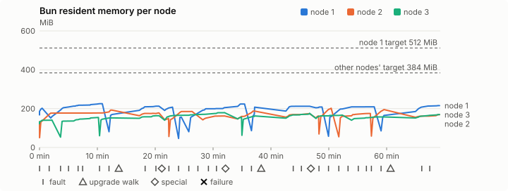
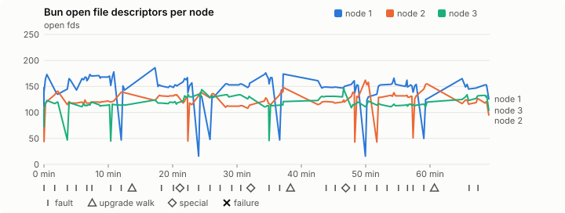
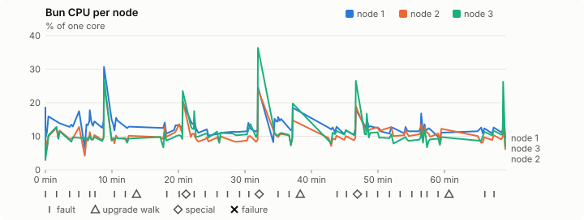
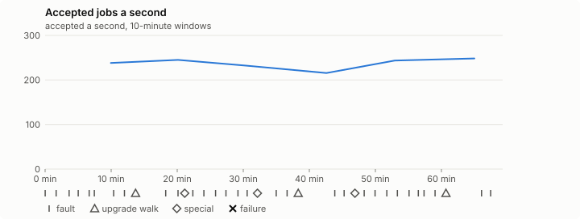

# Sustained soak (V02): PASS

21 November 2026. fast tier, compressed schedule, 1 h 09 min of soak on a three-node quickstart cluster.

**Fast tier: clean.** The iteration loop only, not acceptance: the V02 gate needs a clean final-tier run (8 h, full schedule) on the final candidate.

## Candidate and host

| | |
|---|---|
| Staged base URL | <https://github.com/reliaburger/reliaburger/releases/download/nightly-v0.3.1-44873141955-1> |
| `candidate.json` SHA-256 | `58d812b96598861fd04972622a66f57fe8b77046a6e52bed3a756f099079b59a` |
| Running versions | v0.3.1 x3 |
| Soak build | `bun-v0.3.1-soak.1`, SHA-256 `ed248cb00ca0b5a18a9d55854587c75313e1706a671de83e0c095071994223cc` |
| Walks roll back to | 0.3.1 |
| Host | macOS 27.2, Apple M5 Max, 128 GiB |
| Lima | limactl version 2.2.1 |
| Guest | Ubuntu 26.04.1 LTS, kernel 7.0.0-34-generic |
| RELIABURGER_HOME | `/tmp/rbq.UTwvsN` |
| Evidence | `/Users/miko/github/rb-wt/gate-031/qual/ev-v02-fast` |

## Configuration deviations

- Ubuntu's apt-daily and apt-daily-upgrade timers stopped and disabled in each guest, so unattended upgrades can't restart Bun during the soak (#1417)
- node.toml `[testing] allowed_operations` adds `provision_isolated_workloads` (quickstart allows only inject_workload_faults and alter_node_state), so the catalogue pulse can lease test namespaces
- node.toml `[logs]`/`[metrics]` export to file:///var/lib/reliaburger/soak-export every 60 s with max_storage_mb = 8 (the harness deletes a metrics export 30 minutes after its source has gone), `[storage.snapshots]` every 900 s (compressed: 120 s), retain 4, uploaded to the same directory
- node.toml `[ingress] tls_cert/tls_key` point at an operator pair from a soak CA, 45-minute leaves rotated by the harness
- Bun runs with auto/mixed; host jobs opt in to a single pinned BusyBox copy under /var/lib/reliaburger/soak-jobs, mount_isolation=false. The independent verifier listens on each private VM address, TCP 8189, with a separate run token
- node.toml `[node.labels] soak-volume` = "writer" on node 2 and "redis" on node 3, to pin the volume apps
- node.toml `[upgrades] external_signing_key` = a throwaway operator key the harness made for this run (`ed25519:Z2fSp2ZWQdaG8hPaiQ8IqbqwQgcotiHxHu4BIw0TNR8=`); the soak build's `.sig` gets that key's external signature beside the release one (D2)
- node.toml `[security] leaf_lifetime_override_secs = 3600` (D1)
- apt-daily, apt-daily-upgrade and unattended-upgrades verified inactive on every node before the baseline, after waiting 0 s for any upgrade in progress (snapshots/upgrades-verified-N.txt)

## Timeline

- Started 2026-11-21 07:48:34 UTC, finished 2026-11-21 08:57:50 UTC
- Cycles completed: 6
- Fault and node choices: 26, from seed 2330297381 (`--seed 2330297381` repeats them)
- Teardown: `relish local destroy --yes` and `relish uninstall --yes` succeeded

## Faults and slots

| Class | Runs | Settled/ok | Failed | Skipped | Settle (median / max) |
|---|---|---|---|---|---|
| fault:bun-kill-follower | 6 | 6 | 0 | 0 | 33 s / 41 s |
| fault:bun-kill-leader | 6 | 6 | 0 | 0 | 32 s / 35 s |
| fault:chaos-cpu | 1 | 2 | 0 | 0 | 16 s / 16 s |
| fault:chaos-delay | 2 | 4 | 0 | 0 | 17 s / 17 s |
| fault:chaos-dns | 1 | 2 | 0 | 0 | 19 s / 19 s |
| fault:chaos-drop | 1 | 2 | 0 | 0 | 17 s / 17 s |
| fault:chaos-kill | 2 | 4 | 0 | 0 | 46 s / 46 s |
| fault:chaos-memory | 1 | 2 | 0 | 0 | 19 s / 19 s |
| fault:chaos-partition | 2 | 4 | 0 | 0 | 17 s / 17 s |
| fault:chaos-pause | 1 | 2 | 0 | 0 | 16 s / 16 s |
| fault:chaos-scenario | 1 | 2 | 0 | 0 | 31 s / 31 s |
| fault:deploy-kill | 3 | 3 | 0 | 0 | 37 s / 41 s |
| fault:power-off | 3 | 3 | 0 | 0 | 44 s / 45 s |
| pulse | 1 | 1 | 0 | 0 | n/a |
| pulse:settle | 0 | 1 | 0 | 0 | 23 s / 23 s |
| special:all-off | 1 | 1 | 0 | 0 | 30 s / 30 s |
| special:graceful-stop | 1 | 1 | 0 | 0 | 43 s / 43 s |
| special:quorum-back | 1 | 1 | 0 | 0 | n/a |
| special:quorum-loss | 1 | 1 | 0 | 0 | 43 s / 43 s |
| storage:offline-export | 3 | 3 | 0 | 0 | n/a |
| storage:registry-push | 6 | 0 | 0 | 0 | n/a |
| tls:invalid-expired | 3 | 3 | 0 | 0 | n/a |
| tls:invalid-torn | 6 | 6 | 0 | 0 | n/a |
| tls:reload | 31 | 31 | 0 | 0 | n/a |
| upgrade:rollback | 3 | 3 | 0 | 0 | n/a |
| upgrade:settle | 0 | 3 | 0 | 0 | 64 s / 76 s |
| upgrade:upgrade | 3 | 3 | 0 | 0 | n/a |

## Execution inventory (recorded, not gated)

What the run completed, from its events and kept bytes, against what its schedule owes. A fault counts once it was injected and the cluster settled after it.

| Item | Required | Completed | Verdict |
|---|---|---|---|
| candidate.json bytes match the qualified digest | 1 | 1 | ok |
| app workloads settled at the baseline | 1 | 1 | ok |
| upgrade walk (to the soak build and back) | 2 | 3 | ok |
| fault:bun-kill-follower | 1 | 6 | ok |
| fault:bun-kill-leader | 1 | 6 | ok |
| fault:deploy-kill | 1 | 3 | ok |
| fault:power-off | 1 | 3 | ok |
| fault:chaos-kill | 1 | 2 | ok |
| fault:chaos-delay | 1 | 2 | ok |
| fault:chaos-partition | 1 | 2 | ok |
| fault:chaos-scenario | 1 | 1 | ok |
| fault:chaos-pause | 1 | 1 | ok |
| fault:chaos-drop | 1 | 1 | ok |
| fault:chaos-dns | 1 | 1 | ok |
| fault:chaos-cpu | 1 | 1 | ok |
| special:graceful-stop | 1 | 1 | ok |
| special:quorum-loss | 1 | 1 | ok |
| special:all-off | 1 | 1 | ok |
| catalogue pulse | 1 | 1 | ok |
| offline export | 2 | 3 | ok |
| job campaign drained in its final two minutes | 1 | 1 | ok |

## Observed fault effects

What each injected fault was seen to do, read back from the node.

| Fault | Target | Observed |
|---|---|---|
| effect:bun-kill-follower | rb-729addc2cb2d-2 | MainPID 3518 -> 6085 |
| effect:bun-kill-leader | rb-729addc2cb2d-1 | MainPID 9906 -> 42611 |
| effect:deploy-kill | rb-729addc2cb2d-3 | MainPID 3300 -> 62745 |
| effect:power-off | rb-729addc2cb2d-3 | Lima status Stopped |
| effect:bun-kill-follower | rb-729addc2cb2d-3 | MainPID 1052 -> 73688 |
| effect:bun-kill-leader | rb-729addc2cb2d-1 | MainPID 42611 -> 214589 |
| effect:bun-kill-follower | rb-729addc2cb2d-2 | MainPID 1032 -> 21220 |
| effect:bun-kill-leader | rb-729addc2cb2d-1 | MainPID 1027 -> 46512 |
| effect:deploy-kill | rb-729addc2cb2d-1 | MainPID 46512 -> 73199 |
| effect:power-off | rb-729addc2cb2d-2 | Lima status Stopped |
| effect:bun-kill-follower | rb-729addc2cb2d-3 | MainPID 1031 -> 19809 |
| effect:bun-kill-leader | rb-729addc2cb2d-1 | MainPID 73199 -> 240230 |
| effect:bun-kill-follower | rb-729addc2cb2d-2 | MainPID 1040 -> 19617 |
| effect:bun-kill-leader | rb-729addc2cb2d-1 | MainPID 1036 -> 50278 |
| effect:deploy-kill | rb-729addc2cb2d-2 | MainPID 19617 -> 87586 |
| effect:power-off | rb-729addc2cb2d-3 | Lima status Stopped |
| effect:bun-kill-follower | rb-729addc2cb2d-2 | MainPID 87586 -> 186240 |
| effect:bun-kill-leader | rb-729addc2cb2d-1 | MainPID 50278 -> 193771 |

## Renewals and rotations

| Measure | Observed | Required | Verdict |
|---|---|---|---|
| workload identity rotations (soak-identity, per node) | 9 | ≥ 1 | PASS |
| node leaf renewals (per node) | 2 | ≥ 1 | PASS |
| operator ingress reloads (all nodes) | 31 | ≥ 12 | PASS |
| mixed job campaign and positive drain | 0 missing/failing checks | 0 | PASS |

## Latency SLOs

What a user should feel on a quiet three-node cluster (#1400). Every sample is taken outside fault windows and through a host forward that works; each p99 is the upper bound of its histogram bucket.

| SLO | p99 | Threshold | Samples | Mode | Verdict |
|---|---|---|---|---|---|
| API read p99 | 300 ms | ≤ 3,000 ms | 264 | gated | PASS |
| API write p99 | 1,000 ms | ≤ 3,000 ms | 8 | gated | PASS |
| App start p99 | 7,000 ms | ≤ 30,000 ms | 24 | gated | PASS |
| Rolling update p99 | 30,000 ms | ≤ 100,000 ms | 8 | gated | PASS |
| Job task start p99 | 2,048 ms | ≤ 256 ms | 20 | record only | too few samples |

- API read p99: `GET /v1/status?cluster=true` and `GET /v1/cluster/nodes` on every node, at every light check
- API write p99: `relish apply` of the soak workloads, from the call to the commit
- App start p99: each node's deploy of a new `soak-slo` instance, from its start until the instance passes its health check
- Rolling update p99: from `relish apply` returning to every node's `soak-slo` running the new spec
- Job task start p99: a job task's start lag on a pooled executor, from the job campaign's buckets, in runs no fault window overlapped
- Job task start p99 not judged: only 20 job task start samples, fewer than the 1,000 a p99 needs

## Jobs

| Runtime | Accepted successes | Retries | Last accepted progress |
|---|---|---|---|
| runc | 12507 | 1 | 1795251459 |
| shared-runc | 484887 | 1 | 1795251459 |
| process | 491412 | 1 | 1795251459 |

The bounded campaign shares the app soak's fault schedule. These counts are reliability evidence, not a saturation rate or a 100-million-per-day qualification.

- Independent verifier execution attempts: 24
- Explicit test-operator acknowledgements for known replay-safe fenced fixtures: 140

- rb-729addc2cb2d-1: latest complete job storage (KiB) {'instances': 292, 'job-state': 8, 'task-arrays': 6604}; free 4488968 KiB; live/peak owners 0/11; peak storage {'instances': 8148, 'job-state': 8, 'task-arrays': 16288}
- rb-729addc2cb2d-2: latest complete job storage (KiB) {'instances': 656, 'job-state': 8, 'task-arrays': 6724}; free 5614200 KiB; live/peak owners 0/8; peak storage {'instances': 8480, 'job-state': 8, 'task-arrays': 16044}
- rb-729addc2cb2d-3: latest complete job storage (KiB) {'instances': 2860, 'job-state': 8, 'task-arrays': 6312}; free 5619552 KiB; live/peak owners 0/8; peak storage {'instances': 7752, 'job-state': 8, 'task-arrays': 15848}

Instance storage limit: 64 MiB per node (data/instances, allocated, outside fault windows; #1418).

Complete disk inventories are recorded. Global retention bounds and the 12-hour job qualification remain #668; this gate cannot certify an unimplemented retention policy.

## Job qualification (D18-C)

Load: calibration; 3 nodes; accepted 238.1/s (calibration load: not gated).

The September plan set its targets for one 1M-task batch on a quiet cluster. A soak runs for hours with restarts, upgrades and apps, so its storage, Bun memory and Raft targets are restated (maintainer decision, 15 October 2026, [#668](https://github.com/reliaburger/reliaburger/issues/668)). Bun's steady state is the median RSS of each process once it has been seen for 10 minutes; the gated memory checks are unchanged (`leak-rss`, and Mayo's 70% `memory_high` alert through `wtf`).

| Measure (recorded, not gated) | Observed | Target |
|---|---|---|
| Wall time of a 1,048,576-task array (median / max of 0) | not measured / not measured | ≤ 600 s |
| p99 start lag, pooled executors | 2 ms (bucket upper bound) | < 1,000 ms |
| Raft entries per second, all cluster writes | 6.03 | recorded only; the batch target counts only task-array writes |
| Raft state of one run, largest seen | 42,725 B | ≤ 256 KiB per 1M tasks |
| Bun steady-state RSS per process, worst node against its target | rb-729addc2cb2d-3: 179.02 MiB steady, 179.49 MiB peak | ≤ 384 MiB (≤ 512 MiB on node 1, which serves the API) |
| Bun CPU, busiest node | 0.12 cores | ≤ 1 core (leader batch control) |
| Executor helper CPU, busiest node | 0.00 cores | ≤ 0.5 core |
| Node task-array storage per 1M accepted tasks (peaks summed) | 47.58 MiB | ≤ 64 MiB, deleted after retirement |
| Retained log volume, all nodes | 6.80 MB | ≤ 50 MB |

- Bun RSS on rb-729addc2cb2d-1 (serves the API, target ≤ 512 MiB): pid 9906: 202.03 MiB peak (seen for under 10 minutes); pid 42611: 225.18 MiB peak (seen for under 10 minutes); pid 214589: 169.80 MiB peak (seen for under 10 minutes); pid 256555: 212.50 MiB peak (seen for under 10 minutes); pid 1027: 207.43 MiB peak (seen for under 10 minutes); pid 46512: 156.18 MiB peak (seen for under 10 minutes); pid 73199: 223.65 MiB peak (seen for under 10 minutes); pid 240230: 207.62 MiB peak (seen for under 10 minutes); pid 240230: 212.15 MiB peak (seen for under 10 minutes); pid 1036: 208.03 MiB peak (seen for under 10 minutes); pid 50278: 209.37 MiB peak (seen for under 10 minutes); pid 193771: 164.95 MiB peak (seen for under 10 minutes); pid 193771: 215.43 MiB peak (seen for under 10 minutes)
- Bun RSS on rb-729addc2cb2d-2 (node, target ≤ 384 MiB): pid 3518: 132.37 MiB peak (seen for under 10 minutes); pid 6085: 177.52 MiB steady, 192.22 MiB peak; pid 6085: 177.97 MiB peak (seen for under 10 minutes); pid 1032: 149.43 MiB peak (seen for under 10 minutes); pid 21220: 185.32 MiB peak (seen for under 10 minutes); pid 1056: 162.25 MiB peak (seen for under 10 minutes); pid 1052: 187.35 MiB peak (seen for under 10 minutes); pid 1052: 173.70 MiB peak (seen for under 10 minutes); pid 1040: 162.29 MiB peak (seen for under 10 minutes); pid 19617: 202.18 MiB peak (seen for under 10 minutes); pid 87586: 174.99 MiB peak (seen for under 10 minutes); pid 186240: 195.26 MiB peak (seen for under 10 minutes); pid 186240: 168.88 MiB peak (seen for under 10 minutes)
- Bun RSS on rb-729addc2cb2d-3 (node, target ≤ 384 MiB): pid 3300: 141.30 MiB peak (seen for under 10 minutes); pid 62745: 135.63 MiB peak (seen for under 10 minutes); pid 1052: 154.48 MiB peak (seen for under 10 minutes); pid 73688: 152.28 MiB peak (seen for under 10 minutes); pid 73688: 163.86 MiB peak (seen for under 10 minutes); pid 1037: 179.02 MiB steady, 179.49 MiB peak; pid 1031: 155.80 MiB peak (seen for under 10 minutes); pid 19809: 162.35 MiB peak (seen for under 10 minutes); pid 1036: 176.20 MiB peak (seen for under 10 minutes); pid 1041: 166.54 MiB peak (seen for under 10 minutes); pid 1036: 157.39 MiB peak (seen for under 10 minutes); pid 1039: 169.44 MiB peak (seen for under 10 minutes)

- runc retry causes: exit_code 1, launch 0, signal 0, timeout 0, unknown 0, unrecorded 0
- shared-runc retry causes: exit_code 1, launch 0, signal 0, timeout 0, unknown 0, unrecorded 0
- process retry causes: exit_code 1, launch 0, signal 0, timeout 0, unknown 0, unrecorded 0
- Audited executions: 24; operator replay decisions: 140
- Chunks checked for exactly-once completion: 72, 4 of them re-granted (#1415)
- Job controller API fallbacks: rb-729addc2cb2d-1 missed 19, rb-729addc2cb2d-2 missed 4; rb-729addc2cb2d-2 answered 15, rb-729addc2cb2d-3 answered 4 (requests a node didn't answer, and the node that took them instead)

## Data

- Volume writer: highest ACK 27188 in the log view; the writer file checks (writer-lost, writer-regression) decide data loss, and `*-log-order` failures are about the order the log view returned lines in
- Redis counter: highest INCR 3101 in the log view
- Volume writer resumes: 6 starts, each checked against the highest ACK logged before it
- Redis client starts: 17, each checked against the highest INCR logged before it; counter regressions the client saw: 0
- Export rb-729addc2cb2d-1: 115 source files, 102 at the destination
- Export rb-729addc2cb2d-2: 140 source files, 128 at the destination
- Export rb-729addc2cb2d-3: 116 source files, 115 at the destination
- Registry images pushed and re-verified: 7
- Agent-loop turns over the 1 s budget: rb-729addc2cb2d-1 0, rb-729addc2cb2d-2 0, rb-729addc2cb2d-3 0
- Soak policies checked in force: 123 times, policy generation 39 at the last check
- Guest clock steps by Lima's guest agent: rb-729addc2cb2d-1 3, rb-729addc2cb2d-2 3, rb-729addc2cb2d-3 7
- Checks evaluated: 189 (heavy 17, light 66, settle 106)
- Last observed progress: redis-counter 3101, writer-ack 27188

## Council history (linearizability)

Every test-lease grant, renew, read and release the history client made, checked against a model of the council's leases. A write with no answer may or may not have happened; the check allows both.

- Operations checked: 20937 of 20937, in 2 namespaces; 886 writes had no answer
- Verdict: linearizable

## Leak-checker exposure (recorded, not gated)

How long each leak checker could judge each node's Bun. `leak-rss` arms at its warm sample: 60 minutes into one process in a final, and otherwise at the first heavy check where the log and metrics stores are each 90% full, between 60 minutes and 6 hours in (#1417). `leak-fd` arms after 50 minutes; a restart, kill or upgrade exec starts the warm-up again. A final needs each armed for 60 minutes on every node, with one unbroken window of 30 (#1062); its quiet tail gives them that.

| Node | Checker | Armed | Longest armed window | Evaluated samples | Processes armed | Verdict |
|---|---|---|---|---|---|---|
| rb-729addc2cb2d-1 | leak-rss | 0 min | 0 min | 0 | 0 | short |
| rb-729addc2cb2d-1 | leak-fd | 0 min | 0 min | 0 | 0 | short |
| rb-729addc2cb2d-2 | leak-rss | 0 min | 0 min | 0 | 0 | short |
| rb-729addc2cb2d-2 | leak-fd | 0 min | 0 min | 0 | 0 | short |
| rb-729addc2cb2d-3 | leak-rss | 0 min | 0 min | 0 | 0 | short |
| rb-729addc2cb2d-3 | leak-fd | 0 min | 0 min | 0 | 0 | short |

## Resource trends

| Node | Measure | First | Last | Max |
|---|---|---|---|---|
| rb-729addc2cb2d-1 | disk_kb data | 1382572 | 945088 | 1535588 |
| rb-729addc2cb2d-1 | disk_kb images | 346292 | 470480 | 470480 |
| rb-729addc2cb2d-1 | disk_kb logs | 36 | 2452 | 2452 |
| rb-729addc2cb2d-1 | disk_kb metrics | 84 | 4192 | 4192 |
| rb-729addc2cb2d-1 | disk_kb soak-export | 4 | 5912 | 5912 |
| rb-729addc2cb2d-1 | disk_kb volumes | 284 | 80 | 344 |
| rb-729addc2cb2d-1 | fd | 111 | 126 | 186 |
| rb-729addc2cb2d-1 | rss_anon_kb | 96360 | 136152 | 149772 |
| rb-729addc2cb2d-1 | rss_file_kb | 75312 | 84448 | 84960 |
| rb-729addc2cb2d-1 | rss_kb | 171672 | 220600 | 230580 |
| rb-729addc2cb2d-2 | disk_kb data | 71772 | 91600 | 565404 |
| rb-729addc2cb2d-2 | disk_kb images | 172188 | 346292 | 346292 |
| rb-729addc2cb2d-2 | disk_kb logs | 24 | 2372 | 2372 |
| rb-729addc2cb2d-2 | disk_kb metrics | 64 | 3316 | 3316 |
| rb-729addc2cb2d-2 | disk_kb soak-export | 4 | 5912 | 5912 |
| rb-729addc2cb2d-2 | disk_kb volumes | 16912 | 17336 | 17520 |
| rb-729addc2cb2d-2 | fd | 73 | 95 | 162 |
| rb-729addc2cb2d-2 | rss_anon_kb | 49012 | 89680 | 123488 |
| rb-729addc2cb2d-2 | rss_file_kb | 73840 | 83248 | 84336 |
| rb-729addc2cb2d-2 | rss_kb | 122852 | 172928 | 207036 |
| rb-729addc2cb2d-3 | disk_kb data | 234520 | 719092 | 731828 |
| rb-729addc2cb2d-3 | disk_kb images | 339124 | 346276 | 346276 |
| rb-729addc2cb2d-3 | disk_kb logs | 24 | 1820 | 1820 |
| rb-729addc2cb2d-3 | disk_kb metrics | 28 | 2904 | 2904 |
| rb-729addc2cb2d-3 | disk_kb soak-export | 4 | 6468 | 6468 |
| rb-729addc2cb2d-3 | disk_kb volumes | 16924 | 17408 | 17408 |
| rb-729addc2cb2d-3 | fd | 73 | 104 | 147 |
| rb-729addc2cb2d-3 | rss_anon_kb | 51340 | 95004 | 103428 |
| rb-729addc2cb2d-3 | rss_file_kb | 73392 | 78500 | 83184 |
| rb-729addc2cb2d-3 | rss_kb | 124732 | 173504 | 183796 |

## Bun memory by kind

From each node's `/proc/PID/smaps` at the settle and heavy checks (`memory.jsonl`, #1417). Sizes in MiB; arenas are glibc thread arenas, with the number of 64 MiB arena heaps in brackets. Time is h:mm since the node's first sample.

### rb-729addc2cb2d-1

| Time | Pid | RSS | Heap | Arenas | Stacks | Other anonymous | File | Threads |
|---|---|---|---|---|---|---|---|---|
| 0:00 | 9906 | 167.6 | 42.7 | 0.0 (0) | 0.9 | 46.7 | 77.3 | 42 |
| 1:05 | 193771 | 185.2 | 52.3 | 0.0 (0) | 1.5 | 47.7 | 83.7 | 59 |
| 1:09 | 193771 | 215.4 | 68.3 | 0.0 (0) | 1.5 | 59.4 | 86.2 | 59 |

- rb-729addc2cb2d-1: not enough data: the last Bun process (pid 193771) has no samples after its first hour.
- rb-729addc2cb2d-1: no 6-hour RSS slope: the last Bun process (pid 193771) ran for 0:10 h:mm.

### rb-729addc2cb2d-2

| Time | Pid | RSS | Heap | Arenas | Stacks | Other anonymous | File | Threads |
|---|---|---|---|---|---|---|---|---|
| 0:00 | 3518 | 120.0 | 33.6 | 0.0 (0) | 1.1 | 9.4 | 75.9 | 27 |
| 1:05 | 186240 | 155.3 | 34.9 | 0.0 (0) | 0.7 | 37.3 | 82.4 | 45 |
| 1:09 | 186240 | 168.9 | 42.9 | 0.0 (0) | 0.8 | 40.1 | 85.1 | 45 |

- rb-729addc2cb2d-2: not enough data: the last Bun process (pid 186240) has no samples after its first hour.
- rb-729addc2cb2d-2: no 6-hour RSS slope: the last Bun process (pid 186240) ran for 0:11 h:mm.

### rb-729addc2cb2d-3

| Time | Pid | RSS | Heap | Arenas | Stacks | Other anonymous | File | Threads |
|---|---|---|---|---|---|---|---|---|
| 0:00 | 3300 | 121.8 | 19.3 | 0.0 (0) | 1.3 | 25.8 | 75.4 | 29 |
| 1:05 | 1039 | 151.8 | 40.5 | 0.0 (0) | 0.9 | 28.3 | 82.1 | 39 |
| 1:09 | 1039 | 169.4 | 44.5 | 0.0 (0) | 1.0 | 43.5 | 80.4 | 62 |

- rb-729addc2cb2d-3: not enough data: the last Bun process (pid 1039) has no samples after its first hour.
- rb-729addc2cb2d-3: no 6-hour RSS slope: the last Bun process (pid 1039) ran for 0:04 h:mm.

### Log stores against RSS

Each node's `disk logs` and `disk metrics` and the Parquet files in its log store, from the same samples. RSS in MiB.

| Node | Time | RSS | Logs (KiB) | Log files | Metrics (KiB) |
|---|---|---|---|---|---|
| rb-729addc2cb2d-1 | 0:00 | 167.6 | 36 | 3 | 84 |
| rb-729addc2cb2d-1 | 1:05 | 185.2 | 2,420 | 50 | 3,996 |
| rb-729addc2cb2d-1 | 1:09 | 215.4 | 2,452 | 51 | 4,192 |
| rb-729addc2cb2d-2 | 0:00 | 120.0 | 24 | 3 | 64 |
| rb-729addc2cb2d-2 | 1:05 | 155.3 | 2,324 | 71 | 3,124 |
| rb-729addc2cb2d-2 | 1:09 | 168.9 | 2,372 | 75 | 3,316 |
| rb-729addc2cb2d-3 | 0:00 | 121.8 | 24 | 3 | 28 |
| rb-729addc2cb2d-3 | 1:05 | 151.8 | 1,492 | 51 | 2,596 |
| rb-729addc2cb2d-3 | 1:09 | 169.4 | 1,820 | 55 | 2,904 |

## Agent loop stalls

From the stall watchdog's journal blocks (`loop-stalls.jsonl`, #1707). Each snapshot lists every Bun thread; here are the stall line, threads in uninterruptible sleep and the thread that ran the loop.

- None recorded.

## Charts

Time runs from the start of the soak. The marks under each chart are its faults, upgrade walks, specials and recorded failures; the dashed lines are targets.

## Failures

None.

## Notes

- Unattended upgrades were off on every guest 1 s after they were asked to stop (snapshots/upgrades-stopped-N.txt)

Evidence: `/Users/miko/github/rb-wt/gate-031/qual/ev-v02-fast` (events.jsonl, snapshots/, failures/<n>/).
