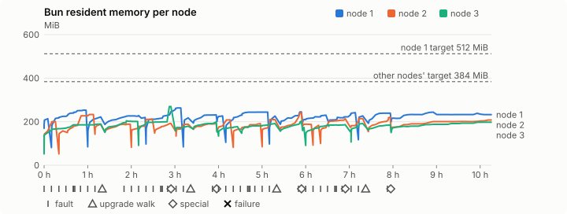
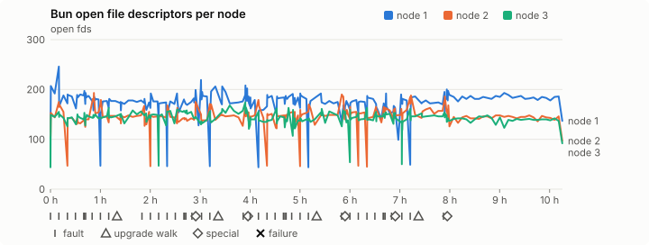
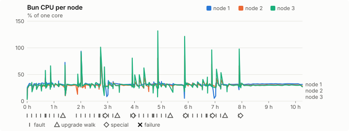
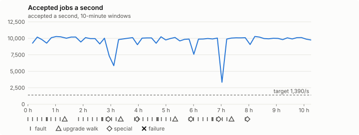

# Sustained soak (V02): PASS

23 November 2026. final tier, full schedule, 10 h 15 min of soak on a three-node quickstart cluster.

**Final job tier: clean. The release gate's final soak passes** for the candidate whose `candidate.json` has SHA-256 `6c6af8c135eb25e4e3e021b0d9f95204d4e75c945aa39ad5b2db7408a8b2022c`, if it is the final candidate.

## Candidate and host

| | |
|---|---|
| Staged base URL | <https://github.com/reliaburger/reliaburger/releases/download/nightly-v0.3.2-45085422355-1> |
| `candidate.json` SHA-256 | `6c6af8c135eb25e4e3e021b0d9f95204d4e75c945aa39ad5b2db7408a8b2022c` |
| Running versions | v0.3.2 x3 |
| Soak build | `bun-v0.3.2-soak.1`, SHA-256 `e82b19908f2825bcbba2cb35d7dc9d84bc267008cd6ff35aa7de264fc050942d` |
| Walks roll back to | 0.3.2 |
| Host | macOS 27.2, Apple M5 Max, 128 GiB |
| Lima | limactl version 2.2.1 |
| Guest | Ubuntu 26.04.1 LTS, kernel 7.0.0-34-generic |
| RELIABURGER_HOME | `/tmp/rbq.fdUgTa` |
| Evidence | `/Users/miko/github/rb-wt/gate-032/qual/ev-jobs-final` |

## Configuration deviations

- Ubuntu's apt-daily and apt-daily-upgrade timers stopped and disabled in each guest, so unattended upgrades can't restart Bun during the soak (#1417)
- node.toml `[testing] allowed_operations` adds `provision_isolated_workloads` (quickstart allows only inject_workload_faults and alter_node_state), so the catalogue pulse can lease test namespaces
- node.toml `[logs]`/`[metrics]` export to file:///var/lib/reliaburger/soak-export every 60 s with max_storage_mb = 8 (the harness deletes a metrics export 30 minutes after its source has gone), `[storage.snapshots]` every 900 s (compressed: 120 s), retain 4, uploaded to the same directory
- node.toml `[ingress] tls_cert/tls_key` point at an operator pair from a soak CA, 45-minute leaves rotated by the harness
- Bun runs with auto/mixed; host jobs opt in to a single pinned BusyBox copy under /var/lib/reliaburger/soak-jobs, mount_isolation=false. The independent verifier listens on each private VM address, TCP 8189, with a separate run token
- node.toml `[node.labels] soak-volume` = "writer" on node 2 and "redis" on node 3, to pin the volume apps
- node.toml `[upgrades] external_signing_key` = a throwaway operator key the harness made for this run (`ed25519:BQV6BzPFx6G90gBrVzCF8lpkSCWmLKDG/AkS75Vx3SE=`); the soak build's `.sig` gets that key's external signature beside the release one (D2)
- node.toml `[security] leaf_lifetime_override_secs = 3600` (D1)
- apt-daily, apt-daily-upgrade and unattended-upgrades verified inactive on every node before the baseline, after waiting 0 s for any upgrade in progress (snapshots/upgrades-verified-N.txt)

## Timeline

- Started 2026-11-23 04:26:32 UTC, finished 2026-11-23 14:42:02 UTC
- Cycles completed: 8
- Fault and node choices: 35, from seed 3482661100 (`--seed 3482661100` repeats them)
- Teardown: `relish local destroy --yes` and `relish uninstall --yes` succeeded

## Faults and slots

| Class | Runs | Settled/ok | Failed | Skipped | Settle (median / max) |
|---|---|---|---|---|---|
| fault:bun-kill-follower | 8 | 8 | 0 | 0 | 42 s / 72 s |
| fault:bun-kill-leader | 8 | 8 | 0 | 0 | 44 s / 62 s |
| fault:chaos-cpu | 1 | 2 | 0 | 0 | 22 s / 22 s |
| fault:chaos-delay | 2 | 4 | 0 | 0 | 21 s / 21 s |
| fault:chaos-dns | 1 | 2 | 0 | 0 | 39 s / 39 s |
| fault:chaos-drop | 1 | 2 | 0 | 0 | 70 s / 70 s |
| fault:chaos-kill | 2 | 4 | 0 | 0 | 44 s / 44 s |
| fault:chaos-memory | 1 | 2 | 0 | 0 | 24 s / 24 s |
| fault:chaos-partition | 2 | 4 | 0 | 0 | 25 s / 25 s |
| fault:chaos-pause | 1 | 2 | 0 | 0 | 23 s / 23 s |
| fault:chaos-scenario | 1 | 2 | 0 | 0 | 46 s / 46 s |
| fault:deploy-kill | 4 | 4 | 0 | 0 | 43 s / 44 s |
| fault:node-delay | 3 | 3 | 0 | 0 | 40 s / 47 s |
| fault:node-disk-full | 3 | 3 | 0 | 0 | 26 s / 26 s |
| fault:node-slow-fsync | 2 | 2 | 0 | 0 | 23 s / 23 s |
| fault:power-off | 4 | 4 | 0 | 0 | 43 s / 62 s |
| pulse | 8 | 8 | 0 | 0 | n/a |
| pulse:settle | 0 | 8 | 0 | 0 | 25 s / 26 s |
| special:all-off | 1 | 1 | 0 | 0 | 38 s / 38 s |
| special:graceful-stop | 2 | 2 | 0 | 0 | 54 s / 54 s |
| special:quorum-back | 2 | 2 | 0 | 0 | n/a |
| special:quorum-loss | 2 | 2 | 0 | 0 | 56 s / 56 s |
| storage:offline-export | 1 | 1 | 0 | 0 | n/a |
| storage:registry-push | 8 | 0 | 0 | 0 | n/a |
| tls:invalid-expired | 15 | 15 | 0 | 0 | n/a |
| tls:invalid-torn | 15 | 15 | 0 | 0 | n/a |
| tls:reload | 118 | 118 | 0 | 0 | n/a |
| upgrade:rollback | 4 | 4 | 0 | 0 | n/a |
| upgrade:settle | 0 | 4 | 0 | 0 | 74 s / 105 s |
| upgrade:upgrade | 4 | 4 | 0 | 0 | n/a |

## Execution inventory (gated)

What the run completed, from its events and kept bytes, against what its schedule owes. A fault counts once it was injected and the cluster settled after it.

| Item | Required | Completed | Verdict |
|---|---|---|---|
| candidate.json bytes match the qualified digest | 1 | 1 | ok |
| app workloads settled at the baseline | 1 | 1 | ok |
| upgrade walk (to the soak build and back) | 4 | 4 | ok |
| fault:bun-kill-follower | 1 | 8 | ok |
| fault:bun-kill-leader | 1 | 8 | ok |
| fault:deploy-kill | 1 | 4 | ok |
| fault:power-off | 1 | 4 | ok |
| fault:chaos-kill | 1 | 2 | ok |
| fault:chaos-delay | 1 | 2 | ok |
| fault:chaos-partition | 1 | 2 | ok |
| fault:chaos-scenario | 1 | 1 | ok |
| fault:chaos-pause | 1 | 1 | ok |
| fault:chaos-drop | 1 | 1 | ok |
| fault:chaos-dns | 1 | 1 | ok |
| fault:chaos-cpu | 1 | 1 | ok |
| fault:chaos-memory | 1 | 1 | ok |
| fault:node-delay | 1 | 3 | ok |
| fault:node-disk-full | 1 | 3 | ok |
| fault:node-slow-fsync | 1 | 2 | ok |
| special:graceful-stop | 2 | 2 | ok |
| special:quorum-loss | 2 | 2 | ok |
| special:all-off | 1 | 1 | ok |
| catalogue pulse | 8 | 8 | ok |
| offline export | 1 | 1 | ok |
| quiet tail with no faults, walks or specials | 1 | 1 | ok |
| job campaign drained in its final two minutes | 1 | 1 | ok |

## Observed fault effects

What each injected fault was seen to do, read back from the node.

| Fault | Target | Observed |
|---|---|---|
| effect:bun-kill-follower | rb-50ad9115cd91-3 | MainPID 3323 -> 5481 |
| effect:bun-kill-leader | rb-50ad9115cd91-1 | MainPID 10304 -> 2066662 |
| effect:deploy-kill | rb-50ad9115cd91-2 | MainPID 3600 -> 556087 |
| effect:power-off | rb-50ad9115cd91-2 | Lima status Stopped |
| effect:node-delay | rb-50ad9115cd91-1 | netem 8001: root refcnt 2 limit 1000 delay 200ms  50ms seed 18228258547657215890  |
| effect:bun-kill-follower | rb-50ad9115cd91-1 | MainPID 2066662 -> 557798 |
| effect:bun-kill-leader | rb-50ad9115cd91-2 | MainPID 1049 -> 547378 |
| effect:node-disk-full | rb-50ad9115cd91-2 | available 67055616 bytes  |
| effect:bun-kill-follower | rb-50ad9115cd91-2 | MainPID 3124438 -> 3120709 |
| effect:bun-kill-leader | rb-50ad9115cd91-3 | MainPID 5481 -> 2134512 |
| effect:deploy-kill | rb-50ad9115cd91-1 | MainPID 557798 -> 2064580 |
| effect:power-off | rb-50ad9115cd91-2 | Lima status Stopped |
| effect:node-slow-fsync | rb-50ad9115cd91-3 | IOWriteBandwidthMax=/dev/vda 1000000 IOWriteIOPSMax=/dev/vda 20  |
| effect:bun-kill-follower | rb-50ad9115cd91-2 | MainPID 1048 -> 370250 |
| effect:bun-kill-leader | rb-50ad9115cd91-1 | MainPID 2064580 -> 3642812 |
| effect:node-delay | rb-50ad9115cd91-2 | netem 8001: root refcnt 2 limit 1000 delay 200ms  50ms seed 1929799059696745092  |
| effect:bun-kill-follower | rb-50ad9115cd91-3 | MainPID 1032 -> 505608 |
| effect:bun-kill-leader | rb-50ad9115cd91-1 | MainPID 1036 -> 2838265 |
| effect:deploy-kill | rb-50ad9115cd91-2 | MainPID 1047 -> 1158295 |
| effect:power-off | rb-50ad9115cd91-3 | Lima status Stopped |
| effect:node-disk-full | rb-50ad9115cd91-3 | available 66871296 bytes  |
| effect:bun-kill-follower | rb-50ad9115cd91-2 | MainPID 1158295 -> 2322200 |
| effect:bun-kill-leader | rb-50ad9115cd91-1 | MainPID 2838265 -> 4110043 |
| effect:node-slow-fsync | rb-50ad9115cd91-1 | IOWriteBandwidthMax=/dev/vda 1000000 IOWriteIOPSMax=/dev/vda 20  |
| effect:bun-kill-follower | rb-50ad9115cd91-3 | MainPID 1053 -> 1013550 |
| effect:bun-kill-leader | rb-50ad9115cd91-2 | MainPID 1036 -> 3298113 |
| effect:deploy-kill | rb-50ad9115cd91-2 | MainPID 3298113 -> 1491376 |
| effect:power-off | rb-50ad9115cd91-1 | Lima status Stopped |
| effect:node-delay | rb-50ad9115cd91-3 | netem 8001: root refcnt 2 limit 1000 delay 200ms  50ms seed 795754631173103819  |
| effect:bun-kill-follower | rb-50ad9115cd91-3 | MainPID 1043 -> 261048 |
| effect:bun-kill-leader | rb-50ad9115cd91-1 | MainPID 1039 -> 3894134 |
| effect:node-disk-full | rb-50ad9115cd91-1 | available 67039232 bytes  |

## Renewals and rotations

| Measure | Observed | Required | Verdict |
|---|---|---|---|
| workload identity rotations (soak-identity, per node) | 23 | ≥ 19 | PASS |
| node leaf renewals (per node) | 22 | ≥ 19 | PASS |
| operator ingress reloads (all nodes) | 118 | ≥ 40 | PASS |
| mixed job campaign and positive drain | 0 missing/failing checks | 0 | PASS |

## Latency SLOs

What a user should feel on a quiet three-node cluster (#1400). Every sample is taken outside fault windows and through a host forward that works; each p99 is the upper bound of its histogram bucket.

| SLO | p99 | Threshold | Samples | Mode | Verdict |
|---|---|---|---|---|---|
| API read p99 | 200 ms | ≤ 3,000 ms | 5,916 | gated | PASS |
| API write p99 | 2,000 ms | ≤ 3,000 ms | 20 | gated | PASS |
| App start p99 | 15,000 ms | ≤ 30,000 ms | 60 | gated | PASS |
| Rolling update p99 | 50,000 ms | ≤ 100,000 ms | 20 | gated | PASS |
| Job task start p99 | 64 ms | ≤ 256 ms | 239,810,246 | gated | PASS |

- API read p99: `GET /v1/status?cluster=true` and `GET /v1/cluster/nodes` on every node, at every light check
- API write p99: `relish apply` of the soak workloads, from the call to the commit
- App start p99: each node's deploy of a new `soak-slo` instance, from its start until the instance passes its health check
- Rolling update p99: from `relish apply` returning to every node's `soak-slo` running the new spec
- Job task start p99: a job task's start lag on a pooled executor, from the job campaign's buckets, in runs no fault window overlapped

## Jobs

| Runtime | Accepted successes | Retries | Last accepted progress |
|---|---|---|---|
| runc | 55539 | 1 | 1795444904 |
| shared-runc | 46534851 | 1 | 1795444904 |
| process | 309683698 | 1 | 1795444904 |

The bounded campaign shares the app soak's fault schedule. These counts are reliability evidence, not a saturation rate or a 100-million-per-day qualification.

- Independent verifier execution attempts: 24
- Explicit test-operator acknowledgements for known replay-safe fenced fixtures: 192

- rb-50ad9115cd91-1: latest complete job storage (KiB) {'instances': 2368, 'job-state': 8, 'task-arrays': 14320}; free 4295156 KiB; live/peak owners 0/29; peak storage {'instances': 22068, 'job-state': 8, 'task-arrays': 51888}
- rb-50ad9115cd91-2: latest complete job storage (KiB) {'instances': 1284, 'job-state': 8, 'task-arrays': 18956}; free 5388452 KiB; live/peak owners 0/29; peak storage {'instances': 21824, 'job-state': 8, 'task-arrays': 55036}
- rb-50ad9115cd91-3: latest complete job storage (KiB) {'instances': 432, 'job-state': 8, 'task-arrays': 15580}; free 5384164 KiB; live/peak owners 0/29; peak storage {'instances': 21652, 'job-state': 8, 'task-arrays': 49140}

Instance storage limit: 64 MiB per node (data/instances, allocated, outside fault windows; #1418).

Complete disk inventories are recorded. Global retention bounds and the 12-hour job qualification remain #668; this gate cannot certify an unimplemented retention policy.

## Job qualification (D18-C)

Load: target; 3 nodes; accepted 9,650.4/s against a 1390.0/s target: PASS.

The September plan set its targets for one 1M-task batch on a quiet cluster. A soak runs for hours with restarts, upgrades and apps, so its storage, Bun memory and Raft targets are restated (maintainer decision, 15 October 2026, [#668](https://github.com/reliaburger/reliaburger/issues/668)). Bun's steady state is the median RSS of each process once it has been seen for 10 minutes; the gated memory checks are unchanged (`leak-rss`, and Mayo's 70% `memory_high` alert through `wtf`).

| Measure (recorded, not gated) | Observed | Target |
|---|---|---|
| Wall time of a 1,048,576-task array (median / max of 64) | 117 s / 831 s | ≤ 600 s |
| p99 start lag, pooled executors | 64 ms (bucket upper bound) | < 1,000 ms |
| Raft entries per second, all cluster writes | 4.94 | recorded only; the batch target counts only task-array writes |
| Raft state of one run, largest seen | 8,410 B | ≤ 256 KiB per 1M tasks |
| Bun steady-state RSS per process, worst node against its target | rb-50ad9115cd91-2: 235.21 MiB steady, 241.47 MiB peak | ≤ 384 MiB (≤ 512 MiB on node 1, which serves the API) |
| Bun CPU, busiest node | 0.31 cores | ≤ 1 core (leader batch control) |
| Executor helper CPU, busiest node | 0.03 cores | ≤ 0.5 core |
| Node task-array storage per 1M accepted tasks (peaks summed) | 0.43 MiB | ≤ 64 MiB, deleted after retirement |
| Retained log volume, all nodes | 23.89 MB | ≤ 50 MB |

- Bun RSS on rb-50ad9115cd91-1 (serves the API, target ≤ 512 MiB): pid 10304: 213.55 MiB peak (seen for under 10 minutes); pid 2066662: 243.40 MiB steady, 252.90 MiB peak; pid 557798: 213.72 MiB steady, 221.89 MiB peak; pid 557798: 225.58 MiB steady, 227.98 MiB peak; pid 2064580: 231.34 MiB steady, 262.98 MiB peak; pid 3642812: 217.67 MiB peak (seen for under 10 minutes); pid 3642812: 230.83 MiB steady, 231.25 MiB peak; pid 1036: 226.16 MiB peak (seen for under 10 minutes); pid 2838265: 243.54 MiB steady, 243.93 MiB peak; pid 4110043: 225.80 MiB peak (seen for under 10 minutes); pid 4110043: 243.31 MiB steady, 244.95 MiB peak; pid 1034: 222.59 MiB steady, 229.71 MiB peak; pid 1039: 222.38 MiB steady, 241.45 MiB peak; pid 3894134: 226.65 MiB peak (seen for under 10 minutes); pid 3894134: 238.76 MiB steady, 239.08 MiB peak; pid 1031: 232.64 MiB steady, 243.99 MiB peak
- Bun RSS on rb-50ad9115cd91-2 (node, target ≤ 384 MiB): pid 3600: 198.76 MiB steady, 200.65 MiB peak; pid 556087: 157.75 MiB peak (seen for under 10 minutes); pid 1049: 226.94 MiB steady, 233.02 MiB peak; pid 547378: 187.98 MiB peak (seen for under 10 minutes); pid 3124438: 188.27 MiB steady, 189.32 MiB peak; pid 3120709: 205.31 MiB steady, 211.00 MiB peak; pid 1047: 188.04 MiB steady, 191.81 MiB peak; pid 1048: 166.03 MiB peak (seen for under 10 minutes); pid 370250: 188.10 MiB steady, 188.23 MiB peak; pid 370250: 190.04 MiB steady, 192.60 MiB peak; pid 1047: 205.95 MiB steady, 208.38 MiB peak; pid 1158295: 185.95 MiB steady, 191.04 MiB peak; pid 2322200: 209.61 MiB steady, 209.79 MiB peak; pid 2322200: 235.21 MiB steady, 241.47 MiB peak; pid 1036: 187.11 MiB steady, 188.38 MiB peak; pid 3298113: 183.29 MiB peak (seen for under 10 minutes); pid 1491376: 204.18 MiB steady, 213.80 MiB peak; pid 1046: 213.50 MiB steady, 215.44 MiB peak; pid 1046: 208.96 MiB steady, 220.06 MiB peak; pid 1035: 200.64 MiB steady, 207.91 MiB peak
- Bun RSS on rb-50ad9115cd91-3 (node, target ≤ 384 MiB): pid 3323: 135.61 MiB peak (seen for under 10 minutes); pid 5481: 185.39 MiB steady, 189.53 MiB peak; pid 5481: 201.16 MiB steady, 203.75 MiB peak; pid 2134512: 198.63 MiB steady, 269.81 MiB peak; pid 1031: 173.21 MiB steady, 179.41 MiB peak; pid 1031: 194.40 MiB steady, 200.57 MiB peak; pid 1032: 164.50 MiB peak (seen for under 10 minutes); pid 505608: 173.09 MiB steady, 177.20 MiB peak; pid 1041: 180.85 MiB steady, 191.46 MiB peak; pid 1041: 191.89 MiB steady, 202.30 MiB peak; pid 1053: 173.67 MiB peak (seen for under 10 minutes); pid 1013550: 184.54 MiB steady, 186.35 MiB peak; pid 1043: 163.66 MiB peak (seen for under 10 minutes); pid 261048: 181.99 MiB steady, 191.61 MiB peak; pid 261048: 183.89 MiB steady, 185.07 MiB peak; pid 1034: 187.97 MiB steady, 197.67 MiB peak

- runc retry causes: exit_code 1, launch 0, signal 0, timeout 0, unknown 0, unrecorded 0
- shared-runc retry causes: exit_code 1, launch 0, signal 0, timeout 0, unknown 0, unrecorded 0
- process retry causes: exit_code 1, launch 0, signal 0, timeout 0, unknown 0, unrecorded 0
- Audited executions: 24; operator replay decisions: 192
- Chunks checked for exactly-once completion: 3128, 6 of them re-granted (#1415)
- Job controller API fallbacks: rb-50ad9115cd91-1 missed 472, rb-50ad9115cd91-2 missed 20; rb-50ad9115cd91-2 answered 452, rb-50ad9115cd91-3 answered 20 (requests a node didn't answer, and the node that took them instead)

## Data

- Volume writer: highest ACK 192245 in the log view; the writer file checks (writer-lost, writer-regression) decide data loss, and `*-log-order` failures are about the order the log view returned lines in
- Redis counter: highest INCR 29584 in the log view
- Volume writer resumes: 8 starts, each checked against the highest ACK logged before it
- Redis client starts: 20, each checked against the highest INCR logged before it; counter regressions the client saw: 0
- Export rb-50ad9115cd91-1: 215 source files, 644 at the destination
- Export rb-50ad9115cd91-2: 751 source files, 781 at the destination
- Export rb-50ad9115cd91-3: 360 source files, 394 at the destination
- Registry images pushed and re-verified: 9
- Agent-loop turns over the 1 s budget: rb-50ad9115cd91-1 0, rb-50ad9115cd91-2 0, rb-50ad9115cd91-3 0
- Soak policies checked in force: 281 times, policy generation 78 at the last check
- Guest clock steps by Lima's guest agent: rb-50ad9115cd91-1 3, rb-50ad9115cd91-2 8, rb-50ad9115cd91-3 7
- Checks evaluated: 1239 (heavy 124, light 958, settle 157)
- Last observed progress: redis-counter 29584, writer-ack 192245

## Council history (linearizability)

Every test-lease grant, renew, read and release the history client made, checked against a model of the council's leases. A write with no answer may or may not have happened; the check allows both.

- Operations checked: 202245 of 202245, in 2 namespaces; 4102 writes had no answer
- Verdict: linearizable

## Leak-checker exposure (gated)

How long each leak checker could judge each node's Bun. `leak-rss` arms at its warm sample: 60 minutes into one process in a final, and otherwise at the first heavy check where the log and metrics stores are each 90% full, between 60 minutes and 6 hours in (#1417). `leak-fd` arms after 50 minutes; a restart, kill or upgrade exec starts the warm-up again. A final needs each armed for 60 minutes on every node, with one unbroken window of 30 (#1062); its quiet tail gives them that.

| Node | Checker | Armed | Longest armed window | Evaluated samples | Processes armed | Verdict |
|---|---|---|---|---|---|---|
| rb-50ad9115cd91-1 | leak-rss | 75 min | 75 min | 16 | 1 | ok |
| rb-50ad9115cd91-1 | leak-fd | 97 min | 85 min | 25 | 3 | ok |
| rb-50ad9115cd91-2 | leak-rss | 75 min | 75 min | 16 | 1 | ok |
| rb-50ad9115cd91-2 | leak-fd | 85 min | 85 min | 18 | 1 | ok |
| rb-50ad9115cd91-3 | leak-rss | 92 min | 75 min | 26 | 2 | ok |
| rb-50ad9115cd91-3 | leak-fd | 114 min | 85 min | 41 | 3 | ok |

- rb-50ad9115cd91-1: the last Bun process's `leak-rss` warm sample was 238,272 kB, 1:02 h:mm in.
- rb-50ad9115cd91-2: the last Bun process's `leak-rss` warm sample was 205,456 kB, 1:02 h:mm in.
- rb-50ad9115cd91-3: the last Bun process's `leak-rss` warm sample was 192,444 kB, 1:02 h:mm in.

## Resource trends

| Node | Measure | First | Last | Max |
|---|---|---|---|---|
| rb-50ad9115cd91-1 | disk_kb data | 1382684 | 1394740 | 1591180 |
| rb-50ad9115cd91-1 | disk_kb images | 346292 | 358992 | 478968 |
| rb-50ad9115cd91-1 | disk_kb logs | 40 | 8656 | 8972 |
| rb-50ad9115cd91-1 | disk_kb metrics | 88 | 8660 | 9036 |
| rb-50ad9115cd91-1 | disk_kb soak-export | 4 | 47908 | 47908 |
| rb-50ad9115cd91-1 | disk_kb volumes | 284 | 260 | 344 |
| rb-50ad9115cd91-1 | fd | 115 | 137 | 246 |
| rb-50ad9115cd91-1 | rss_anon_kb | 97428 | 180292 | 188032 |
| rb-50ad9115cd91-1 | rss_file_kb | 76188 | 57792 | 84272 |
| rb-50ad9115cd91-1 | rss_kb | 173616 | 238084 | 269292 |
| rb-50ad9115cd91-2 | disk_kb data | 71796 | 308324 | 520332 |
| rb-50ad9115cd91-2 | disk_kb images | 179196 | 358824 | 358824 |
| rb-50ad9115cd91-2 | disk_kb logs | 24 | 9008 | 9008 |
| rb-50ad9115cd91-2 | disk_kb metrics | 60 | 8752 | 9020 |
| rb-50ad9115cd91-2 | disk_kb soak-export | 4 | 20188 | 20528 |
| rb-50ad9115cd91-2 | disk_kb volumes | 16912 | 22104 | 22104 |
| rb-50ad9115cd91-2 | fd | 77 | 97 | 193 |
| rb-50ad9115cd91-2 | rss_anon_kb | 47612 | 135888 | 165952 |
| rb-50ad9115cd91-2 | rss_file_kb | 74160 | 77016 | 84828 |
| rb-50ad9115cd91-2 | rss_kb | 121772 | 212904 | 247264 |
| rb-50ad9115cd91-3 | disk_kb data | 234544 | 235260 | 741460 |
| rb-50ad9115cd91-3 | disk_kb images | 339124 | 354684 | 354684 |
| rb-50ad9115cd91-3 | disk_kb logs | 24 | 5348 | 5348 |
| rb-50ad9115cd91-3 | disk_kb metrics | 60 | 8652 | 8940 |
| rb-50ad9115cd91-3 | disk_kb soak-export | 4 | 20772 | 21460 |
| rb-50ad9115cd91-3 | disk_kb volumes | 16924 | 19160 | 19160 |
| rb-50ad9115cd91-3 | fd | 76 | 92 | 174 |
| rb-50ad9115cd91-3 | rss_anon_kb | 50024 | 124676 | 194908 |
| rb-50ad9115cd91-3 | rss_file_kb | 73884 | 77740 | 83556 |
| rb-50ad9115cd91-3 | rss_kb | 123908 | 202416 | 276284 |

## Bun memory by kind

From each node's `/proc/PID/smaps` at the settle and heavy checks (`memory.jsonl`, #1417). Sizes in MiB; arenas are glibc thread arenas, with the number of 64 MiB arena heaps in brackets. Time is h:mm since the node's first sample.

### rb-50ad9115cd91-1

| Time | Pid | RSS | Heap | Arenas | Stacks | Other anonymous | File | Threads |
|---|---|---|---|---|---|---|---|---|
| 0:00 | 10304 | 169.5 | 40.7 | 0.0 (0) | 1.0 | 49.7 | 78.2 | 50 |
| 1:00 | 557798 | 84.7 | 12.0 | 0.0 (0) | 0.6 | 6.0 | 66.0 | 11 |
| 2:00 | 557798 | 226.6 | 77.6 | 0.0 (0) | 1.4 | 65.7 | 81.9 | 80 |
| 3:01 | 2064580 | 256.2 | 86.3 | 0.0 (0) | 2.1 | 84.8 | 83.1 | 95 |
| 4:00 | 1036 | 223.9 | 73.1 | 0.0 (0) | 1.6 | 64.5 | 84.8 | 58 |
| 5:00 | 2838265 | 243.9 | 80.4 | 0.0 (0) | 1.1 | 80.0 | 82.4 | 73 |
| 6:00 | 1034 | 209.6 | 62.1 | 0.0 (0) | 3.9 | 61.9 | 81.7 | 69 |
| 7:01 | 1039 | 230.6 | 76.4 | 0.0 (0) | 4.6 | 64.1 | 85.5 | 79 |
| 8:00 | 1031 | 216.6 | 62.1 | 0.0 (0) | 3.6 | 67.8 | 83.1 | 62 |
| 9:00 | 1031 | 232.7 | 76.1 | 0.0 (0) | 4.3 | 83.9 | 68.5 | 76 |
| 10:01 | 1031 | 234.3 | 84.1 | 0.0 (0) | 4.3 | 83.9 | 62.0 | 76 |
| 10:15 | 1031 | 232.5 | 84.1 | 0.0 (0) | 4.3 | 83.9 | 60.2 | 76 |

- rb-50ad9115cd91-1: **heap** grew most after the first hour: +8.0 MiB over 1:15 h:mm (others, MiB: arenas +0.0, stacks +0.0, other anonymous +0.1, file -8.3).
- rb-50ad9115cd91-1: no 6-hour RSS slope: the last Bun process (pid 1031) ran for 2:17 h:mm.

### rb-50ad9115cd91-2

| Time | Pid | RSS | Heap | Arenas | Stacks | Other anonymous | File | Threads |
|---|---|---|---|---|---|---|---|---|
| 0:00 | 3600 | 118.9 | 30.2 | 0.0 (0) | 1.0 | 11.5 | 76.2 | 28 |
| 1:00 | 1049 | 227.0 | 74.5 | 0.0 (0) | 1.4 | 64.6 | 86.5 | 78 |
| 2:00 | 3120709 | 82.4 | 8.4 | 0.0 (0) | 0.6 | 7.2 | 66.2 | 11 |
| 3:01 | 1048 | 158.1 | 31.4 | 0.0 (0) | 1.4 | 43.1 | 82.2 | 48 |
| 4:00 | 1047 | 171.9 | 42.5 | 0.0 (0) | 3.9 | 43.2 | 82.3 | 75 |
| 5:00 | 2322200 | 84.9 | 9.6 | 0.0 (0) | 0.6 | 8.5 | 66.2 | 11 |
| 6:00 | 1036 | 188.3 | 58.1 | 0.0 (0) | 1.0 | 45.3 | 83.9 | 49 |
| 7:01 | 1046 | 173.9 | 37.2 | 0.0 (0) | 0.8 | 53.5 | 82.4 | 53 |
| 8:00 | 1035 | 174.6 | 49.3 | 0.0 (0) | 0.7 | 42.2 | 82.3 | 54 |
| 9:00 | 1035 | 200.6 | 63.3 | 0.0 (0) | 0.7 | 57.3 | 79.3 | 65 |
| 10:01 | 1035 | 203.2 | 65.3 | 0.0 (0) | 0.7 | 58.2 | 79.0 | 77 |
| 10:15 | 1035 | 207.9 | 67.3 | 0.0 (0) | 0.7 | 60.9 | 79.0 | 77 |

- rb-50ad9115cd91-2: **heap** grew most after the first hour: +4.0 MiB over 1:15 h:mm (others, MiB: arenas +0.0, stacks +0.0, other anonymous +3.6, file -0.4).
- rb-50ad9115cd91-2: no 6-hour RSS slope: the last Bun process (pid 1035) ran for 2:17 h:mm.

### rb-50ad9115cd91-3

| Time | Pid | RSS | Heap | Arenas | Stacks | Other anonymous | File | Threads |
|---|---|---|---|---|---|---|---|---|
| 0:00 | 3323 | 121.0 | 16.1 | 0.0 (0) | 1.0 | 28.1 | 75.9 | 26 |
| 1:00 | 5481 | 185.4 | 60.8 | 0.0 (0) | 4.3 | 40.0 | 80.3 | 55 |
| 2:00 | 5481 | 201.8 | 63.5 | 0.0 (0) | 3.5 | 56.5 | 78.2 | 72 |
| 3:01 | 1031 | 157.8 | 32.0 | 0.0 (0) | 1.6 | 42.0 | 82.2 | 57 |
| 4:00 | 505608 | 133.7 | 17.6 | 0.0 (0) | 2.2 | 38.9 | 75.0 | 46 |
| 5:00 | 1041 | 180.9 | 42.1 | 0.0 (0) | 1.7 | 51.7 | 85.4 | 63 |
| 6:00 | 1013550 | 90.8 | 12.2 | 0.0 (0) | 0.8 | 7.6 | 70.2 | 24 |
| 7:01 | 1043 | 153.1 | 30.8 | 0.0 (0) | 0.7 | 39.0 | 82.5 | 43 |
| 8:00 | 1034 | 171.4 | 48.1 | 0.0 (0) | 1.7 | 39.2 | 82.4 | 68 |
| 9:00 | 1034 | 187.9 | 60.1 | 0.0 (0) | 1.7 | 46.5 | 79.6 | 70 |
| 10:01 | 1034 | 197.5 | 64.1 | 0.0 (0) | 1.7 | 52.1 | 79.6 | 78 |
| 10:15 | 1034 | 197.7 | 64.1 | 0.0 (0) | 1.7 | 52.2 | 79.7 | 78 |

- rb-50ad9115cd91-3: **other anonymous** grew most after the first hour: +5.7 MiB over 1:15 h:mm (others, MiB: heap +4.0, arenas +0.0, stacks +0.0, file +0.1).
- rb-50ad9115cd91-3: no 6-hour RSS slope: the last Bun process (pid 1034) ran for 2:17 h:mm.

### Log stores against RSS

Each node's `disk logs` and `disk metrics` and the Parquet files in its log store, from the same samples. RSS in MiB.

| Node | Time | RSS | Logs (KiB) | Log files | Metrics (KiB) |
|---|---|---|---|---|---|
| rb-50ad9115cd91-1 | 0:00 | 169.5 | 40 | 4 | 88 |
| rb-50ad9115cd91-1 | 1:00 | 84.7 | 4,580 | 65 | 6,204 |
| rb-50ad9115cd91-1 | 2:00 | 226.6 | 8,612 | 118 | 8,584 |
| rb-50ad9115cd91-1 | 3:01 | 256.2 | 8,488 | 118 | 8,308 |
| rb-50ad9115cd91-1 | 4:00 | 223.9 | 8,500 | 120 | 8,612 |
| rb-50ad9115cd91-1 | 5:00 | 243.9 | 8,764 | 123 | 8,832 |
| rb-50ad9115cd91-1 | 6:00 | 209.6 | 8,632 | 126 | 9,036 |
| rb-50ad9115cd91-1 | 7:01 | 230.6 | 8,480 | 122 | 8,372 |
| rb-50ad9115cd91-1 | 8:00 | 216.6 | 8,500 | 127 | 8,660 |
| rb-50ad9115cd91-1 | 9:00 | 232.7 | 8,684 | 125 | 8,732 |
| rb-50ad9115cd91-1 | 10:01 | 234.3 | 8,696 | 118 | 8,580 |
| rb-50ad9115cd91-1 | 10:15 | 232.5 | 8,656 | 117 | 8,660 |
| rb-50ad9115cd91-2 | 0:00 | 118.9 | 24 | 3 | 60 |
| rb-50ad9115cd91-2 | 1:00 | 227.0 | 508 | 63 | 3,476 |
| rb-50ad9115cd91-2 | 2:00 | 82.4 | 1,084 | 125 | 7,224 |
| rb-50ad9115cd91-2 | 3:01 | 158.1 | 1,516 | 178 | 8,632 |
| rb-50ad9115cd91-2 | 4:00 | 171.9 | 2,088 | 239 | 8,764 |
| rb-50ad9115cd91-2 | 5:00 | 84.9 | 2,592 | 300 | 8,812 |
| rb-50ad9115cd91-2 | 6:00 | 188.3 | 3,164 | 359 | 8,964 |
| rb-50ad9115cd91-2 | 7:01 | 173.9 | 5,264 | 416 | 8,756 |
| rb-50ad9115cd91-2 | 8:00 | 174.6 | 7,896 | 476 | 8,716 |
| rb-50ad9115cd91-2 | 9:00 | 200.6 | 8,392 | 537 | 8,668 |
| rb-50ad9115cd91-2 | 10:01 | 203.2 | 8,884 | 597 | 8,672 |
| rb-50ad9115cd91-2 | 10:15 | 207.9 | 9,008 | 612 | 8,752 |
| rb-50ad9115cd91-3 | 0:00 | 121.0 | 24 | 3 | 60 |
| rb-50ad9115cd91-3 | 1:00 | 185.4 | 88 | 17 | 4,276 |
| rb-50ad9115cd91-3 | 2:00 | 201.8 | 172 | 34 | 7,988 |
| rb-50ad9115cd91-3 | 3:01 | 157.8 | 280 | 51 | 8,764 |
| rb-50ad9115cd91-3 | 4:00 | 133.7 | 2,712 | 97 | 8,904 |
| rb-50ad9115cd91-3 | 5:00 | 180.9 | 2,768 | 110 | 8,624 |
| rb-50ad9115cd91-3 | 6:00 | 90.8 | 4,964 | 152 | 8,536 |
| rb-50ad9115cd91-3 | 7:01 | 153.1 | 5,044 | 165 | 8,800 |
| rb-50ad9115cd91-3 | 8:00 | 171.4 | 5,240 | 188 | 8,704 |
| rb-50ad9115cd91-3 | 9:00 | 187.9 | 5,288 | 200 | 8,564 |
| rb-50ad9115cd91-3 | 10:01 | 197.5 | 5,336 | 212 | 8,708 |
| rb-50ad9115cd91-3 | 10:15 | 197.7 | 5,348 | 215 | 8,652 |

## Agent loop stalls

From the stall watchdog's journal blocks (`loop-stalls.jsonl`, #1707). Each snapshot lists every Bun thread; here are the stall line, threads in uninterruptible sleep and the thread that ran the loop.

- Stalls: rb-50ad9115cd91-1 1

```
Nov 23 11:49:01 lima-rb-50ad9115cd91-1 bun[3894134]: bun: agent loop stalled 822 ms in snapshot, 322 ms past its turn deadline; thread snapshot (pid 3894134, 71 threads):
Nov 23 11:49:01 lima-rb-50ad9115cd91-1 bun[3894134]: bun:   tid 1650014 tokio-rt-worker D wchan=folio_wait_bit_common syscall=read(0x89, 0xe91167549360, 0x20)
Nov 23 11:49:01 lima-rb-50ad9115cd91-1 bun[3894134]: bun:   tid 1650016 tokio-rt-worker D wchan=folio_wait_bit_common syscall=fdatasync(0x10, 0x0, 0x0)
Nov 23 11:49:01 lima-rb-50ad9115cd91-1 bun[3894134]: bun:   tid 3894136 tokio-rt-worker D wchan=folio_wait_bit_common syscall=not in a syscall [ran the agent loop]
Nov 23 11:49:01 lima-rb-50ad9115cd91-1 bun[3894134]: bun:   tid 3894137 tokio-rt-worker D wchan=folio_wait_bit_common syscall=not in a syscall
Nov 23 11:49:01 lima-rb-50ad9115cd91-1 bun[3894134]: bun:   tid 3894214 tokio-rt-worker D wchan=folio_wait_bit_common syscall=fdatasync(0x5c, 0x0, 0x0)
Nov 23 11:49:01 lima-rb-50ad9115cd91-1 bun[3894134]: bun:   tid 3894670 tokio-rt-worker D wchan=jbd2_log_wait_commit syscall=fsync(0x6f, 0x0, 0x0)
Nov 23 11:49:01 lima-rb-50ad9115cd91-1 bun[3894134]: bun:   tid 4007295 tokio-rt-worker D wchan=folio_wait_bit_common syscall=fdatasync(0x45, 0x0, 0x0)
```

## Charts

Time runs from the start of the soak. The marks under each chart are its faults, upgrade walks, specials and recorded failures; the dashed lines are targets.









## Failures

None.

## Notes

- Unattended upgrades were off on every guest 0 s after they were asked to stop (snapshots/upgrades-stopped-N.txt)

Evidence: `/Users/miko/github/rb-wt/gate-032/qual/ev-jobs-final` (events.jsonl, snapshots/, failures/<n>/).
