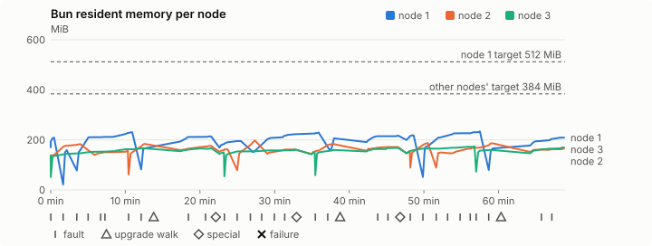
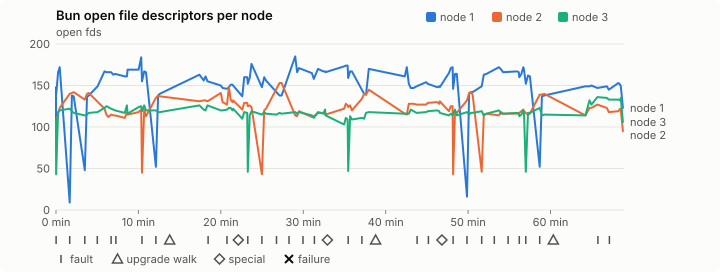
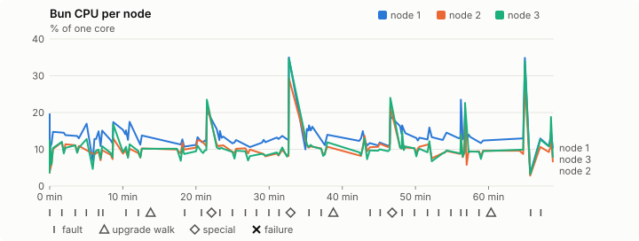
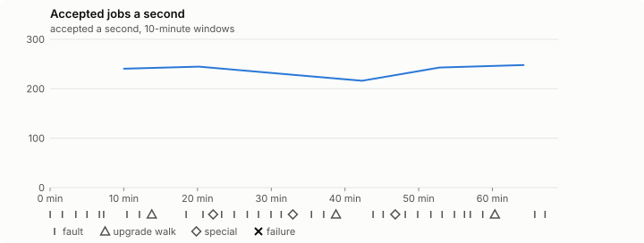

# Sustained soak (V02): PASS

23 November 2026. fast tier, compressed schedule, 1 h 08 min of soak on a three-node quickstart cluster.

**Fast tier: clean.** The iteration loop only, not acceptance: the V02 gate needs a clean final-tier run (8 h, full schedule) on the final candidate.

## Candidate and host

| | |
|---|---|
| Staged base URL | <https://github.com/reliaburger/reliaburger/releases/download/nightly-v0.3.2-45085422355-1> |
| `candidate.json` SHA-256 | `6c6af8c135eb25e4e3e021b0d9f95204d4e75c945aa39ad5b2db7408a8b2022c` |
| Running versions | v0.3.2 x3 |
| Soak build | `bun-v0.3.2-soak.1`, SHA-256 `e82b19908f2825bcbba2cb35d7dc9d84bc267008cd6ff35aa7de264fc050942d` |
| Walks roll back to | 0.3.2 |
| Host | macOS 27.2, Apple M5 Max, 128 GiB |
| Lima | limactl version 2.2.1 |
| Guest | Ubuntu 26.04.1 LTS, kernel 7.0.0-34-generic |
| RELIABURGER_HOME | `/tmp/rbq.avv6ep` |
| Evidence | `/Users/miko/github/rb-wt/gate-032/qual/ev-v02-fast` |

## Configuration deviations

- Ubuntu's apt-daily and apt-daily-upgrade timers stopped and disabled in each guest, so unattended upgrades can't restart Bun during the soak (#1417)
- node.toml `[testing] allowed_operations` adds `provision_isolated_workloads` (quickstart allows only inject_workload_faults and alter_node_state), so the catalogue pulse can lease test namespaces
- node.toml `[logs]`/`[metrics]` export to file:///var/lib/reliaburger/soak-export every 60 s with max_storage_mb = 8 (the harness deletes a metrics export 30 minutes after its source has gone), `[storage.snapshots]` every 900 s (compressed: 120 s), retain 4, uploaded to the same directory
- node.toml `[ingress] tls_cert/tls_key` point at an operator pair from a soak CA, 45-minute leaves rotated by the harness
- Bun runs with auto/mixed; host jobs opt in to a single pinned BusyBox copy under /var/lib/reliaburger/soak-jobs, mount_isolation=false. The independent verifier listens on each private VM address, TCP 8189, with a separate run token
- node.toml `[node.labels] soak-volume` = "writer" on node 2 and "redis" on node 3, to pin the volume apps
- node.toml `[upgrades] external_signing_key` = a throwaway operator key the harness made for this run (`ed25519:ziF7U98MuwFXnOV9bkOn0LN0jH/tRTS3awpo72gS7yk=`); the soak build's `.sig` gets that key's external signature beside the release one (D2)
- node.toml `[security] leaf_lifetime_override_secs = 3600` (D1)
- apt-daily, apt-daily-upgrade and unattended-upgrades verified inactive on every node before the baseline, after waiting 0 s for any upgrade in progress (snapshots/upgrades-verified-N.txt)

## Timeline

- Started 2026-11-23 02:03:17 UTC, finished 2026-11-23 03:12:12 UTC
- Cycles completed: 6
- Fault and node choices: 26, from seed 4203751959 (`--seed 4203751959` repeats them)
- Teardown: `relish local destroy --yes` and `relish uninstall --yes` succeeded

## Faults and slots

| Class | Runs | Settled/ok | Failed | Skipped | Settle (median / max) |
|---|---|---|---|---|---|
| fault:bun-kill-follower | 6 | 6 | 0 | 0 | 33 s / 35 s |
| fault:bun-kill-leader | 6 | 6 | 0 | 0 | 34 s / 46 s |
| fault:chaos-cpu | 1 | 2 | 0 | 0 | 18 s / 18 s |
| fault:chaos-delay | 2 | 4 | 0 | 0 | 19 s / 19 s |
| fault:chaos-dns | 1 | 2 | 0 | 0 | 16 s / 16 s |
| fault:chaos-drop | 1 | 2 | 0 | 0 | 16 s / 16 s |
| fault:chaos-kill | 2 | 4 | 0 | 0 | 34 s / 34 s |
| fault:chaos-memory | 1 | 2 | 0 | 0 | 16 s / 16 s |
| fault:chaos-partition | 2 | 4 | 0 | 0 | 18 s / 18 s |
| fault:chaos-pause | 1 | 2 | 0 | 0 | 17 s / 17 s |
| fault:chaos-scenario | 1 | 2 | 0 | 0 | 44 s / 44 s |
| fault:deploy-kill | 3 | 3 | 0 | 0 | 39 s / 41 s |
| fault:power-off | 3 | 3 | 0 | 0 | 33 s / 34 s |
| pulse | 1 | 1 | 0 | 0 | n/a |
| pulse:settle | 0 | 1 | 0 | 0 | 24 s / 24 s |
| special:all-off | 1 | 1 | 0 | 0 | 30 s / 30 s |
| special:graceful-stop | 1 | 1 | 0 | 0 | 39 s / 39 s |
| special:quorum-back | 1 | 1 | 0 | 0 | n/a |
| special:quorum-loss | 1 | 1 | 0 | 0 | 29 s / 29 s |
| storage:offline-export | 3 | 3 | 0 | 0 | n/a |
| storage:registry-push | 6 | 0 | 0 | 0 | n/a |
| tls:invalid-expired | 3 | 3 | 0 | 0 | n/a |
| tls:invalid-torn | 6 | 6 | 0 | 0 | n/a |
| tls:reload | 33 | 33 | 0 | 0 | n/a |
| upgrade:rollback | 3 | 3 | 0 | 0 | n/a |
| upgrade:settle | 0 | 3 | 0 | 0 | 89 s / 90 s |
| upgrade:upgrade | 3 | 3 | 0 | 0 | n/a |

## Execution inventory (recorded, not gated)

What the run completed, from its events and kept bytes, against what its schedule owes. A fault counts once it was injected and the cluster settled after it.

| Item | Required | Completed | Verdict |
|---|---|---|---|
| candidate.json bytes match the qualified digest | 1 | 1 | ok |
| app workloads settled at the baseline | 1 | 1 | ok |
| upgrade walk (to the soak build and back) | 2 | 3 | ok |
| fault:bun-kill-follower | 1 | 6 | ok |
| fault:bun-kill-leader | 1 | 6 | ok |
| fault:deploy-kill | 1 | 3 | ok |
| fault:power-off | 1 | 3 | ok |
| fault:chaos-kill | 1 | 2 | ok |
| fault:chaos-delay | 1 | 2 | ok |
| fault:chaos-partition | 1 | 2 | ok |
| fault:chaos-scenario | 1 | 1 | ok |
| fault:chaos-pause | 1 | 1 | ok |
| fault:chaos-drop | 1 | 1 | ok |
| fault:chaos-dns | 1 | 1 | ok |
| fault:chaos-cpu | 1 | 1 | ok |
| special:graceful-stop | 1 | 1 | ok |
| special:quorum-loss | 1 | 1 | ok |
| special:all-off | 1 | 1 | ok |
| catalogue pulse | 1 | 1 | ok |
| offline export | 2 | 3 | ok |
| job campaign drained in its final two minutes | 1 | 1 | ok |

## Observed fault effects

What each injected fault was seen to do, read back from the node.

| Fault | Target | Observed |
|---|---|---|
| effect:bun-kill-follower | rb-5983a0dc21c2-3 | MainPID 3354 -> 5896 |
| effect:bun-kill-leader | rb-5983a0dc21c2-1 | MainPID 10173 -> 42235 |
| effect:deploy-kill | rb-5983a0dc21c2-1 | MainPID 42235 -> 77311 |
| effect:power-off | rb-5983a0dc21c2-2 | Lima status Stopped |
| effect:bun-kill-follower | rb-5983a0dc21c2-2 | MainPID 1046 -> 74603 |
| effect:bun-kill-leader | rb-5983a0dc21c2-1 | MainPID 77311 -> 217953 |
| effect:bun-kill-follower | rb-5983a0dc21c2-3 | MainPID 1033 -> 17643 |
| effect:bun-kill-leader | rb-5983a0dc21c2-2 | MainPID 1047 -> 48780 |
| effect:deploy-kill | rb-5983a0dc21c2-1 | MainPID 1034 -> 79212 |
| effect:power-off | rb-5983a0dc21c2-2 | Lima status Stopped |
| effect:bun-kill-follower | rb-5983a0dc21c2-3 | MainPID 1054 -> 13588 |
| effect:bun-kill-leader | rb-5983a0dc21c2-1 | MainPID 79212 -> 249927 |
| effect:bun-kill-follower | rb-5983a0dc21c2-2 | MainPID 1040 -> 16804 |
| effect:bun-kill-leader | rb-5983a0dc21c2-1 | MainPID 1045 -> 50101 |
| effect:deploy-kill | rb-5983a0dc21c2-2 | MainPID 16804 -> 75974 |
| effect:power-off | rb-5983a0dc21c2-2 | Lima status Stopped |
| effect:bun-kill-follower | rb-5983a0dc21c2-3 | MainPID 1047 -> 156954 |
| effect:bun-kill-leader | rb-5983a0dc21c2-1 | MainPID 50101 -> 197814 |

## Renewals and rotations

| Measure | Observed | Required | Verdict |
|---|---|---|---|
| workload identity rotations (soak-identity, per node) | 9 | ≥ 1 | PASS |
| node leaf renewals (per node) | 2 | ≥ 1 | PASS |
| operator ingress reloads (all nodes) | 33 | ≥ 12 | PASS |
| mixed job campaign and positive drain | 0 missing/failing checks | 0 | PASS |

## Latency SLOs

What a user should feel on a quiet three-node cluster (#1400). Every sample is taken outside fault windows and through a host forward that works; each p99 is the upper bound of its histogram bucket.

| SLO | p99 | Threshold | Samples | Mode | Verdict |
|---|---|---|---|---|---|
| API read p99 | 300 ms | ≤ 3,000 ms | 270 | gated | PASS |
| API write p99 | 2,000 ms | ≤ 3,000 ms | 8 | gated | PASS |
| App start p99 | 10,000 ms | ≤ 30,000 ms | 24 | gated | PASS |
| Rolling update p99 | 30,000 ms | ≤ 100,000 ms | 8 | gated | PASS |
| Job task start p99 | 2,048 ms | ≤ 256 ms | 20 | record only | too few samples |

- API read p99: `GET /v1/status?cluster=true` and `GET /v1/cluster/nodes` on every node, at every light check
- API write p99: `relish apply` of the soak workloads, from the call to the commit
- App start p99: each node's deploy of a new `soak-slo` instance, from its start until the instance passes its health check
- Rolling update p99: from `relish apply` returning to every node's `soak-slo` running the new spec
- Job task start p99: a job task's start lag on a pooled executor, from the job campaign's buckets, in runs no fault window overlapped
- Job task start p99 not judged: only 20 job task start samples, fewer than the 1,000 a p99 needs

## Jobs

| Runtime | Accepted successes | Retries | Last accepted progress |
|---|---|---|---|
| runc | 10300 | 1 | 1795403521 |
| shared-runc | 485444 | 1 | 1795403521 |
| process | 491200 | 1 | 1795403521 |

The bounded campaign shares the app soak's fault schedule. These counts are reliability evidence, not a saturation rate or a 100-million-per-day qualification.

- Independent verifier execution attempts: 24
- Explicit test-operator acknowledgements for known replay-safe fenced fixtures: 136

- rb-5983a0dc21c2-1: latest complete job storage (KiB) {'instances': 960, 'job-state': 8, 'task-arrays': 6592}; free 4524152 KiB; live/peak owners 0/9; peak storage {'instances': 9132, 'job-state': 8, 'task-arrays': 16476}
- rb-5983a0dc21c2-2: latest complete job storage (KiB) {'instances': 628, 'job-state': 8, 'task-arrays': 6344}; free 5594616 KiB; live/peak owners 0/8; peak storage {'instances': 7688, 'job-state': 8, 'task-arrays': 16084}
- rb-5983a0dc21c2-3: latest complete job storage (KiB) {'instances': 3760, 'job-state': 8, 'task-arrays': 6432}; free 5651396 KiB; live/peak owners 0/8; peak storage {'instances': 8260, 'job-state': 8, 'task-arrays': 16404}

Instance storage limit: 64 MiB per node (data/instances, allocated, outside fault windows; #1418).

Complete disk inventories are recorded. Global retention bounds and the 12-hour job qualification remain #668; this gate cannot certify an unimplemented retention policy.

## Job qualification (D18-C)

Load: calibration; 3 nodes; accepted 238.8/s (calibration load: not gated).

The September plan set its targets for one 1M-task batch on a quiet cluster. A soak runs for hours with restarts, upgrades and apps, so its storage, Bun memory and Raft targets are restated (maintainer decision, 15 October 2026, [#668](https://github.com/reliaburger/reliaburger/issues/668)). Bun's steady state is the median RSS of each process once it has been seen for 10 minutes; the gated memory checks are unchanged (`leak-rss`, and Mayo's 70% `memory_high` alert through `wtf`).

| Measure (recorded, not gated) | Observed | Target |
|---|---|---|
| Wall time of a 1,048,576-task array (median / max of 0) | not measured / not measured | ≤ 600 s |
| p99 start lag, pooled executors | 2 ms (bucket upper bound) | < 1,000 ms |
| Raft entries per second, all cluster writes | 5.60 | recorded only; the batch target counts only task-array writes |
| Raft state of one run, largest seen | 43,124 B | ≤ 256 KiB per 1M tasks |
| Bun steady-state RSS per process, worst node against its target | rb-5983a0dc21c2-3: 162.73 MiB steady, 174.52 MiB peak | ≤ 384 MiB (≤ 512 MiB on node 1, which serves the API) |
| Bun CPU, busiest node | 0.13 cores | ≤ 1 core (leader batch control) |
| Executor helper CPU, busiest node | 0.00 cores | ≤ 0.5 core |
| Node task-array storage per 1M accepted tasks (peaks summed) | 48.45 MiB | ≤ 64 MiB, deleted after retirement |
| Retained log volume, all nodes | 6.83 MB | ≤ 50 MB |

- Bun RSS on rb-5983a0dc21c2-1 (serves the API, target ≤ 512 MiB): pid 10173: 208.96 MiB peak (seen for under 10 minutes); pid 42235: 158.91 MiB peak (seen for under 10 minutes); pid 77311: 230.42 MiB peak (seen for under 10 minutes); pid 217953: 166.14 MiB peak (seen for under 10 minutes); pid 252252: 214.00 MiB peak (seen for under 10 minutes); pid 1034: 195.27 MiB peak (seen for under 10 minutes); pid 79212: 229.10 MiB peak (seen for under 10 minutes); pid 249927: 206.36 MiB peak (seen for under 10 minutes); pid 249927: 216.85 MiB peak (seen for under 10 minutes); pid 1045: 217.93 MiB peak (seen for under 10 minutes); pid 50101: 234.03 MiB peak (seen for under 10 minutes); pid 197814: 166.04 MiB peak (seen for under 10 minutes); pid 197814: 208.90 MiB peak (seen for under 10 minutes)
- Bun RSS on rb-5983a0dc21c2-2 (node, target ≤ 384 MiB): pid 3509: 182.66 MiB peak (seen for under 10 minutes); pid 1046: 156.50 MiB peak (seen for under 10 minutes); pid 74603: 183.88 MiB peak (seen for under 10 minutes); pid 74603: 175.96 MiB peak (seen for under 10 minutes); pid 1047: 162.02 MiB peak (seen for under 10 minutes); pid 48780: 197.47 MiB peak (seen for under 10 minutes); pid 1051: 161.66 MiB peak (seen for under 10 minutes); pid 1038: 182.93 MiB peak (seen for under 10 minutes); pid 1045: 171.44 MiB peak (seen for under 10 minutes); pid 1040: 154.34 MiB peak (seen for under 10 minutes); pid 16804: 186.84 MiB peak (seen for under 10 minutes); pid 75974: 149.54 MiB peak (seen for under 10 minutes); pid 1052: 186.11 MiB peak (seen for under 10 minutes); pid 1052: 165.67 MiB peak (seen for under 10 minutes)
- Bun RSS on rb-5983a0dc21c2-3 (node, target ≤ 384 MiB): pid 3354: 137.82 MiB peak (seen for under 10 minutes); pid 5896: 162.73 MiB steady, 166.35 MiB peak; pid 5896: 166.86 MiB peak (seen for under 10 minutes); pid 1033: 150.30 MiB peak (seen for under 10 minutes); pid 17643: 162.14 MiB peak (seen for under 10 minutes); pid 1054: 148.18 MiB peak (seen for under 10 minutes); pid 13588: 159.79 MiB peak (seen for under 10 minutes); pid 13588: 167.70 MiB peak (seen for under 10 minutes); pid 1047: 174.52 MiB peak (seen for under 10 minutes); pid 156954: 159.47 MiB peak (seen for under 10 minutes); pid 1043: 169.39 MiB peak (seen for under 10 minutes)

- runc retry causes: exit_code 1, launch 0, signal 0, timeout 0, unknown 0, unrecorded 0
- shared-runc retry causes: exit_code 1, launch 0, signal 0, timeout 0, unknown 0, unrecorded 0
- process retry causes: exit_code 1, launch 0, signal 0, timeout 0, unknown 0, unrecorded 0
- Audited executions: 24; operator replay decisions: 136
- Chunks checked for exactly-once completion: 72, 2 of them re-granted (#1415)
- Job controller API fallbacks: rb-5983a0dc21c2-1 missed 42, rb-5983a0dc21c2-2 missed 9; rb-5983a0dc21c2-2 answered 33, rb-5983a0dc21c2-3 answered 9 (requests a node didn't answer, and the node that took them instead)

## Data

- Volume writer: highest ACK 26962 in the log view; the writer file checks (writer-lost, writer-regression) decide data loss, and `*-log-order` failures are about the order the log view returned lines in
- Redis counter: highest INCR 3230 in the log view
- Volume writer resumes: 9 starts, each checked against the highest ACK logged before it
- Redis client starts: 15, each checked against the highest INCR logged before it; counter regressions the client saw: 0
- Export rb-5983a0dc21c2-1: 132 source files, 120 at the destination
- Export rb-5983a0dc21c2-2: 135 source files, 135 at the destination
- Export rb-5983a0dc21c2-3: 105 source files, 104 at the destination
- Registry images pushed and re-verified: 7
- Agent-loop turns over the 1 s budget: rb-5983a0dc21c2-1 0, rb-5983a0dc21c2-2 0, rb-5983a0dc21c2-3 0
- Soak policies checked in force: 122 times, policy generation 39 at the last check
- Guest clock steps by Lima's guest agent: rb-5983a0dc21c2-1 3, rb-5983a0dc21c2-2 6, rb-5983a0dc21c2-3 4
- Checks evaluated: 187 (heavy 16, light 65, settle 106)
- Last observed progress: redis-counter 3230, writer-ack 26962

## Council history (linearizability)

Every test-lease grant, renew, read and release the history client made, checked against a model of the council's leases. A write with no answer may or may not have happened; the check allows both.

- Operations checked: 21378 of 21378, in 2 namespaces; 904 writes had no answer
- Verdict: linearizable

## Leak-checker exposure (recorded, not gated)

How long each leak checker could judge each node's Bun. `leak-rss` arms at its warm sample: 60 minutes into one process in a final, and otherwise at the first heavy check where the log and metrics stores are each 90% full, between 60 minutes and 6 hours in (#1417). `leak-fd` arms after 50 minutes; a restart, kill or upgrade exec starts the warm-up again. A final needs each armed for 60 minutes on every node, with one unbroken window of 30 (#1062); its quiet tail gives them that.

| Node | Checker | Armed | Longest armed window | Evaluated samples | Processes armed | Verdict |
|---|---|---|---|---|---|---|
| rb-5983a0dc21c2-1 | leak-rss | 0 min | 0 min | 0 | 0 | short |
| rb-5983a0dc21c2-1 | leak-fd | 0 min | 0 min | 0 | 0 | short |
| rb-5983a0dc21c2-2 | leak-rss | 0 min | 0 min | 0 | 0 | short |
| rb-5983a0dc21c2-2 | leak-fd | 0 min | 0 min | 0 | 0 | short |
| rb-5983a0dc21c2-3 | leak-rss | 0 min | 0 min | 0 | 0 | short |
| rb-5983a0dc21c2-3 | leak-fd | 0 min | 0 min | 0 | 0 | short |

## Resource trends

| Node | Measure | First | Last | Max |
|---|---|---|---|---|
| rb-5983a0dc21c2-1 | disk_kb data | 1382628 | 947048 | 1536844 |
| rb-5983a0dc21c2-1 | disk_kb images | 346292 | 470604 | 470604 |
| rb-5983a0dc21c2-1 | disk_kb logs | 40 | 4648 | 4648 |
| rb-5983a0dc21c2-1 | disk_kb metrics | 84 | 5092 | 5092 |
| rb-5983a0dc21c2-1 | disk_kb soak-export | 4 | 8752 | 8752 |
| rb-5983a0dc21c2-1 | disk_kb volumes | 284 | 80 | 344 |
| rb-5983a0dc21c2-1 | fd | 111 | 123 | 185 |
| rb-5983a0dc21c2-1 | rss_anon_kb | 98636 | 132072 | 157360 |
| rb-5983a0dc21c2-1 | rss_file_kb | 76208 | 81840 | 82288 |
| rb-5983a0dc21c2-1 | rss_kb | 174844 | 213912 | 239648 |
| rb-5983a0dc21c2-2 | disk_kb data | 71796 | 91740 | 561724 |
| rb-5983a0dc21c2-2 | disk_kb images | 179196 | 346308 | 346308 |
| rb-5983a0dc21c2-2 | disk_kb logs | 24 | 1404 | 1404 |
| rb-5983a0dc21c2-2 | disk_kb metrics | 64 | 2616 | 2616 |
| rb-5983a0dc21c2-2 | disk_kb soak-export | 4 | 5444 | 5444 |
| rb-5983a0dc21c2-2 | disk_kb volumes | 16912 | 17540 | 17540 |
| rb-5983a0dc21c2-2 | fd | 74 | 95 | 153 |
| rb-5983a0dc21c2-2 | rss_anon_kb | 54140 | 88892 | 120440 |
| rb-5983a0dc21c2-2 | rss_file_kb | 74352 | 80752 | 84464 |
| rb-5983a0dc21c2-2 | rss_kb | 128492 | 169644 | 202208 |
| rb-5983a0dc21c2-3 | disk_kb data | 234548 | 720148 | 732880 |
| rb-5983a0dc21c2-3 | disk_kb images | 339124 | 346260 | 346260 |
| rb-5983a0dc21c2-3 | disk_kb logs | 28 | 616 | 616 |
| rb-5983a0dc21c2-3 | disk_kb metrics | 68 | 2872 | 2872 |
| rb-5983a0dc21c2-3 | disk_kb soak-export | 4 | 3424 | 3424 |
| rb-5983a0dc21c2-3 | disk_kb volumes | 16916 | 17428 | 17428 |
| rb-5983a0dc21c2-3 | fd | 76 | 106 | 136 |
| rb-5983a0dc21c2-3 | rss_anon_kb | 56364 | 93988 | 98088 |
| rb-5983a0dc21c2-3 | rss_file_kb | 73840 | 79472 | 80624 |
| rb-5983a0dc21c2-3 | rss_kb | 130204 | 173460 | 178712 |

## Bun memory by kind

From each node's `/proc/PID/smaps` at the settle and heavy checks (`memory.jsonl`, #1417). Sizes in MiB; arenas are glibc thread arenas, with the number of 64 MiB arena heaps in brackets. Time is h:mm since the node's first sample.

### rb-5983a0dc21c2-1

| Time | Pid | RSS | Heap | Arenas | Stacks | Other anonymous | File | Threads |
|---|---|---|---|---|---|---|---|---|
| 0:00 | 10173 | 170.7 | 51.7 | 0.0 (0) | 1.6 | 39.3 | 78.2 | 46 |
| 1:04 | 197814 | 177.5 | 41.4 | 0.0 (0) | 0.8 | 54.2 | 81.2 | 54 |
| 1:09 | 197814 | 208.9 | 55.4 | 0.0 (0) | 0.8 | 69.0 | 83.7 | 54 |

- rb-5983a0dc21c2-1: not enough data: the last Bun process (pid 197814) has no samples after its first hour.
- rb-5983a0dc21c2-1: no 6-hour RSS slope: the last Bun process (pid 197814) ran for 0:10 h:mm.

### rb-5983a0dc21c2-2

| Time | Pid | RSS | Heap | Arenas | Stacks | Other anonymous | File | Threads |
|---|---|---|---|---|---|---|---|---|
| 0:00 | 3509 | 125.5 | 24.7 | 0.0 (0) | 1.0 | 23.4 | 76.4 | 25 |
| 1:04 | 1052 | 152.0 | 39.3 | 0.0 (0) | 1.2 | 31.5 | 79.9 | 43 |
| 1:09 | 1052 | 165.7 | 49.3 | 0.0 (0) | 1.3 | 32.4 | 82.6 | 43 |

- rb-5983a0dc21c2-2: not enough data: the last Bun process (pid 1052) has no samples after its first hour.
- rb-5983a0dc21c2-2: no 6-hour RSS slope: the last Bun process (pid 1052) ran for 0:15 h:mm.

### rb-5983a0dc21c2-3

| Time | Pid | RSS | Heap | Arenas | Stacks | Other anonymous | File | Threads |
|---|---|---|---|---|---|---|---|---|
| 0:00 | 3354 | 127.2 | 25.0 | 0.0 (0) | 1.3 | 25.0 | 75.9 | 31 |
| 1:04 | 1043 | 146.4 | 22.7 | 0.0 (0) | 0.9 | 41.2 | 81.6 | 35 |
| 1:09 | 1043 | 169.4 | 34.7 | 0.0 (0) | 0.9 | 52.3 | 81.4 | 58 |

- rb-5983a0dc21c2-3: not enough data: the last Bun process (pid 1043) has no samples after its first hour.
- rb-5983a0dc21c2-3: no 6-hour RSS slope: the last Bun process (pid 1043) ran for 0:04 h:mm.

### Log stores against RSS

Each node's `disk logs` and `disk metrics` and the Parquet files in its log store, from the same samples. RSS in MiB.

| Node | Time | RSS | Logs (KiB) | Log files | Metrics (KiB) |
|---|---|---|---|---|---|
| rb-5983a0dc21c2-1 | 0:00 | 170.7 | 40 | 4 | 84 |
| rb-5983a0dc21c2-1 | 1:04 | 177.5 | 4,576 | 67 | 4,900 |
| rb-5983a0dc21c2-1 | 1:09 | 208.9 | 4,648 | 68 | 5,092 |
| rb-5983a0dc21c2-2 | 0:00 | 125.5 | 24 | 3 | 64 |
| rb-5983a0dc21c2-2 | 1:04 | 152.0 | 1,284 | 68 | 2,348 |
| rb-5983a0dc21c2-2 | 1:09 | 165.7 | 1,404 | 73 | 2,616 |
| rb-5983a0dc21c2-3 | 0:00 | 127.2 | 28 | 3 | 68 |
| rb-5983a0dc21c2-3 | 1:04 | 146.4 | 308 | 35 | 2,492 |
| rb-5983a0dc21c2-3 | 1:09 | 169.4 | 616 | 39 | 2,872 |

## Agent loop stalls

From the stall watchdog's journal blocks (`loop-stalls.jsonl`, #1707). Each snapshot lists every Bun thread; here are the stall line, threads in uninterruptible sleep and the thread that ran the loop.

- None recorded.

## Charts

Time runs from the start of the soak. The marks under each chart are its faults, upgrade walks, specials and recorded failures; the dashed lines are targets.

## Failures

None.

## Notes

- Unattended upgrades were off on every guest 0 s after they were asked to stop (snapshots/upgrades-stopped-N.txt)

Evidence: `/Users/miko/github/rb-wt/gate-032/qual/ev-v02-fast` (events.jsonl, snapshots/, failures/<n>/).
