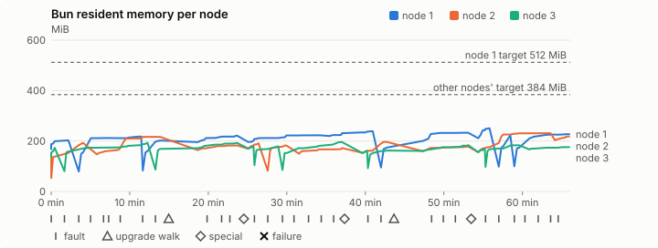
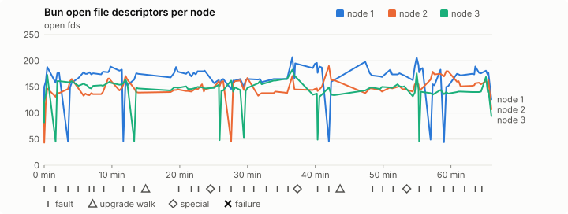
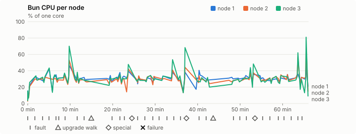
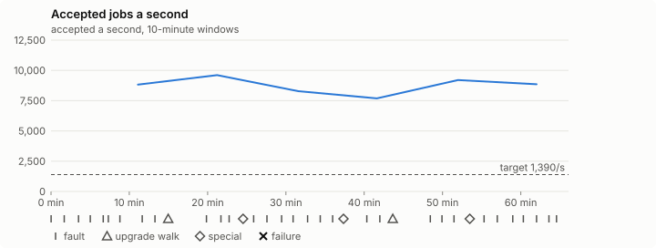

# Sustained soak (V02): PASS

27 November 2026. fast tier, compressed schedule, 1 h 06 min of soak on a three-node quickstart cluster.

**Fast tier: clean.** The iteration loop only, not acceptance: the V02 gate needs a clean final-tier run (8 h, full schedule) on the final candidate.

## Candidate and host

| | |
|---|---|
| Staged base URL | <https://github.com/reliaburger/reliaburger/releases/download/nightly-v0.3.3-45869980780-1> |
| `candidate.json` SHA-256 | `758b7c0dc2bcfccae8752a582603d43d0e1ff78f7e40cbf8a4870a4c17f7203f` |
| Running versions | v0.3.3 x3 |
| Soak build | `bun-v0.3.3-soak.1`, SHA-256 `4c31bb63ca74f9ebe83fd63b5ba20f9cfb8604133d53a9b30fbb9aa38e2b1b6f` |
| Walks roll back to | 0.3.3 |
| Host | macOS 27.2, Apple M5 Max, 128 GiB |
| Lima | limactl version 2.2.1 |
| Guest | Ubuntu 26.04.1 LTS, kernel 7.0.0-34-generic |
| RELIABURGER_HOME | `/tmp/rbq.DksdHI` |
| Evidence | `/Users/miko/github/rb-wt/gate-033/qual/ev-jobs-fast` |

## Configuration deviations

- Ubuntu's apt-daily and apt-daily-upgrade timers stopped and disabled in each guest, so unattended upgrades can't restart Bun during the soak (#1417)
- node.toml `[testing] allowed_operations` adds `provision_isolated_workloads` (quickstart allows only inject_workload_faults and alter_node_state), so the catalogue pulse can lease test namespaces
- node.toml `[logs]`/`[metrics]` export to file:///var/lib/reliaburger/soak-export every 60 s with max_storage_mb = 8 (the harness deletes a metrics export 30 minutes after its source has gone), `[storage.snapshots]` every 900 s (compressed: 120 s), retain 4, uploaded to the same directory
- node.toml `[ingress] tls_cert/tls_key` point at an operator pair from a soak CA, 45-minute leaves rotated by the harness
- Bun runs with auto/mixed; host jobs opt in to a single pinned BusyBox copy under /var/lib/reliaburger/soak-jobs, mount_isolation=false. The independent verifier listens on each private VM address, TCP 8189, with a separate run token
- node.toml `[node.labels] soak-volume` = "writer" on node 2 and "redis" on node 3, to pin the volume apps
- node.toml `[upgrades] external_signing_key` = a throwaway operator key the harness made for this run (`ed25519:Ueq74VwDmrTDnulCy8PuVtSRDqPluPgYEefBoHJdzcE=`); the soak build's `.sig` gets that key's external signature beside the release one (D2)
- node.toml `[security] leaf_lifetime_override_secs = 3600` (D1)
- apt-daily, apt-daily-upgrade and unattended-upgrades verified inactive on every node before the baseline, after waiting 1 s for any upgrade in progress (snapshots/upgrades-verified-N.txt)

## Timeline

- Started 2026-11-27 01:31:58 UTC, finished 2026-11-27 02:38:04 UTC
- Cycles completed: 5
- Fault and node choices: 27, from seed 801303033 (`--seed 801303033` repeats them)
- Teardown: `relish local destroy --yes` and `relish uninstall --yes` succeeded

## Faults and slots

| Class | Runs | Settled/ok | Failed | Skipped | Settle (median / max) |
|---|---|---|---|---|---|
| fault:bun-kill-follower | 5 | 5 | 0 | 0 | 37 s / 46 s |
| fault:bun-kill-leader | 5 | 5 | 0 | 0 | 40 s / 52 s |
| fault:chaos-cpu | 1 | 2 | 0 | 0 | 24 s / 24 s |
| fault:chaos-delay | 1 | 2 | 0 | 0 | 23 s / 23 s |
| fault:chaos-dns | 1 | 2 | 0 | 0 | 22 s / 22 s |
| fault:chaos-drop | 1 | 2 | 0 | 0 | 29 s / 29 s |
| fault:chaos-kill | 2 | 4 | 0 | 0 | 57 s / 57 s |
| fault:chaos-memory | 1 | 2 | 0 | 0 | 29 s / 29 s |
| fault:chaos-partition | 1 | 2 | 0 | 0 | 23 s / 23 s |
| fault:chaos-pause | 1 | 2 | 0 | 0 | 32 s / 32 s |
| fault:chaos-scenario | 1 | 2 | 0 | 0 | 62 s / 62 s |
| fault:deploy-kill | 3 | 3 | 0 | 0 | 39 s / 44 s |
| fault:node-delay | 2 | 2 | 0 | 0 | 59 s / 59 s |
| fault:node-disk-full | 2 | 2 | 0 | 0 | 24 s / 24 s |
| fault:node-slow-fsync | 1 | 1 | 0 | 0 | 24 s / 24 s |
| fault:power-off | 3 | 3 | 0 | 0 | 38 s / 38 s |
| pulse | 1 | 1 | 0 | 0 | n/a |
| pulse:settle | 0 | 1 | 0 | 0 | 29 s / 29 s |
| special:all-off | 1 | 1 | 0 | 0 | 55 s / 55 s |
| special:graceful-stop | 1 | 1 | 0 | 0 | 47 s / 47 s |
| special:quorum-back | 1 | 1 | 0 | 0 | n/a |
| special:quorum-loss | 1 | 1 | 0 | 0 | 41 s / 41 s |
| storage:offline-export | 2 | 2 | 0 | 0 | n/a |
| storage:registry-push | 5 | 0 | 0 | 0 | n/a |
| tls:invalid-expired | 3 | 3 | 0 | 0 | n/a |
| tls:invalid-torn | 3 | 3 | 0 | 0 | n/a |
| tls:reload | 32 | 32 | 0 | 0 | n/a |
| upgrade:rollback | 2 | 2 | 0 | 0 | n/a |
| upgrade:settle | 0 | 2 | 0 | 0 | 71 s / 71 s |
| upgrade:upgrade | 2 | 2 | 0 | 0 | n/a |

## Execution inventory (recorded, not gated)

What the run completed, from its events and kept bytes, against what its schedule owes. A fault counts once it was injected and the cluster settled after it.

| Item | Required | Completed | Verdict |
|---|---|---|---|
| candidate.json bytes match the qualified digest | 1 | 1 | ok |
| app workloads settled at the baseline | 1 | 1 | ok |
| upgrade walk (to the soak build and back) | 2 | 2 | ok |
| fault:bun-kill-follower | 1 | 5 | ok |
| fault:bun-kill-leader | 1 | 5 | ok |
| fault:deploy-kill | 1 | 3 | ok |
| fault:power-off | 1 | 3 | ok |
| fault:chaos-kill | 1 | 2 | ok |
| fault:chaos-delay | 1 | 1 | ok |
| fault:chaos-partition | 1 | 1 | ok |
| fault:chaos-scenario | 1 | 1 | ok |
| fault:chaos-pause | 1 | 1 | ok |
| fault:chaos-drop | 1 | 1 | ok |
| fault:chaos-dns | 1 | 1 | ok |
| fault:chaos-cpu | 1 | 1 | ok |
| fault:node-delay | 1 | 2 | ok |
| fault:node-disk-full | 1 | 2 | ok |
| fault:node-slow-fsync | 1 | 1 | ok |
| special:graceful-stop | 1 | 1 | ok |
| special:quorum-loss | 1 | 1 | ok |
| special:all-off | 1 | 1 | ok |
| catalogue pulse | 1 | 1 | ok |
| offline export | 2 | 2 | ok |
| job campaign drained in its final two minutes | 1 | 1 | ok |

## Observed fault effects

What each injected fault was seen to do, read back from the node.

| Fault | Target | Observed |
|---|---|---|
| effect:bun-kill-follower | rb-b647d0fbc27e-2 | MainPID 3566 -> 6538 |
| effect:bun-kill-leader | rb-b647d0fbc27e-3 | MainPID 3303 -> 299714 |
| effect:deploy-kill | rb-b647d0fbc27e-1 | MainPID 10248 -> 658042 |
| effect:power-off | rb-b647d0fbc27e-2 | Lima status Stopped |
| effect:node-delay | rb-b647d0fbc27e-1 | netem 8001: root refcnt 2 limit 1000 delay 200ms  50ms seed 12556996919386598447  |
| effect:bun-kill-follower | rb-b647d0fbc27e-1 | MainPID 658042 -> 2390727 |
| effect:bun-kill-leader | rb-b647d0fbc27e-3 | MainPID 299714 -> 3019715 |
| effect:node-disk-full | rb-b647d0fbc27e-2 | available 67063808 bytes  |
| effect:bun-kill-follower | rb-b647d0fbc27e-3 | MainPID 1035 -> 215095 |
| effect:bun-kill-leader | rb-b647d0fbc27e-2 | MainPID 1031 -> 578570 |
| effect:deploy-kill | rb-b647d0fbc27e-3 | MainPID 215095 -> 975984 |
| effect:power-off | rb-b647d0fbc27e-2 | Lima status Stopped |
| effect:node-slow-fsync | rb-b647d0fbc27e-3 | IOWriteBandwidthMax=/dev/vda 1000000 IOWriteIOPSMax=/dev/vda 20  |
| effect:bun-kill-follower | rb-b647d0fbc27e-3 | MainPID 1040 -> 231680 |
| effect:bun-kill-leader | rb-b647d0fbc27e-1 | MainPID 1037 -> 3407940 |
| effect:node-delay | rb-b647d0fbc27e-2 | netem 8001: root refcnt 2 limit 1000 delay 200ms  50ms seed 18304809285963898375  |
| effect:bun-kill-follower | rb-b647d0fbc27e-3 | MainPID 1036 -> 269061 |
| effect:bun-kill-leader | rb-b647d0fbc27e-1 | MainPID 1041 -> 624224 |
| effect:deploy-kill | rb-b647d0fbc27e-1 | MainPID 624224 -> 1047276 |
| effect:power-off | rb-b647d0fbc27e-3 | Lima status Stopped |
| effect:node-disk-full | rb-b647d0fbc27e-3 | available 67063808 bytes  |

## Renewals and rotations

| Measure | Observed | Required | Verdict |
|---|---|---|---|
| workload identity rotations (soak-identity, per node) | 8 | ≥ 1 | PASS |
| node leaf renewals (per node) | 2 | ≥ 1 | PASS |
| operator ingress reloads (all nodes) | 32 | ≥ 12 | PASS |
| mixed job campaign and positive drain | 0 missing/failing checks | 0 | PASS |

## Latency SLOs

What a user should feel on a quiet three-node cluster (#1400). Every sample is taken outside fault windows and through a host forward that works; each p99 is the upper bound of its histogram bucket.

| SLO | p99 | Threshold | Samples | Mode | Verdict |
|---|---|---|---|---|---|
| API read p99 | 200 ms | ≤ 3,000 ms | 204 | gated | PASS |
| API write p99 | 300 ms | ≤ 3,000 ms | 7 | gated | PASS |
| App start p99 | 10,000 ms | ≤ 30,000 ms | 21 | gated | PASS |
| Rolling update p99 | 50,000 ms | ≤ 100,000 ms | 7 | gated | PASS |
| Job task start p99 | 2,048 ms | ≤ 256 ms | 20 | record only | too few samples |

- API read p99: `GET /v1/status?cluster=true` and `GET /v1/cluster/nodes` on every node, at every light check
- API write p99: `relish apply` of the soak workloads, from the call to the commit
- App start p99: each node's deploy of a new `soak-slo` instance, from its start until the instance passes its health check
- Rolling update p99: from `relish apply` returning to every node's `soak-slo` running the new spec
- Job task start p99: a job task's start lag on a pooled executor, from the job campaign's buckets, in runs no fault window overlapped
- Job task start p99 not judged: only 20 job task start samples, fewer than the 1,000 a p99 needs

## Jobs

| Runtime | Accepted successes | Retries | Last accepted progress |
|---|---|---|---|
| runc | 6479 | 1 | 1795747074 |
| shared-runc | 4595393 | 1 | 1795747074 |
| process | 30198126 | 1 | 1795747074 |

The bounded campaign shares the app soak's fault schedule. These counts are reliability evidence, not a saturation rate or a 100-million-per-day qualification.

- Independent verifier execution attempts: 24
- Explicit test-operator acknowledgements for known replay-safe fenced fixtures: 105

- rb-b647d0fbc27e-1: latest complete job storage (KiB) {'instances': 2656, 'job-state': 8, 'task-arrays': 12112}; free 4478820 KiB; live/peak owners 0/29; peak storage {'instances': 21992, 'job-state': 8, 'task-arrays': 42540}
- rb-b647d0fbc27e-2: latest complete job storage (KiB) {'instances': 860, 'job-state': 8, 'task-arrays': 12324}; free 5608280 KiB; live/peak owners 0/29; peak storage {'instances': 21808, 'job-state': 8, 'task-arrays': 44828}
- rb-b647d0fbc27e-3: latest complete job storage (KiB) {'instances': 420, 'job-state': 8, 'task-arrays': 10976}; free 5605684 KiB; live/peak owners 0/29; peak storage {'instances': 22408, 'job-state': 8, 'task-arrays': 46164}

Instance storage limit: 64 MiB per node (data/instances, allocated, outside fault windows; #1418).

Complete disk inventories are recorded. Global retention bounds and the 12-hour job qualification remain #668; this gate cannot certify an unimplemented retention policy.

## Job qualification (D18-C)

Load: target; 3 nodes; accepted 8,781.2/s against a 1390.0/s target: PASS.

The September plan set its targets for one 1M-task batch on a quiet cluster. A soak runs for hours with restarts, upgrades and apps, so its storage, Bun memory and Raft targets are restated (maintainer decision, 15 October 2026, [#668](https://github.com/reliaburger/reliaburger/issues/668)). Bun's steady state is the median RSS of each process once it has been seen for 10 minutes; the gated memory checks are unchanged (`leak-rss`, and Mayo's 70% `memory_high` alert through `wtf`).

| Measure (recorded, not gated) | Observed | Target |
|---|---|---|
| Wall time of a 1,048,576-task array (median / max of 45) | 124 s / 922 s | ≤ 600 s |
| p99 start lag, pooled executors | 64 ms (bucket upper bound) | < 1,000 ms |
| Raft entries per second, all cluster writes | 5.26 | recorded only; the batch target counts only task-array writes |
| Raft state of one run, largest seen | 8,340 B | ≤ 256 KiB per 1M tasks |
| Bun steady-state RSS per process, worst node against its target | rb-b647d0fbc27e-2: 213.20 MiB steady, 230.84 MiB peak | ≤ 384 MiB (≤ 512 MiB on node 1, which serves the API) |
| Bun CPU, busiest node | 0.30 cores | ≤ 1 core (leader batch control) |
| Executor helper CPU, busiest node | 0.08 cores | ≤ 0.5 core |
| Node task-array storage per 1M accepted tasks (peaks summed) | 3.75 MiB | ≤ 64 MiB, deleted after retirement |
| Retained log volume, all nodes | 5.47 MB | ≤ 50 MB |

- Bun RSS on rb-b647d0fbc27e-1 (serves the API, target ≤ 512 MiB): pid 10248: 202.58 MiB peak (seen for under 10 minutes); pid 658042: 217.44 MiB peak (seen for under 10 minutes); pid 2390727: 202.00 MiB peak (seen for under 10 minutes); pid 2390727: 221.08 MiB peak (seen for under 10 minutes); pid 1037: 233.65 MiB steady, 238.43 MiB peak; pid 3407940: 174.35 MiB peak (seen for under 10 minutes); pid 3407940: 232.86 MiB peak (seen for under 10 minutes); pid 1041: 251.00 MiB peak (seen for under 10 minutes); pid 624224: 222.77 MiB peak (seen for under 10 minutes); pid 1047276: 227.00 MiB peak (seen for under 10 minutes)
- Bun RSS on rb-b647d0fbc27e-2 (node, target ≤ 384 MiB): pid 3566: 137.18 MiB peak (seen for under 10 minutes); pid 6538: 192.74 MiB peak (seen for under 10 minutes); pid 1037: 216.51 MiB peak (seen for under 10 minutes); pid 1037: 182.44 MiB peak (seen for under 10 minutes); pid 1031: 190.79 MiB peak (seen for under 10 minutes); pid 578570: 182.04 MiB peak (seen for under 10 minutes); pid 1052: 172.08 MiB peak (seen for under 10 minutes); pid 1053: 196.22 MiB peak (seen for under 10 minutes); pid 1053: 177.87 MiB peak (seen for under 10 minutes); pid 1042: 213.20 MiB steady, 230.84 MiB peak
- Bun RSS on rb-b647d0fbc27e-3 (node, target ≤ 384 MiB): pid 3303: 172.74 MiB peak (seen for under 10 minutes); pid 299714: 190.98 MiB steady, 193.37 MiB peak; pid 3019715: 168.86 MiB peak (seen for under 10 minutes); pid 3582981: 192.23 MiB peak (seen for under 10 minutes); pid 1035: 178.98 MiB peak (seen for under 10 minutes); pid 215095: 178.66 MiB peak (seen for under 10 minutes); pid 975984: 195.89 MiB peak (seen for under 10 minutes); pid 1040: 161.26 MiB peak (seen for under 10 minutes); pid 231680: 162.20 MiB peak (seen for under 10 minutes); pid 1064: 183.57 MiB peak (seen for under 10 minutes); pid 1036: 170.02 MiB peak (seen for under 10 minutes); pid 269061: 183.38 MiB peak (seen for under 10 minutes); pid 1049: 175.89 MiB peak (seen for under 10 minutes)

- runc retry causes: exit_code 1, launch 0, signal 0, timeout 0, unknown 0, unrecorded 0
- shared-runc retry causes: exit_code 1, launch 0, signal 0, timeout 0, unknown 0, unrecorded 0
- process retry causes: exit_code 1, launch 0, signal 0, timeout 0, unknown 0, unrecorded 0
- Audited executions: 24; operator replay decisions: 105
- Chunks checked for exactly-once completion: 304, 3 of them re-granted (#1415)
- Job controller API fallbacks: rb-b647d0fbc27e-1 missed 167, rb-b647d0fbc27e-2 missed 11; rb-b647d0fbc27e-2 answered 156, rb-b647d0fbc27e-3 answered 11 (requests a node didn't answer, and the node that took them instead)

## Data

- Volume writer: highest ACK 21875 in the log view; the writer file checks (writer-lost, writer-regression) decide data loss, and `*-log-order` failures are about the order the log view returned lines in
- Redis counter: highest INCR 2935 in the log view
- Volume writer resumes: 6 starts, each checked against the highest ACK logged before it
- Redis client starts: 13, each checked against the highest INCR logged before it; counter regressions the client saw: 0
- Export rb-b647d0fbc27e-1: 124 source files, 121 at the destination
- Export rb-b647d0fbc27e-2: 134 source files, 131 at the destination
- Export rb-b647d0fbc27e-3: 105 source files, 105 at the destination
- Registry images pushed and re-verified: 6
- Agent-loop turns over the 1 s budget: rb-b647d0fbc27e-1 0, rb-b647d0fbc27e-2 0, rb-b647d0fbc27e-3 0
- Soak policies checked in force: 114 times, policy generation 36 at the last check
- Guest clock steps by Lima's guest agent: rb-b647d0fbc27e-1 2, rb-b647d0fbc27e-2 4, rb-b647d0fbc27e-3 5
- Checks evaluated: 171 (heavy 16, light 57, settle 98)
- Last observed progress: redis-counter 2935, writer-ack 21875

## Council history (linearizability)

Every test-lease grant, renew, read and release the history client made, checked against a model of the council's leases. A write with no answer may or may not have happened; the check allows both.

- Operations checked: 20090 of 20090, in 2 namespaces; 1108 writes had no answer
- Verdict: linearizable

## Leak-checker exposure (recorded, not gated)

How long each leak checker could judge each node's Bun. `leak-rss` arms at its warm sample: 60 minutes into one process in a final, and otherwise at the first heavy check where the log and metrics stores are each 90% full, between 60 minutes and 6 hours in (#1417). `leak-fd` arms after 50 minutes; a restart, kill or upgrade exec starts the warm-up again. A final needs each armed for 60 minutes on every node, with one unbroken window of 30 (#1062); its quiet tail gives them that.

| Node | Checker | Armed | Longest armed window | Evaluated samples | Processes armed | Verdict |
|---|---|---|---|---|---|---|
| rb-b647d0fbc27e-1 | leak-rss | 0 min | 0 min | 0 | 0 | short |
| rb-b647d0fbc27e-1 | leak-fd | 0 min | 0 min | 0 | 0 | short |
| rb-b647d0fbc27e-2 | leak-rss | 0 min | 0 min | 0 | 0 | short |
| rb-b647d0fbc27e-2 | leak-fd | 0 min | 0 min | 0 | 0 | short |
| rb-b647d0fbc27e-3 | leak-rss | 0 min | 0 min | 0 | 0 | short |
| rb-b647d0fbc27e-3 | leak-fd | 0 min | 0 min | 0 | 0 | short |

## Resource trends

| Node | Measure | First | Last | Max |
|---|---|---|---|---|
| rb-b647d0fbc27e-1 | disk_kb data | 1382632 | 1304752 | 1564668 |
| rb-b647d0fbc27e-1 | disk_kb images | 346292 | 472240 | 472240 |
| rb-b647d0fbc27e-1 | disk_kb logs | 40 | 3128 | 3128 |
| rb-b647d0fbc27e-1 | disk_kb metrics | 68 | 4784 | 4784 |
| rb-b647d0fbc27e-1 | disk_kb soak-export | 4 | 7684 | 7684 |
| rb-b647d0fbc27e-1 | disk_kb volumes | 284 | 260 | 344 |
| rb-b647d0fbc27e-1 | fd | 110 | 126 | 207 |
| rb-b647d0fbc27e-1 | rss_anon_kb | 94496 | 147732 | 170892 |
| rb-b647d0fbc27e-1 | rss_file_kb | 77288 | 84716 | 87024 |
| rb-b647d0fbc27e-1 | rss_kb | 171784 | 232448 | 257020 |
| rb-b647d0fbc27e-2 | disk_kb data | 71764 | 276792 | 441976 |
| rb-b647d0fbc27e-2 | disk_kb images | 179196 | 346324 | 346324 |
| rb-b647d0fbc27e-2 | disk_kb logs | 24 | 1052 | 1052 |
| rb-b647d0fbc27e-2 | disk_kb metrics | 56 | 3216 | 3216 |
| rb-b647d0fbc27e-2 | disk_kb soak-export | 4 | 4144 | 4144 |
| rb-b647d0fbc27e-2 | disk_kb volumes | 16912 | 17368 | 17368 |
| rb-b647d0fbc27e-2 | fd | 75 | 107 | 190 |
| rb-b647d0fbc27e-2 | rss_anon_kb | 51828 | 137244 | 150060 |
| rb-b647d0fbc27e-2 | rss_file_kb | 75944 | 86384 | 87532 |
| rb-b647d0fbc27e-2 | rss_kb | 127772 | 223628 | 236380 |
| rb-b647d0fbc27e-3 | disk_kb data | 234516 | 210456 | 826788 |
| rb-b647d0fbc27e-3 | disk_kb images | 339124 | 339268 | 339268 |
| rb-b647d0fbc27e-3 | disk_kb logs | 24 | 1160 | 1160 |
| rb-b647d0fbc27e-3 | disk_kb metrics | 28 | 3180 | 3180 |
| rb-b647d0fbc27e-3 | disk_kb soak-export | 4 | 5480 | 5480 |
| rb-b647d0fbc27e-3 | disk_kb volumes | 16924 | 17172 | 17344 |
| rb-b647d0fbc27e-3 | fd | 82 | 94 | 183 |
| rb-b647d0fbc27e-3 | rss_anon_kb | 62680 | 94496 | 119428 |
| rb-b647d0fbc27e-3 | rss_file_kb | 76912 | 85616 | 86768 |
| rb-b647d0fbc27e-3 | rss_kb | 139592 | 180112 | 200596 |

## Bun memory by kind

From each node's `/proc/PID/smaps` at the settle and heavy checks (`memory.jsonl`, #1417). Sizes in MiB; arenas are glibc thread arenas, with the number of 64 MiB arena heaps in brackets. Time is h:mm since the node's first sample.

### rb-b647d0fbc27e-1

| Time | Pid | RSS | Heap | Arenas | Stacks | Other anonymous | File | Threads |
|---|---|---|---|---|---|---|---|---|
| 0:00 | 10248 | 167.8 | 47.9 | 0.0 (0) | 1.5 | 39.1 | 79.2 | 51 |
| 1:00 | 1047276 | 173.4 | 47.2 | 0.0 (0) | 1.2 | 41.2 | 83.8 | 59 |
| 1:06 | 1047276 | 227.0 | 69.2 | 4.0 (1) | 1.2 | 66.0 | 86.5 | 59 |

- rb-b647d0fbc27e-1: not enough data: the last Bun process (pid 1047276) has no samples after its first hour.
- rb-b647d0fbc27e-1: no 6-hour RSS slope: the last Bun process (pid 1047276) ran for 0:06 h:mm.

### rb-b647d0fbc27e-2

| Time | Pid | RSS | Heap | Arenas | Stacks | Other anonymous | File | Threads |
|---|---|---|---|---|---|---|---|---|
| 0:00 | 3566 | 124.8 | 33.0 | 0.0 (0) | 0.9 | 12.9 | 77.9 | 29 |
| 1:00 | 1042 | 230.6 | 75.4 | 0.0 (0) | 3.4 | 64.0 | 87.9 | 58 |
| 1:06 | 1042 | 218.4 | 68.4 | 0.0 (0) | 3.5 | 58.4 | 88.1 | 61 |

- rb-b647d0fbc27e-2: not enough data: the last Bun process (pid 1042) has no samples after its first hour.
- rb-b647d0fbc27e-2: no 6-hour RSS slope: the last Bun process (pid 1042) ran for 0:11 h:mm.

### rb-b647d0fbc27e-3

| Time | Pid | RSS | Heap | Arenas | Stacks | Other anonymous | File | Threads |
|---|---|---|---|---|---|---|---|---|
| 0:00 | 3303 | 136.3 | 28.6 | 0.0 (0) | 2.3 | 26.5 | 78.9 | 37 |
| 1:00 | 269061 | 183.4 | 56.2 | 0.0 (0) | 3.8 | 36.7 | 86.7 | 78 |
| 1:06 | 1049 | 175.9 | 45.9 | 0.0 (0) | 2.0 | 40.7 | 87.4 | 57 |

- rb-b647d0fbc27e-3: not enough data: the last Bun process (pid 1049) has no samples after its first hour.
- rb-b647d0fbc27e-3: no 6-hour RSS slope: the last Bun process (pid 1049) ran for 0:05 h:mm.

### Log stores against RSS

Each node's `disk logs` and `disk metrics` and the Parquet files in its log store, from the same samples. RSS in MiB.

| Node | Time | RSS | Logs (KiB) | Log files | Metrics (KiB) |
|---|---|---|---|---|---|
| rb-b647d0fbc27e-1 | 0:00 | 167.8 | 40 | 4 | 68 |
| rb-b647d0fbc27e-1 | 1:00 | 173.4 | 2,632 | 51 | 4,220 |
| rb-b647d0fbc27e-1 | 1:06 | 227.0 | 3,128 | 57 | 4,784 |
| rb-b647d0fbc27e-2 | 0:00 | 124.8 | 24 | 3 | 56 |
| rb-b647d0fbc27e-2 | 1:00 | 230.6 | 996 | 64 | 2,764 |
| rb-b647d0fbc27e-2 | 1:06 | 218.4 | 1,052 | 71 | 3,216 |
| rb-b647d0fbc27e-3 | 0:00 | 136.3 | 24 | 3 | 28 |
| rb-b647d0fbc27e-3 | 1:00 | 183.4 | 1,148 | 44 | 2,940 |
| rb-b647d0fbc27e-3 | 1:06 | 175.9 | 1,160 | 46 | 3,180 |

## Agent loop stalls

From the stall watchdog's journal blocks (`loop-stalls.jsonl`, #1707). Each snapshot lists every Bun thread; here are the stall line, threads in uninterruptible sleep and the thread that ran the loop.

- None recorded.

## Charts

Time runs from the start of the soak. The marks under each chart are its faults, upgrade walks, specials and recorded failures; the dashed lines are targets.

## Failures

None.

## Notes

- Unattended upgrades were off on every guest 0 s after they were asked to stop (snapshots/upgrades-stopped-N.txt)

Evidence: `/Users/miko/github/rb-wt/gate-033/qual/ev-jobs-fast` (events.jsonl, snapshots/, failures/<n>/).
