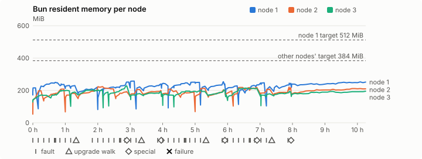
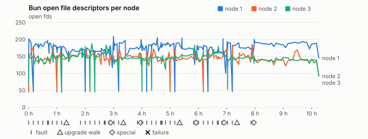
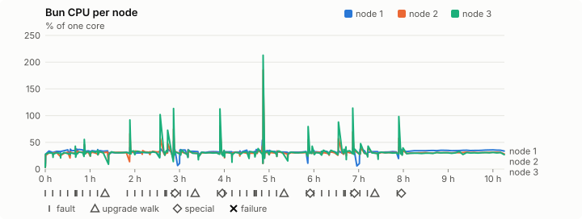
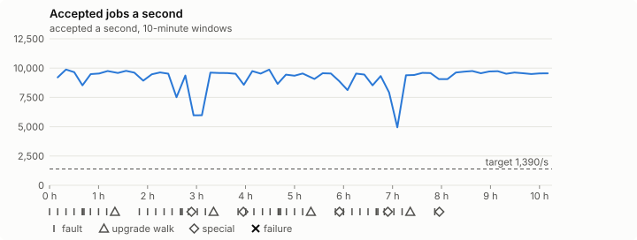

# Sustained soak (V02): PASS

27 November 2026. final tier, full schedule, 10 h 15 min of soak on a three-node quickstart cluster.

**Final job tier: clean. The release gate's final soak passes** for the candidate whose `candidate.json` has SHA-256 `758b7c0dc2bcfccae8752a582603d43d0e1ff78f7e40cbf8a4870a4c17f7203f`, if it is the final candidate.

## Candidate and host

| | |
|---|---|
| Staged base URL | <https://github.com/reliaburger/reliaburger/releases/download/nightly-v0.3.3-45869980780-1> |
| `candidate.json` SHA-256 | `758b7c0dc2bcfccae8752a582603d43d0e1ff78f7e40cbf8a4870a4c17f7203f` |
| Running versions | v0.3.3 x3 |
| Soak build | `bun-v0.3.3-soak.1`, SHA-256 `4c31bb63ca74f9ebe83fd63b5ba20f9cfb8604133d53a9b30fbb9aa38e2b1b6f` |
| Walks roll back to | 0.3.3 |
| Host | macOS 27.2, Apple M5 Max, 128 GiB |
| Lima | limactl version 2.2.1 |
| Guest | Ubuntu 26.04.1 LTS, kernel 7.0.0-34-generic |
| RELIABURGER_HOME | `/tmp/rbq.lU4g6C` |
| Evidence | `/Users/miko/github/rb-wt/gate-033/qual/ev-jobs-final` |

## Configuration deviations

- Ubuntu's apt-daily and apt-daily-upgrade timers stopped and disabled in each guest, so unattended upgrades can't restart Bun during the soak (#1417)
- node.toml `[testing] allowed_operations` adds `provision_isolated_workloads` (quickstart allows only inject_workload_faults and alter_node_state), so the catalogue pulse can lease test namespaces
- node.toml `[logs]`/`[metrics]` export to file:///var/lib/reliaburger/soak-export every 60 s with max_storage_mb = 8 (the harness deletes a metrics export 30 minutes after its source has gone), `[storage.snapshots]` every 900 s (compressed: 120 s), retain 4, uploaded to the same directory
- node.toml `[ingress] tls_cert/tls_key` point at an operator pair from a soak CA, 45-minute leaves rotated by the harness
- Bun runs with auto/mixed; host jobs opt in to a single pinned BusyBox copy under /var/lib/reliaburger/soak-jobs, mount_isolation=false. The independent verifier listens on each private VM address, TCP 8189, with a separate run token
- node.toml `[node.labels] soak-volume` = "writer" on node 2 and "redis" on node 3, to pin the volume apps
- node.toml `[upgrades] external_signing_key` = a throwaway operator key the harness made for this run (`ed25519:UyAF8u1jnOyGnimwTUoRVVcsbn3WjT9D/nzkAcq+mF4=`); the soak build's `.sig` gets that key's external signature beside the release one (D2)
- node.toml `[security] leaf_lifetime_override_secs = 3600` (D1)
- apt-daily, apt-daily-upgrade and unattended-upgrades verified inactive on every node before the baseline, after waiting 1 s for any upgrade in progress (snapshots/upgrades-verified-N.txt)

## Timeline

- Started 2026-11-27 02:41:55 UTC, finished 2026-11-27 12:57:18 UTC
- Cycles completed: 8
- Fault and node choices: 35, from seed 170461452 (`--seed 170461452` repeats them)
- Teardown: `relish local destroy --yes` and `relish uninstall --yes` succeeded

## Faults and slots

| Class | Runs | Settled/ok | Failed | Skipped | Settle (median / max) |
|---|---|---|---|---|---|
| fault:bun-kill-follower | 8 | 8 | 0 | 0 | 40 s / 49 s |
| fault:bun-kill-leader | 8 | 8 | 0 | 0 | 43 s / 45 s |
| fault:chaos-cpu | 1 | 2 | 0 | 0 | 24 s / 24 s |
| fault:chaos-delay | 2 | 4 | 0 | 0 | 22 s / 22 s |
| fault:chaos-dns | 1 | 2 | 0 | 0 | 22 s / 22 s |
| fault:chaos-drop | 1 | 2 | 0 | 0 | 23 s / 23 s |
| fault:chaos-kill | 2 | 4 | 0 | 0 | 48 s / 48 s |
| fault:chaos-memory | 1 | 2 | 0 | 0 | 21 s / 21 s |
| fault:chaos-partition | 2 | 4 | 0 | 0 | 26 s / 26 s |
| fault:chaos-pause | 1 | 2 | 0 | 0 | 21 s / 21 s |
| fault:chaos-scenario | 1 | 2 | 0 | 0 | 39 s / 39 s |
| fault:deploy-kill | 4 | 4 | 0 | 0 | 43 s / 44 s |
| fault:node-delay | 3 | 3 | 0 | 0 | 23 s / 39 s |
| fault:node-disk-full | 3 | 3 | 0 | 0 | 24 s / 52 s |
| fault:node-slow-fsync | 2 | 2 | 0 | 0 | 24 s / 24 s |
| fault:power-off | 4 | 4 | 0 | 0 | 42 s / 44 s |
| pulse | 8 | 8 | 0 | 0 | n/a |
| pulse:settle | 0 | 8 | 0 | 0 | 22 s / 24 s |
| special:all-off | 1 | 1 | 0 | 0 | 55 s / 55 s |
| special:graceful-stop | 2 | 2 | 0 | 0 | 55 s / 55 s |
| special:quorum-back | 2 | 2 | 0 | 0 | n/a |
| special:quorum-loss | 2 | 2 | 0 | 0 | 53 s / 53 s |
| storage:offline-export | 1 | 1 | 0 | 0 | n/a |
| storage:registry-push | 8 | 0 | 0 | 0 | n/a |
| tls:invalid-expired | 15 | 15 | 0 | 0 | n/a |
| tls:invalid-torn | 15 | 15 | 0 | 0 | n/a |
| tls:reload | 117 | 117 | 0 | 0 | n/a |
| upgrade:rollback | 4 | 4 | 0 | 0 | n/a |
| upgrade:settle | 0 | 4 | 0 | 0 | 66 s / 83 s |
| upgrade:upgrade | 4 | 4 | 0 | 0 | n/a |

## Execution inventory (gated)

What the run completed, from its events and kept bytes, against what its schedule owes. A fault counts once it was injected and the cluster settled after it.

| Item | Required | Completed | Verdict |
|---|---|---|---|
| candidate.json bytes match the qualified digest | 1 | 1 | ok |
| app workloads settled at the baseline | 1 | 1 | ok |
| upgrade walk (to the soak build and back) | 4 | 4 | ok |
| fault:bun-kill-follower | 1 | 8 | ok |
| fault:bun-kill-leader | 1 | 8 | ok |
| fault:deploy-kill | 1 | 4 | ok |
| fault:power-off | 1 | 4 | ok |
| fault:chaos-kill | 1 | 2 | ok |
| fault:chaos-delay | 1 | 2 | ok |
| fault:chaos-partition | 1 | 2 | ok |
| fault:chaos-scenario | 1 | 1 | ok |
| fault:chaos-pause | 1 | 1 | ok |
| fault:chaos-drop | 1 | 1 | ok |
| fault:chaos-dns | 1 | 1 | ok |
| fault:chaos-cpu | 1 | 1 | ok |
| fault:chaos-memory | 1 | 1 | ok |
| fault:node-delay | 1 | 3 | ok |
| fault:node-disk-full | 1 | 3 | ok |
| fault:node-slow-fsync | 1 | 2 | ok |
| special:graceful-stop | 2 | 2 | ok |
| special:quorum-loss | 2 | 2 | ok |
| special:all-off | 1 | 1 | ok |
| catalogue pulse | 8 | 8 | ok |
| offline export | 1 | 1 | ok |
| quiet tail with no faults, walks or specials | 1 | 1 | ok |
| job campaign drained in its final two minutes | 1 | 1 | ok |

## Observed fault effects

What each injected fault was seen to do, read back from the node.

| Fault | Target | Observed |
|---|---|---|
| effect:bun-kill-follower | rb-6be6f5b769fb-2 | MainPID 3558 -> 6645 |
| effect:bun-kill-leader | rb-6be6f5b769fb-1 | MainPID 10293 -> 2063418 |
| effect:deploy-kill | rb-6be6f5b769fb-2 | MainPID 6645 -> 419272 |
| effect:power-off | rb-6be6f5b769fb-3 | Lima status Stopped |
| effect:node-delay | rb-6be6f5b769fb-1 | netem 8001: root refcnt 2 limit 1000 delay 200ms  50ms seed 2756989358262713298  |
| effect:bun-kill-follower | rb-6be6f5b769fb-2 | MainPID 419272 -> 1171264 |
| effect:bun-kill-leader | rb-6be6f5b769fb-3 | MainPID 1050 -> 195039 |
| effect:node-disk-full | rb-6be6f5b769fb-2 | available 67096576 bytes  |
| effect:bun-kill-follower | rb-6be6f5b769fb-1 | MainPID 2063418 -> 1007149 |
| effect:bun-kill-leader | rb-6be6f5b769fb-3 | MainPID 2604944 -> 1121865 |
| effect:deploy-kill | rb-6be6f5b769fb-3 | MainPID 1121865 -> 3440978 |
| effect:power-off | rb-6be6f5b769fb-2 | Lima status Stopped |
| effect:node-slow-fsync | rb-6be6f5b769fb-3 | IOWriteBandwidthMax=/dev/vda 1000000 IOWriteIOPSMax=/dev/vda 20  |
| effect:bun-kill-follower | rb-6be6f5b769fb-3 | MainPID 1043 -> 226611 |
| effect:bun-kill-leader | rb-6be6f5b769fb-1 | MainPID 1007149 -> 2163615 |
| effect:node-delay | rb-6be6f5b769fb-2 | netem 8001: root refcnt 2 limit 1000 delay 200ms  50ms seed 12787869706407347220  |
| effect:bun-kill-follower | rb-6be6f5b769fb-3 | MainPID 1044 -> 562849 |
| effect:bun-kill-leader | rb-6be6f5b769fb-1 | MainPID 1029 -> 2834192 |
| effect:deploy-kill | rb-6be6f5b769fb-3 | MainPID 562849 -> 1022352 |
| effect:power-off | rb-6be6f5b769fb-2 | Lima status Stopped |
| effect:node-disk-full | rb-6be6f5b769fb-3 | available 69361664 bytes  |
| effect:bun-kill-follower | rb-6be6f5b769fb-2 | MainPID 1041 -> 2040845 |
| effect:bun-kill-leader | rb-6be6f5b769fb-1 | MainPID 2834192 -> 3516974 |
| effect:node-slow-fsync | rb-6be6f5b769fb-1 | IOWriteBandwidthMax=/dev/vda 1000000 IOWriteIOPSMax=/dev/vda 20  |
| effect:bun-kill-follower | rb-6be6f5b769fb-3 | MainPID 1040 -> 838634 |
| effect:bun-kill-leader | rb-6be6f5b769fb-2 | MainPID 1030 -> 3146650 |
| effect:deploy-kill | rb-6be6f5b769fb-1 | MainPID 1036 -> 859675 |
| effect:power-off | rb-6be6f5b769fb-1 | Lima status Stopped |
| effect:node-delay | rb-6be6f5b769fb-3 | netem 8001: root refcnt 2 limit 1000 delay 200ms  50ms seed 3745330313451158660  |
| effect:bun-kill-follower | rb-6be6f5b769fb-3 | MainPID 1041 -> 192592 |
| effect:bun-kill-leader | rb-6be6f5b769fb-1 | MainPID 1041 -> 3089071 |
| effect:node-disk-full | rb-6be6f5b769fb-1 | available 67072000 bytes  |

## Renewals and rotations

| Measure | Observed | Required | Verdict |
|---|---|---|---|
| workload identity rotations (soak-identity, per node) | 23 | ≥ 19 | PASS |
| node leaf renewals (per node) | 22 | ≥ 19 | PASS |
| operator ingress reloads (all nodes) | 117 | ≥ 40 | PASS |
| mixed job campaign and positive drain | 0 missing/failing checks | 0 | PASS |

## Latency SLOs

What a user should feel on a quiet three-node cluster (#1400). Every sample is taken outside fault windows and through a host forward that works; each p99 is the upper bound of its histogram bucket.

| SLO | p99 | Threshold | Samples | Mode | Verdict |
|---|---|---|---|---|---|
| API read p99 | 200 ms | ≤ 3,000 ms | 5,940 | gated | PASS |
| API write p99 | 1,500 ms | ≤ 3,000 ms | 20 | gated | PASS |
| App start p99 | 10,000 ms | ≤ 30,000 ms | 60 | gated | PASS |
| Rolling update p99 | 50,000 ms | ≤ 100,000 ms | 20 | gated | PASS |
| Job task start p99 | 64 ms | ≤ 256 ms | 218,947,894 | gated | PASS |

- API read p99: `GET /v1/status?cluster=true` and `GET /v1/cluster/nodes` on every node, at every light check
- API write p99: `relish apply` of the soak workloads, from the call to the commit
- App start p99: each node's deploy of a new `soak-slo` instance, from its start until the instance passes its health check
- Rolling update p99: from `relish apply` returning to every node's `soak-slo` running the new spec
- Job task start p99: a job task's start lag on a pooled executor, from the job campaign's buckets, in runs no fault window overlapped

## Jobs

| Runtime | Accepted successes | Retries | Last accepted progress |
|---|---|---|---|
| runc | 62164 | 2 | 1795784219 |
| shared-runc | 45519684 | 1 | 1795784219 |
| process | 292982246 | 1 | 1795784219 |

The bounded campaign shares the app soak's fault schedule. These counts are reliability evidence, not a saturation rate or a 100-million-per-day qualification.

- Independent verifier execution attempts: 24
- Explicit test-operator acknowledgements for known replay-safe fenced fixtures: 191

- rb-6be6f5b769fb-1: latest complete job storage (KiB) {'instances': 3100, 'job-state': 8, 'task-arrays': 15880}; free 4285984 KiB; live/peak owners 0/29; peak storage {'instances': 22480, 'job-state': 8, 'task-arrays': 49372}
- rb-6be6f5b769fb-2: latest complete job storage (KiB) {'instances': 940, 'job-state': 8, 'task-arrays': 16128}; free 5355044 KiB; live/peak owners 0/29; peak storage {'instances': 22128, 'job-state': 8, 'task-arrays': 45548}
- rb-6be6f5b769fb-3: latest complete job storage (KiB) {'instances': 432, 'job-state': 8, 'task-arrays': 16480}; free 5349940 KiB; live/peak owners 0/29; peak storage {'instances': 21660, 'job-state': 8, 'task-arrays': 46848}

Instance storage limit: 64 MiB per node (data/instances, allocated, outside fault windows; #1418).

Complete disk inventories are recorded. Global retention bounds and the 12-hour job qualification remain #668; this gate cannot certify an unimplemented retention policy.

## Job qualification (D18-C)

Load: target; 3 nodes; accepted 9,172.2/s against a 1390.0/s target: PASS.

The September plan set its targets for one 1M-task batch on a quiet cluster. A soak runs for hours with restarts, upgrades and apps, so its storage, Bun memory and Raft targets are restated (maintainer decision, 15 October 2026, [#668](https://github.com/reliaburger/reliaburger/issues/668)). Bun's steady state is the median RSS of each process once it has been seen for 10 minutes; the gated memory checks are unchanged (`leak-rss`, and Mayo's 70% `memory_high` alert through `wtf`).

| Measure (recorded, not gated) | Observed | Target |
|---|---|---|
| Wall time of a 1,048,576-task array (median / max of 64) | 122 s / 862 s | ≤ 600 s |
| p99 start lag, pooled executors | 64 ms (bucket upper bound) | < 1,000 ms |
| Raft entries per second, all cluster writes | 5.08 | recorded only; the batch target counts only task-array writes |
| Raft state of one run, largest seen | 9,323 B | ≤ 256 KiB per 1M tasks |
| Bun steady-state RSS per process, worst node against its target | rb-6be6f5b769fb-2: 214.00 MiB steady, 223.55 MiB peak | ≤ 384 MiB (≤ 512 MiB on node 1, which serves the API) |
| Bun CPU, busiest node | 0.32 cores | ≤ 1 core (leader batch control) |
| Executor helper CPU, busiest node | 0.04 cores | ≤ 0.5 core |
| Node task-array storage per 1M accepted tasks (peaks summed) | 0.41 MiB | ≤ 64 MiB, deleted after retirement |
| Retained log volume, all nodes | 25.96 MB | ≤ 50 MB |

- Bun RSS on rb-6be6f5b769fb-1 (serves the API, target ≤ 512 MiB): pid 10293: 215.84 MiB peak (seen for under 10 minutes); pid 2063418: 236.20 MiB steady, 249.83 MiB peak; pid 2063418: 207.04 MiB steady, 219.53 MiB peak; pid 1007149: 227.82 MiB steady, 257.70 MiB peak; pid 2163615: 222.01 MiB peak (seen for under 10 minutes); pid 2163615: 232.28 MiB steady, 239.73 MiB peak; pid 1029: 227.70 MiB steady, 243.98 MiB peak; pid 2834192: 244.18 MiB steady, 250.78 MiB peak; pid 3516974: 225.74 MiB peak (seen for under 10 minutes); pid 3516974: 233.54 MiB steady, 253.43 MiB peak; pid 1036: 220.75 MiB steady, 228.09 MiB peak; pid 859675: 205.65 MiB peak (seen for under 10 minutes); pid 1041: 234.11 MiB steady, 247.11 MiB peak; pid 3089071: 222.96 MiB peak (seen for under 10 minutes); pid 3089071: 233.47 MiB steady, 244.84 MiB peak; pid 1036: 241.88 MiB steady, 252.59 MiB peak
- Bun RSS on rb-6be6f5b769fb-2 (node, target ≤ 384 MiB): pid 3558: 135.57 MiB peak (seen for under 10 minutes); pid 6645: 196.35 MiB steady, 197.49 MiB peak; pid 419272: 182.27 MiB steady, 208.17 MiB peak; pid 1171264: 179.73 MiB steady, 181.96 MiB peak; pid 1171264: 212.74 MiB steady, 223.55 MiB peak; pid 1038: 189.60 MiB steady, 192.25 MiB peak; pid 1040: 203.43 MiB steady, 205.49 MiB peak; pid 1040: 191.90 MiB steady, 199.45 MiB peak; pid 1051: 195.65 MiB steady, 207.61 MiB peak; pid 1041: 186.48 MiB steady, 189.16 MiB peak; pid 2040845: 211.71 MiB steady, 212.70 MiB peak; pid 2040845: 199.90 MiB steady, 204.25 MiB peak; pid 1030: 196.39 MiB steady, 196.39 MiB peak; pid 3146650: 214.00 MiB steady, 218.39 MiB peak; pid 1067: 205.25 MiB steady, 207.37 MiB peak; pid 1067: 203.41 MiB steady, 220.87 MiB peak; pid 1035: 202.71 MiB steady, 211.55 MiB peak
- Bun RSS on rb-6be6f5b769fb-3 (node, target ≤ 384 MiB): pid 3317: 169.56 MiB steady, 171.74 MiB peak; pid 1050: 198.45 MiB steady, 200.80 MiB peak; pid 195039: 190.07 MiB peak (seen for under 10 minutes); pid 2604944: 200.68 MiB steady, 203.01 MiB peak; pid 1121865: 190.08 MiB peak (seen for under 10 minutes); pid 3440978: 200.18 MiB steady, 227.55 MiB peak; pid 1043: 168.55 MiB peak (seen for under 10 minutes); pid 226611: 171.28 MiB steady, 180.22 MiB peak; pid 226611: 183.78 MiB steady, 192.46 MiB peak; pid 1044: 177.14 MiB peak (seen for under 10 minutes); pid 562849: 170.17 MiB steady, 176.36 MiB peak; pid 1022352: 193.38 MiB steady, 197.95 MiB peak; pid 1042: 193.01 MiB steady, 202.11 MiB peak; pid 1040: 171.81 MiB peak (seen for under 10 minutes); pid 838634: 211.02 MiB steady, 214.45 MiB peak; pid 1041: 173.58 MiB peak (seen for under 10 minutes); pid 192592: 167.40 MiB steady, 179.26 MiB peak; pid 192592: 186.07 MiB steady, 194.06 MiB peak; pid 1034: 188.76 MiB steady, 194.68 MiB peak

- runc retry causes: exit_code 1, launch 0, signal 0, timeout 1, unknown 0, unrecorded 0
- shared-runc retry causes: exit_code 1, launch 0, signal 0, timeout 0, unknown 0, unrecorded 0
- process retry causes: exit_code 1, launch 0, signal 0, timeout 0, unknown 0, unrecorded 0
- Audited executions: 24; operator replay decisions: 191
- Chunks checked for exactly-once completion: 2992, 6 of them re-granted (#1415)
- Job controller API fallbacks: rb-6be6f5b769fb-1 missed 650, rb-6be6f5b769fb-2 missed 13; rb-6be6f5b769fb-2 answered 637, rb-6be6f5b769fb-3 answered 13 (requests a node didn't answer, and the node that took them instead)

## Data

- Volume writer: highest ACK 209804 in the log view; the writer file checks (writer-lost, writer-regression) decide data loss, and `*-log-order` failures are about the order the log view returned lines in
- Redis counter: highest INCR 30989 in the log view
- Volume writer resumes: 8 starts, each checked against the highest ACK logged before it
- Redis client starts: 19, each checked against the highest INCR logged before it; counter regressions the client saw: 0
- Export rb-6be6f5b769fb-1: 180 source files, 530 at the destination
- Export rb-6be6f5b769fb-2: 608 source files, 769 at the destination
- Export rb-6be6f5b769fb-3: 382 source files, 417 at the destination
- Registry images pushed and re-verified: 9
- Agent-loop turns over the 1 s budget: rb-6be6f5b769fb-1 0, rb-6be6f5b769fb-2 0, rb-6be6f5b769fb-3 0
- Soak policies checked in force: 282 times, policy generation 78 at the last check
- Guest clock steps by Lima's guest agent: rb-6be6f5b769fb-1 4, rb-6be6f5b769fb-2 9, rb-6be6f5b769fb-3 7
- Checks evaluated: 1247 (heavy 124, light 965, settle 158)
- Last observed progress: redis-counter 30989, writer-ack 209804

## Council history (linearizability)

Every test-lease grant, renew, read and release the history client made, checked against a model of the council's leases. A write with no answer may or may not have happened; the check allows both.

- Operations checked: 209970 of 209970, in 2 namespaces; 4410 writes had no answer
- Verdict: linearizable

## Leak-checker exposure (gated)

How long each leak checker could judge each node's Bun. `leak-rss` arms at its warm sample: 60 minutes into one process in a final, and otherwise at the first heavy check where the log and metrics stores are each 90% full, between 60 minutes and 6 hours in (#1417). `leak-fd` arms after 50 minutes; a restart, kill or upgrade exec starts the warm-up again. A final needs each armed for 60 minutes on every node, with one unbroken window of 30 (#1062); its quiet tail gives them that.

| Node | Checker | Armed | Longest armed window | Evaluated samples | Processes armed | Verdict |
|---|---|---|---|---|---|---|
| rb-6be6f5b769fb-1 | leak-rss | 90 min | 75 min | 29 | 3 | ok |
| rb-6be6f5b769fb-1 | leak-fd | 126 min | 85 min | 47 | 4 | ok |
| rb-6be6f5b769fb-2 | leak-rss | 80 min | 75 min | 18 | 2 | ok |
| rb-6be6f5b769fb-2 | leak-fd | 100 min | 85 min | 25 | 2 | ok |
| rb-6be6f5b769fb-3 | leak-rss | 75 min | 75 min | 16 | 1 | ok |
| rb-6be6f5b769fb-3 | leak-fd | 92 min | 85 min | 25 | 3 | ok |

- rb-6be6f5b769fb-1: the last Bun process's `leak-rss` warm sample was 244,784 kB, 1:01 h:mm in.
- rb-6be6f5b769fb-2: the last Bun process's `leak-rss` warm sample was 207,580 kB, 1:01 h:mm in.
- rb-6be6f5b769fb-3: the last Bun process's `leak-rss` warm sample was 194,048 kB, 1:01 h:mm in.

## Resource trends

| Node | Measure | First | Last | Max |
|---|---|---|---|---|
| rb-6be6f5b769fb-1 | disk_kb data | 1382896 | 1620712 | 1661372 |
| rb-6be6f5b769fb-1 | disk_kb images | 346292 | 354836 | 476392 |
| rb-6be6f5b769fb-1 | disk_kb logs | 44 | 8656 | 9088 |
| rb-6be6f5b769fb-1 | disk_kb metrics | 80 | 8568 | 9100 |
| rb-6be6f5b769fb-1 | disk_kb soak-export | 4 | 43024 | 43024 |
| rb-6be6f5b769fb-1 | disk_kb volumes | 284 | 344 | 344 |
| rb-6be6f5b769fb-1 | fd | 112 | 145 | 209 |
| rb-6be6f5b769fb-1 | rss_anon_kb | 98544 | 181780 | 182952 |
| rb-6be6f5b769fb-1 | rss_file_kb | 77280 | 75696 | 87664 |
| rb-6be6f5b769fb-1 | rss_kb | 175824 | 257476 | 263888 |
| rb-6be6f5b769fb-2 | disk_kb data | 71792 | 61376 | 454644 |
| rb-6be6f5b769fb-2 | disk_kb images | 179196 | 358808 | 358808 |
| rb-6be6f5b769fb-2 | disk_kb logs | 24 | 9244 | 9316 |
| rb-6be6f5b769fb-2 | disk_kb metrics | 60 | 8544 | 9048 |
| rb-6be6f5b769fb-2 | disk_kb soak-export | 4 | 24768 | 25496 |
| rb-6be6f5b769fb-2 | disk_kb volumes | 16912 | 21736 | 21736 |
| rb-6be6f5b769fb-2 | fd | 76 | 92 | 185 |
| rb-6be6f5b769fb-2 | rss_anon_kb | 51928 | 131672 | 146968 |
| rb-6be6f5b769fb-2 | rss_file_kb | 75888 | 82912 | 86576 |
| rb-6be6f5b769fb-2 | rss_kb | 127816 | 214584 | 228916 |
| rb-6be6f5b769fb-3 | disk_kb data | 234540 | 251052 | 809528 |
| rb-6be6f5b769fb-3 | disk_kb images | 339124 | 358808 | 358808 |
| rb-6be6f5b769fb-3 | disk_kb logs | 24 | 6944 | 6944 |
| rb-6be6f5b769fb-3 | disk_kb metrics | 60 | 8616 | 9088 |
| rb-6be6f5b769fb-3 | disk_kb soak-export | 4 | 22068 | 22800 |
| rb-6be6f5b769fb-3 | disk_kb volumes | 16924 | 19244 | 19244 |
| rb-6be6f5b769fb-3 | fd | 74 | 92 | 188 |
| rb-6be6f5b769fb-3 | rss_anon_kb | 55812 | 120452 | 149692 |
| rb-6be6f5b769fb-3 | rss_file_kb | 75552 | 78900 | 86948 |
| rb-6be6f5b769fb-3 | rss_kb | 131364 | 199352 | 233012 |

## Bun memory by kind

From each node's `/proc/PID/smaps` at the settle and heavy checks (`memory.jsonl`, #1417). Sizes in MiB; arenas are glibc thread arenas, with the number of 64 MiB arena heaps in brackets. Time is h:mm since the node's first sample.

### rb-6be6f5b769fb-1

| Time | Pid | RSS | Heap | Arenas | Stacks | Other anonymous | File | Threads |
|---|---|---|---|---|---|---|---|---|
| 0:00 | 10293 | 171.7 | 43.2 | 0.0 (0) | 0.9 | 48.4 | 79.2 | 42 |
| 1:00 | 2063418 | 211.8 | 71.9 | 0.0 (0) | 1.7 | 80.6 | 57.7 | 94 |
| 2:00 | 1007149 | 81.6 | 9.8 | 0.0 (0) | 0.8 | 3.4 | 67.6 | 14 |
| 3:00 | 1007149 | 215.4 | 66.9 | 0.0 (0) | 2.4 | 61.1 | 85.0 | 72 |
| 4:00 | 1029 | 242.0 | 80.0 | 0.0 (0) | 3.7 | 71.2 | 87.1 | 65 |
| 5:00 | 2834192 | 250.7 | 92.4 | 0.0 (0) | 4.6 | 75.8 | 77.9 | 85 |
| 6:00 | 1036 | 211.4 | 68.6 | 0.0 (0) | 2.3 | 54.2 | 86.3 | 69 |
| 7:01 | 1041 | 245.7 | 80.6 | 0.0 (0) | 1.8 | 77.4 | 85.9 | 93 |
| 8:04 | 1036 | 238.4 | 80.8 | 4.0 (1) | 1.2 | 66.2 | 86.1 | 65 |
| 9:00 | 1036 | 239.0 | 82.4 | 0.0 (0) | 4.4 | 71.6 | 80.6 | 77 |
| 10:00 | 1036 | 247.9 | 88.9 | 0.0 (0) | 4.5 | 76.8 | 77.7 | 77 |
| 10:15 | 1036 | 251.4 | 89.6 | 0.0 (0) | 4.5 | 79.7 | 77.7 | 77 |

- rb-6be6f5b769fb-1: **other anonymous** grew most after the first hour: +20.4 MiB over 2:17 h:mm (others, MiB: heap +16.8, arenas +0.0, stacks +3.6, file -7.7).
- rb-6be6f5b769fb-1: no 6-hour RSS slope: the last Bun process (pid 1036) ran for 4:18 h:mm.

### rb-6be6f5b769fb-2

| Time | Pid | RSS | Heap | Arenas | Stacks | Other anonymous | File | Threads |
|---|---|---|---|---|---|---|---|---|
| 0:00 | 3558 | 124.8 | 19.4 | 0.0 (0) | 1.8 | 25.7 | 77.9 | 29 |
| 1:00 | 1171264 | 67.4 | 11.4 | 0.0 (0) | 0.5 | 10.8 | 44.6 | 11 |
| 2:00 | 1171264 | 220.3 | 57.8 | 0.0 (0) | 5.7 | 72.9 | 84.0 | 108 |
| 3:00 | 1040 | 163.2 | 41.1 | 0.0 (0) | 0.9 | 34.3 | 86.9 | 41 |
| 4:00 | 1051 | 177.5 | 35.7 | 0.0 (0) | 1.3 | 53.2 | 87.3 | 48 |
| 5:00 | 2040845 | 68.8 | 13.9 | 0.0 (0) | 0.7 | 7.1 | 47.0 | 13 |
| 6:00 | 1030 | 183.9 | 54.0 | 0.0 (0) | 3.1 | 38.6 | 88.2 | 63 |
| 7:01 | 1067 | 175.6 | 37.4 | 0.0 (0) | 1.6 | 49.4 | 87.2 | 46 |
| 8:04 | 1035 | 186.2 | 41.0 | 0.0 (0) | 0.7 | 57.3 | 87.1 | 55 |
| 9:00 | 1035 | 202.7 | 55.0 | 0.0 (0) | 4.3 | 58.7 | 84.7 | 90 |
| 10:00 | 1035 | 210.0 | 59.8 | 0.0 (0) | 4.3 | 61.2 | 84.7 | 90 |
| 10:15 | 1035 | 209.6 | 59.0 | 0.0 (0) | 4.3 | 61.5 | 84.7 | 90 |

- rb-6be6f5b769fb-2: **heap** grew most after the first hour: +4.0 MiB over 1:15 h:mm (others, MiB: arenas +0.0, stacks +0.0, other anonymous +2.8, file +0.0).
- rb-6be6f5b769fb-2: no 6-hour RSS slope: the last Bun process (pid 1035) ran for 2:17 h:mm.

### rb-6be6f5b769fb-3

| Time | Pid | RSS | Heap | Arenas | Stacks | Other anonymous | File | Threads |
|---|---|---|---|---|---|---|---|---|
| 0:00 | 3317 | 128.3 | 32.1 | 0.0 (0) | 1.3 | 17.3 | 77.6 | 26 |
| 1:00 | 1050 | 198.6 | 58.8 | 0.0 (0) | 0.9 | 50.5 | 88.4 | 60 |
| 2:00 | 2604944 | 198.8 | 50.3 | 0.0 (0) | 1.4 | 62.4 | 84.6 | 70 |
| 3:00 | 1043 | 161.7 | 29.3 | 0.0 (0) | 0.8 | 47.4 | 84.3 | 58 |
| 4:00 | 1044 | 177.1 | 50.1 | 0.0 (0) | 3.1 | 37.6 | 86.4 | 54 |
| 5:00 | 1022352 | 193.7 | 50.4 | 0.0 (0) | 4.1 | 55.8 | 83.5 | 75 |
| 6:00 | 838634 | 137.6 | 34.1 | 0.0 (0) | 1.8 | 21.7 | 79.9 | 35 |
| 7:01 | 1041 | 162.0 | 32.4 | 0.0 (0) | 0.8 | 44.4 | 84.4 | 36 |
| 8:04 | 1034 | 181.3 | 55.5 | 0.0 (0) | 2.9 | 35.5 | 87.3 | 57 |
| 9:00 | 1034 | 189.5 | 57.5 | 0.0 (0) | 2.9 | 44.6 | 84.4 | 65 |
| 10:00 | 1034 | 191.8 | 59.5 | 0.0 (0) | 2.9 | 48.6 | 80.8 | 65 |
| 10:15 | 1034 | 194.7 | 59.5 | 0.0 (0) | 2.9 | 51.4 | 80.8 | 72 |

- rb-6be6f5b769fb-3: **other anonymous** grew most after the first hour: +6.8 MiB over 1:15 h:mm (others, MiB: heap +2.0, arenas +0.0, stacks +0.0, file -3.6).
- rb-6be6f5b769fb-3: no 6-hour RSS slope: the last Bun process (pid 1034) ran for 2:17 h:mm.

### Log stores against RSS

Each node's `disk logs` and `disk metrics` and the Parquet files in its log store, from the same samples. RSS in MiB.

| Node | Time | RSS | Logs (KiB) | Log files | Metrics (KiB) |
|---|---|---|---|---|---|
| rb-6be6f5b769fb-1 | 0:00 | 171.7 | 44 | 4 | 80 |
| rb-6be6f5b769fb-1 | 1:00 | 211.8 | 4,664 | 65 | 6,364 |
| rb-6be6f5b769fb-1 | 2:00 | 81.6 | 6,272 | 92 | 8,520 |
| rb-6be6f5b769fb-1 | 3:00 | 215.4 | 6,364 | 104 | 8,816 |
| rb-6be6f5b769fb-1 | 4:00 | 242.0 | 8,360 | 135 | 8,712 |
| rb-6be6f5b769fb-1 | 5:00 | 250.7 | 8,824 | 139 | 8,800 |
| rb-6be6f5b769fb-1 | 6:00 | 211.4 | 8,644 | 141 | 8,736 |
| rb-6be6f5b769fb-1 | 7:01 | 245.7 | 8,448 | 119 | 8,640 |
| rb-6be6f5b769fb-1 | 8:04 | 238.4 | 8,684 | 124 | 8,580 |
| rb-6be6f5b769fb-1 | 9:00 | 239.0 | 8,624 | 117 | 8,692 |
| rb-6be6f5b769fb-1 | 10:00 | 247.9 | 8,652 | 111 | 8,612 |
| rb-6be6f5b769fb-1 | 10:15 | 251.4 | 8,656 | 111 | 8,568 |
| rb-6be6f5b769fb-2 | 0:00 | 124.8 | 24 | 3 | 60 |
| rb-6be6f5b769fb-2 | 1:00 | 67.4 | 528 | 65 | 4,312 |
| rb-6be6f5b769fb-2 | 2:00 | 220.3 | 3,648 | 126 | 8,596 |
| rb-6be6f5b769fb-2 | 3:00 | 163.2 | 6,200 | 178 | 8,384 |
| rb-6be6f5b769fb-2 | 4:00 | 177.5 | 9,044 | 240 | 8,764 |
| rb-6be6f5b769fb-2 | 5:00 | 68.8 | 8,700 | 207 | 8,580 |
| rb-6be6f5b769fb-2 | 6:00 | 183.9 | 8,768 | 261 | 8,736 |
| rb-6be6f5b769fb-2 | 7:01 | 175.6 | 8,908 | 313 | 8,756 |
| rb-6be6f5b769fb-2 | 8:04 | 186.2 | 8,972 | 345 | 8,544 |
| rb-6be6f5b769fb-2 | 9:00 | 202.7 | 9,104 | 396 | 8,560 |
| rb-6be6f5b769fb-2 | 10:00 | 210.0 | 9,208 | 451 | 8,624 |
| rb-6be6f5b769fb-2 | 10:15 | 209.6 | 9,244 | 465 | 8,544 |
| rb-6be6f5b769fb-3 | 0:00 | 128.3 | 24 | 3 | 60 |
| rb-6be6f5b769fb-3 | 1:00 | 198.6 | 92 | 17 | 3,392 |
| rb-6be6f5b769fb-3 | 2:00 | 198.8 | 340 | 36 | 6,508 |
| rb-6be6f5b769fb-3 | 3:00 | 161.7 | 2,156 | 69 | 8,792 |
| rb-6be6f5b769fb-3 | 4:00 | 177.1 | 2,308 | 91 | 8,892 |
| rb-6be6f5b769fb-3 | 5:00 | 193.7 | 2,436 | 107 | 8,668 |
| rb-6be6f5b769fb-3 | 6:00 | 137.6 | 4,840 | 150 | 8,628 |
| rb-6be6f5b769fb-3 | 7:01 | 162.0 | 6,712 | 181 | 8,816 |
| rb-6be6f5b769fb-3 | 8:04 | 181.3 | 6,836 | 201 | 8,500 |
| rb-6be6f5b769fb-3 | 9:00 | 189.5 | 6,880 | 212 | 8,628 |
| rb-6be6f5b769fb-3 | 10:00 | 191.8 | 6,932 | 224 | 8,688 |
| rb-6be6f5b769fb-3 | 10:15 | 194.7 | 6,944 | 227 | 8,616 |

## Agent loop stalls

From the stall watchdog's journal blocks (`loop-stalls.jsonl`, #1707). Each snapshot lists every Bun thread; here are the stall line, threads in uninterruptible sleep and the thread that ran the loop.

- None recorded.

## Charts

Time runs from the start of the soak. The marks under each chart are its faults, upgrade walks, specials and recorded failures; the dashed lines are targets.

## Failures

None.

## Notes

- Unattended upgrades were off on every guest 0 s after they were asked to stop (snapshots/upgrades-stopped-N.txt)

Evidence: `/Users/miko/github/rb-wt/gate-033/qual/ev-jobs-final` (events.jsonl, snapshots/, failures/<n>/).
