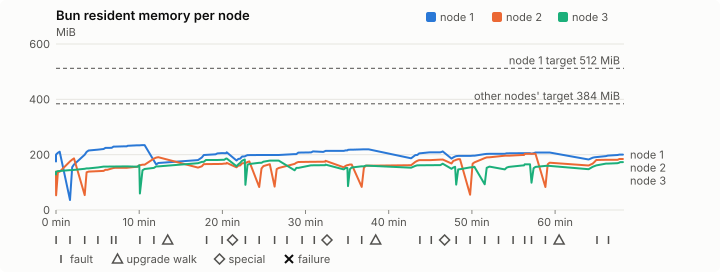
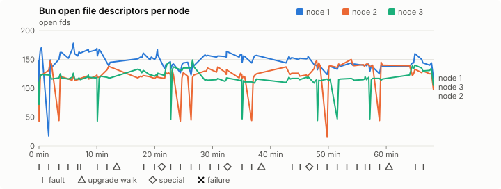
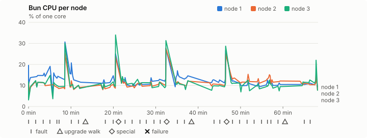
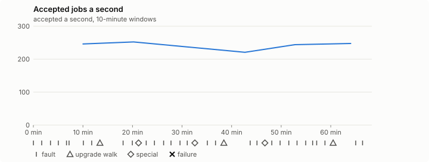

# Sustained soak (V02): PASS

27 November 2026. fast tier, compressed schedule, 1 h 08 min of soak on a three-node quickstart cluster.

**Fast tier: clean.** The iteration loop only, not acceptance: the V02 gate needs a clean final-tier run (8 h, full schedule) on the final candidate.

## Candidate and host

| | |
|---|---|
| Staged base URL | <https://github.com/reliaburger/reliaburger/releases/download/nightly-v0.3.3-45869980780-1> |
| `candidate.json` SHA-256 | `758b7c0dc2bcfccae8752a582603d43d0e1ff78f7e40cbf8a4870a4c17f7203f` |
| Running versions | v0.3.3 x3 |
| Soak build | `bun-v0.3.3-soak.1`, SHA-256 `4c31bb63ca74f9ebe83fd63b5ba20f9cfb8604133d53a9b30fbb9aa38e2b1b6f` |
| Walks roll back to | 0.3.3 |
| Host | macOS 27.2, Apple M5 Max, 128 GiB |
| Lima | limactl version 2.2.1 |
| Guest | Ubuntu 26.04.1 LTS, kernel 7.0.0-34-generic |
| RELIABURGER_HOME | `/tmp/rbq.tQfKiR` |
| Evidence | `/Users/miko/github/rb-wt/gate-033/qual/ev-v02-fast` |

## Configuration deviations

- Ubuntu's apt-daily and apt-daily-upgrade timers stopped and disabled in each guest, so unattended upgrades can't restart Bun during the soak (#1417)
- node.toml `[testing] allowed_operations` adds `provision_isolated_workloads` (quickstart allows only inject_workload_faults and alter_node_state), so the catalogue pulse can lease test namespaces
- node.toml `[logs]`/`[metrics]` export to file:///var/lib/reliaburger/soak-export every 60 s with max_storage_mb = 8 (the harness deletes a metrics export 30 minutes after its source has gone), `[storage.snapshots]` every 900 s (compressed: 120 s), retain 4, uploaded to the same directory
- node.toml `[ingress] tls_cert/tls_key` point at an operator pair from a soak CA, 45-minute leaves rotated by the harness
- Bun runs with auto/mixed; host jobs opt in to a single pinned BusyBox copy under /var/lib/reliaburger/soak-jobs, mount_isolation=false. The independent verifier listens on each private VM address, TCP 8189, with a separate run token
- node.toml `[node.labels] soak-volume` = "writer" on node 2 and "redis" on node 3, to pin the volume apps
- node.toml `[upgrades] external_signing_key` = a throwaway operator key the harness made for this run (`ed25519:gTLKUH3i5QfkHURz3GnwJpiwtWJvK8ITcdDRkXMJ1KQ=`); the soak build's `.sig` gets that key's external signature beside the release one (D2)
- node.toml `[security] leaf_lifetime_override_secs = 3600` (D1)
- apt-daily, apt-daily-upgrade and unattended-upgrades verified inactive on every node before the baseline, after waiting 0 s for any upgrade in progress (snapshots/upgrades-verified-N.txt)

## Timeline

- Started 2026-11-27 00:20:02 UTC, finished 2026-11-27 01:28:19 UTC
- Cycles completed: 6
- Fault and node choices: 26, from seed 3355979067 (`--seed 3355979067` repeats them)
- Teardown: `relish local destroy --yes` and `relish uninstall --yes` succeeded

## Faults and slots

| Class | Runs | Settled/ok | Failed | Skipped | Settle (median / max) |
|---|---|---|---|---|---|
| fault:bun-kill-follower | 6 | 6 | 0 | 0 | 32 s / 37 s |
| fault:bun-kill-leader | 6 | 6 | 0 | 0 | 34 s / 35 s |
| fault:chaos-cpu | 1 | 2 | 0 | 0 | 16 s / 16 s |
| fault:chaos-delay | 2 | 4 | 0 | 0 | 17 s / 17 s |
| fault:chaos-dns | 1 | 2 | 0 | 0 | 16 s / 16 s |
| fault:chaos-drop | 1 | 2 | 0 | 0 | 16 s / 16 s |
| fault:chaos-kill | 2 | 4 | 0 | 0 | 38 s / 38 s |
| fault:chaos-memory | 1 | 2 | 0 | 0 | 18 s / 18 s |
| fault:chaos-partition | 2 | 4 | 0 | 0 | 17 s / 17 s |
| fault:chaos-pause | 1 | 2 | 0 | 0 | 23 s / 23 s |
| fault:chaos-scenario | 1 | 2 | 0 | 0 | 32 s / 32 s |
| fault:deploy-kill | 3 | 3 | 0 | 0 | 34 s / 40 s |
| fault:power-off | 3 | 3 | 0 | 0 | 30 s / 33 s |
| pulse | 1 | 1 | 0 | 0 | n/a |
| pulse:settle | 0 | 1 | 0 | 0 | 16 s / 16 s |
| special:all-off | 1 | 1 | 0 | 0 | 33 s / 33 s |
| special:graceful-stop | 1 | 1 | 0 | 0 | 63 s / 63 s |
| special:quorum-back | 1 | 1 | 0 | 0 | n/a |
| special:quorum-loss | 1 | 1 | 0 | 0 | 30 s / 30 s |
| storage:offline-export | 3 | 3 | 0 | 0 | n/a |
| storage:registry-push | 6 | 0 | 0 | 0 | n/a |
| tls:invalid-expired | 3 | 3 | 0 | 0 | n/a |
| tls:invalid-torn | 6 | 6 | 0 | 0 | n/a |
| tls:reload | 32 | 32 | 0 | 0 | n/a |
| upgrade:rollback | 3 | 3 | 0 | 0 | n/a |
| upgrade:settle | 0 | 3 | 0 | 0 | 60 s / 64 s |
| upgrade:upgrade | 3 | 3 | 0 | 0 | n/a |

## Execution inventory (recorded, not gated)

What the run completed, from its events and kept bytes, against what its schedule owes. A fault counts once it was injected and the cluster settled after it.

| Item | Required | Completed | Verdict |
|---|---|---|---|
| candidate.json bytes match the qualified digest | 1 | 1 | ok |
| app workloads settled at the baseline | 1 | 1 | ok |
| upgrade walk (to the soak build and back) | 2 | 3 | ok |
| fault:bun-kill-follower | 1 | 6 | ok |
| fault:bun-kill-leader | 1 | 6 | ok |
| fault:deploy-kill | 1 | 3 | ok |
| fault:power-off | 1 | 3 | ok |
| fault:chaos-kill | 1 | 2 | ok |
| fault:chaos-delay | 1 | 2 | ok |
| fault:chaos-partition | 1 | 2 | ok |
| fault:chaos-scenario | 1 | 1 | ok |
| fault:chaos-pause | 1 | 1 | ok |
| fault:chaos-drop | 1 | 1 | ok |
| fault:chaos-dns | 1 | 1 | ok |
| fault:chaos-cpu | 1 | 1 | ok |
| special:graceful-stop | 1 | 1 | ok |
| special:quorum-loss | 1 | 1 | ok |
| special:all-off | 1 | 1 | ok |
| catalogue pulse | 1 | 1 | ok |
| offline export | 2 | 3 | ok |
| job campaign drained in its final two minutes | 1 | 1 | ok |

## Observed fault effects

What each injected fault was seen to do, read back from the node.

| Fault | Target | Observed |
|---|---|---|
| effect:bun-kill-follower | rb-49ec39cc7c8f-2 | MainPID 3614 -> 6745 |
| effect:bun-kill-leader | rb-49ec39cc7c8f-1 | MainPID 10191 -> 42347 |
| effect:deploy-kill | rb-49ec39cc7c8f-2 | MainPID 6745 -> 68224 |
| effect:power-off | rb-49ec39cc7c8f-2 | Lima status Stopped |
| effect:bun-kill-follower | rb-49ec39cc7c8f-3 | MainPID 3355 -> 174477 |
| effect:bun-kill-leader | rb-49ec39cc7c8f-1 | MainPID 42347 -> 223516 |
| effect:bun-kill-follower | rb-49ec39cc7c8f-3 | MainPID 1045 -> 28166 |
| effect:bun-kill-leader | rb-49ec39cc7c8f-2 | MainPID 1033 -> 54060 |
| effect:deploy-kill | rb-49ec39cc7c8f-2 | MainPID 54060 -> 83987 |
| effect:power-off | rb-49ec39cc7c8f-3 | Lima status Stopped |
| effect:bun-kill-follower | rb-49ec39cc7c8f-3 | MainPID 1037 -> 13264 |
| effect:bun-kill-leader | rb-49ec39cc7c8f-2 | MainPID 1044 -> 54050 |
| effect:bun-kill-follower | rb-49ec39cc7c8f-3 | MainPID 1044 -> 17505 |
| effect:bun-kill-leader | rb-49ec39cc7c8f-2 | MainPID 1032 -> 54632 |
| effect:deploy-kill | rb-49ec39cc7c8f-3 | MainPID 17505 -> 74778 |
| effect:power-off | rb-49ec39cc7c8f-3 | Lima status Stopped |
| effect:bun-kill-follower | rb-49ec39cc7c8f-3 | MainPID 1035 -> 55261 |
| effect:bun-kill-leader | rb-49ec39cc7c8f-2 | MainPID 54632 -> 214443 |

## Renewals and rotations

| Measure | Observed | Required | Verdict |
|---|---|---|---|
| workload identity rotations (soak-identity, per node) | 7 | ≥ 1 | PASS |
| node leaf renewals (per node) | 2 | ≥ 1 | PASS |
| operator ingress reloads (all nodes) | 32 | ≥ 12 | PASS |
| mixed job campaign and positive drain | 0 missing/failing checks | 0 | PASS |

## Latency SLOs

What a user should feel on a quiet three-node cluster (#1400). Every sample is taken outside fault windows and through a host forward that works; each p99 is the upper bound of its histogram bucket.

| SLO | p99 | Threshold | Samples | Mode | Verdict |
|---|---|---|---|---|---|
| API read p99 | 150 ms | ≤ 3,000 ms | 276 | gated | PASS |
| API write p99 | 150 ms | ≤ 3,000 ms | 8 | gated | PASS |
| App start p99 | 10,000 ms | ≤ 30,000 ms | 24 | gated | PASS |
| Rolling update p99 | 30,000 ms | ≤ 100,000 ms | 8 | gated | PASS |
| Job task start p99 | 2,048 ms | ≤ 256 ms | 20 | record only | too few samples |

- API read p99: `GET /v1/status?cluster=true` and `GET /v1/cluster/nodes` on every node, at every light check
- API write p99: `relish apply` of the soak workloads, from the call to the commit
- App start p99: each node's deploy of a new `soak-slo` instance, from its start until the instance passes its health check
- Rolling update p99: from `relish apply` returning to every node's `soak-slo` running the new spec
- Job task start p99: a job task's start lag on a pooled executor, from the job campaign's buckets, in runs no fault window overlapped
- Job task start p99 not judged: only 20 job task start samples, fewer than the 1,000 a p99 needs

## Jobs

| Runtime | Accepted successes | Retries | Last accepted progress |
|---|---|---|---|
| runc | 10785 | 1 | 1795742887 |
| shared-runc | 488425 | 1 | 1795742887 |
| process | 492448 | 1 | 1795742887 |

The bounded campaign shares the app soak's fault schedule. These counts are reliability evidence, not a saturation rate or a 100-million-per-day qualification.

- Independent verifier execution attempts: 24
- Explicit test-operator acknowledgements for known replay-safe fenced fixtures: 135

- rb-49ec39cc7c8f-1: latest complete job storage (KiB) {'instances': 444, 'job-state': 8, 'task-arrays': 6660}; free 4510048 KiB; live/peak owners 0/11; peak storage {'instances': 8684, 'job-state': 8, 'task-arrays': 16512}
- rb-49ec39cc7c8f-2: latest complete job storage (KiB) {'instances': 1180, 'job-state': 8, 'task-arrays': 6564}; free 5618448 KiB; live/peak owners 0/8; peak storage {'instances': 9020, 'job-state': 8, 'task-arrays': 16396}
- rb-49ec39cc7c8f-3: latest complete job storage (KiB) {'instances': 3532, 'job-state': 8, 'task-arrays': 6292}; free 5624232 KiB; live/peak owners 0/8; peak storage {'instances': 8568, 'job-state': 8, 'task-arrays': 16140}

Instance storage limit: 64 MiB per node (data/instances, allocated, outside fault windows; #1418).

Complete disk inventories are recorded. Global retention bounds and the 12-hour job qualification remain #668; this gate cannot certify an unimplemented retention policy.

## Job qualification (D18-C)

Load: calibration; 3 nodes; accepted 242.3/s (calibration load: not gated).

The September plan set its targets for one 1M-task batch on a quiet cluster. A soak runs for hours with restarts, upgrades and apps, so its storage, Bun memory and Raft targets are restated (maintainer decision, 15 October 2026, [#668](https://github.com/reliaburger/reliaburger/issues/668)). Bun's steady state is the median RSS of each process once it has been seen for 10 minutes; the gated memory checks are unchanged (`leak-rss`, and Mayo's 70% `memory_high` alert through `wtf`).

| Measure (recorded, not gated) | Observed | Target |
|---|---|---|
| Wall time of a 1,048,576-task array (median / max of 0) | not measured / not measured | ≤ 600 s |
| p99 start lag, pooled executors | 4 ms (bucket upper bound) | < 1,000 ms |
| Raft entries per second, all cluster writes | 5.53 | recorded only; the batch target counts only task-array writes |
| Raft state of one run, largest seen | 43,621 B | ≤ 256 KiB per 1M tasks |
| Bun steady-state RSS per process, worst node against its target | rb-49ec39cc7c8f-1: 217.52 MiB steady, 234.72 MiB peak | ≤ 512 MiB (≤ 512 MiB on node 1, which serves the API) |
| Bun CPU, busiest node | 0.12 cores | ≤ 1 core (leader batch control) |
| Executor helper CPU, busiest node | 0.01 cores | ≤ 0.5 core |
| Node task-array storage per 1M accepted tasks (peaks summed) | 48.30 MiB | ≤ 64 MiB, deleted after retirement |
| Retained log volume, all nodes | 6.68 MB | ≤ 50 MB |

- Bun RSS on rb-49ec39cc7c8f-1 (serves the API, target ≤ 512 MiB): pid 10191: 210.57 MiB peak (seen for under 10 minutes); pid 42347: 234.72 MiB peak (seen for under 10 minutes); pid 223516: 169.98 MiB peak (seen for under 10 minutes); pid 260919: 208.69 MiB peak (seen for under 10 minutes); pid 1035: 217.52 MiB steady, 219.54 MiB peak; pid 1035: 211.73 MiB peak (seen for under 10 minutes); pid 1039: 207.88 MiB steady, 207.89 MiB peak; pid 1039: 200.34 MiB peak (seen for under 10 minutes)
- Bun RSS on rb-49ec39cc7c8f-2 (node, target ≤ 384 MiB): pid 3614: 138.77 MiB peak (seen for under 10 minutes); pid 6745: 186.41 MiB peak (seen for under 10 minutes); pid 68224: 138.95 MiB peak (seen for under 10 minutes); pid 1035: 190.97 MiB peak (seen for under 10 minutes); pid 1035: 170.14 MiB peak (seen for under 10 minutes); pid 1033: 175.70 MiB peak (seen for under 10 minutes); pid 54060: 165.51 MiB peak (seen for under 10 minutes); pid 83987: 177.85 MiB peak (seen for under 10 minutes); pid 1044: 164.41 MiB peak (seen for under 10 minutes); pid 54050: 160.07 MiB peak (seen for under 10 minutes); pid 54050: 182.45 MiB peak (seen for under 10 minutes); pid 1032: 183.79 MiB peak (seen for under 10 minutes); pid 54632: 203.03 MiB peak (seen for under 10 minutes); pid 214443: 171.14 MiB peak (seen for under 10 minutes); pid 214443: 184.30 MiB peak (seen for under 10 minutes)
- Bun RSS on rb-49ec39cc7c8f-3 (node, target ≤ 384 MiB): pid 3355: 161.68 MiB steady, 161.68 MiB peak; pid 174477: 157.72 MiB peak (seen for under 10 minutes); pid 174477: 186.16 MiB peak (seen for under 10 minutes); pid 1045: 182.37 MiB peak (seen for under 10 minutes); pid 28166: 178.54 MiB peak (seen for under 10 minutes); pid 1047: 163.97 MiB peak (seen for under 10 minutes); pid 1037: 151.89 MiB peak (seen for under 10 minutes); pid 13264: 160.01 MiB peak (seen for under 10 minutes); pid 1038: 167.33 MiB peak (seen for under 10 minutes); pid 1044: 156.19 MiB peak (seen for under 10 minutes); pid 17505: 156.21 MiB peak (seen for under 10 minutes); pid 74778: 156.70 MiB peak (seen for under 10 minutes); pid 1035: 165.28 MiB peak (seen for under 10 minutes); pid 55261: 159.54 MiB peak (seen for under 10 minutes); pid 1033: 172.99 MiB peak (seen for under 10 minutes)

- runc retry causes: exit_code 1, launch 0, signal 0, timeout 0, unknown 0, unrecorded 0
- shared-runc retry causes: exit_code 1, launch 0, signal 0, timeout 0, unknown 0, unrecorded 0
- process retry causes: exit_code 1, launch 0, signal 0, timeout 0, unknown 0, unrecorded 0
- Audited executions: 24; operator replay decisions: 135
- Chunks checked for exactly-once completion: 72, 5 of them re-granted (#1415)
- Job controller API fallbacks: rb-49ec39cc7c8f-1 missed 96; rb-49ec39cc7c8f-2 answered 96 (requests a node didn't answer, and the node that took them instead)

## Data

- Volume writer: highest ACK 28770 in the log view; the writer file checks (writer-lost, writer-regression) decide data loss, and `*-log-order` failures are about the order the log view returned lines in
- Redis counter: highest INCR 3137 in the log view
- Volume writer resumes: 5 starts, each checked against the highest ACK logged before it
- Redis client starts: 16, each checked against the highest INCR logged before it; counter regressions the client saw: 0
- Export rb-49ec39cc7c8f-1: 123 source files, 112 at the destination
- Export rb-49ec39cc7c8f-2: 140 source files, 126 at the destination
- Export rb-49ec39cc7c8f-3: 106 source files, 106 at the destination
- Registry images pushed and re-verified: 7
- Agent-loop turns over the 1 s budget: rb-49ec39cc7c8f-1 0, rb-49ec39cc7c8f-2 0, rb-49ec39cc7c8f-3 0
- Soak policies checked in force: 119 times, policy generation 39 at the last check
- Guest clock steps by Lima's guest agent: rb-49ec39cc7c8f-1 3, rb-49ec39cc7c8f-2 4, rb-49ec39cc7c8f-3 6
- Checks evaluated: 185 (heavy 17, light 66, settle 102)
- Last observed progress: redis-counter 3137, writer-ack 28770

## Council history (linearizability)

Every test-lease grant, renew, read and release the history client made, checked against a model of the council's leases. A write with no answer may or may not have happened; the check allows both.

- Operations checked: 21085 of 21085, in 2 namespaces; 1025 writes had no answer
- Verdict: linearizable

## Leak-checker exposure (recorded, not gated)

How long each leak checker could judge each node's Bun. `leak-rss` arms at its warm sample: 60 minutes into one process in a final, and otherwise at the first heavy check where the log and metrics stores are each 90% full, between 60 minutes and 6 hours in (#1417). `leak-fd` arms after 50 minutes; a restart, kill or upgrade exec starts the warm-up again. A final needs each armed for 60 minutes on every node, with one unbroken window of 30 (#1062); its quiet tail gives them that.

| Node | Checker | Armed | Longest armed window | Evaluated samples | Processes armed | Verdict |
|---|---|---|---|---|---|---|
| rb-49ec39cc7c8f-1 | leak-rss | 0 min | 0 min | 0 | 0 | short |
| rb-49ec39cc7c8f-1 | leak-fd | 0 min | 0 min | 0 | 0 | short |
| rb-49ec39cc7c8f-2 | leak-rss | 0 min | 0 min | 0 | 0 | short |
| rb-49ec39cc7c8f-2 | leak-fd | 0 min | 0 min | 0 | 0 | short |
| rb-49ec39cc7c8f-3 | leak-rss | 0 min | 0 min | 0 | 0 | short |
| rb-49ec39cc7c8f-3 | leak-fd | 0 min | 0 min | 0 | 0 | short |

## Resource trends

| Node | Measure | First | Last | Max |
|---|---|---|---|---|
| rb-49ec39cc7c8f-1 | disk_kb data | 1382968 | 999040 | 1534520 |
| rb-49ec39cc7c8f-1 | disk_kb images | 346292 | 472272 | 472272 |
| rb-49ec39cc7c8f-1 | disk_kb logs | 40 | 3196 | 3196 |
| rb-49ec39cc7c8f-1 | disk_kb metrics | 96 | 4616 | 4616 |
| rb-49ec39cc7c8f-1 | disk_kb soak-export | 4 | 7220 | 7220 |
| rb-49ec39cc7c8f-1 | disk_kb volumes | 284 | 108 | 344 |
| rb-49ec39cc7c8f-1 | fd | 109 | 118 | 178 |
| rb-49ec39cc7c8f-1 | rss_anon_kb | 102304 | 120560 | 157420 |
| rb-49ec39cc7c8f-1 | rss_file_kb | 77232 | 84584 | 86176 |
| rb-49ec39cc7c8f-1 | rss_kb | 179536 | 205144 | 240356 |
| rb-49ec39cc7c8f-2 | disk_kb data | 71804 | 39544 | 630664 |
| rb-49ec39cc7c8f-2 | disk_kb images | 172188 | 346260 | 346260 |
| rb-49ec39cc7c8f-2 | disk_kb logs | 24 | 2224 | 2224 |
| rb-49ec39cc7c8f-2 | disk_kb metrics | 68 | 3352 | 3352 |
| rb-49ec39cc7c8f-2 | disk_kb soak-export | 4 | 5312 | 5312 |
| rb-49ec39cc7c8f-2 | disk_kb volumes | 16912 | 17424 | 17640 |
| rb-49ec39cc7c8f-2 | fd | 74 | 98 | 150 |
| rb-49ec39cc7c8f-2 | rss_anon_kb | 58320 | 102852 | 121528 |
| rb-49ec39cc7c8f-2 | rss_file_kb | 75888 | 85872 | 86512 |
| rb-49ec39cc7c8f-2 | rss_kb | 134208 | 188724 | 207904 |
| rb-49ec39cc7c8f-3 | disk_kb data | 234556 | 720592 | 787980 |
| rb-49ec39cc7c8f-3 | disk_kb images | 346132 | 346276 | 346276 |
| rb-49ec39cc7c8f-3 | disk_kb logs | 24 | 1108 | 1108 |
| rb-49ec39cc7c8f-3 | disk_kb metrics | 68 | 2944 | 2944 |
| rb-49ec39cc7c8f-3 | disk_kb soak-export | 4 | 5172 | 5172 |
| rb-49ec39cc7c8f-3 | disk_kb volumes | 16924 | 17408 | 17408 |
| rb-49ec39cc7c8f-3 | fd | 72 | 105 | 149 |
| rb-49ec39cc7c8f-3 | rss_anon_kb | 55948 | 95048 | 108272 |
| rb-49ec39cc7c8f-3 | rss_file_kb | 75504 | 82096 | 86576 |
| rb-49ec39cc7c8f-3 | rss_kb | 131452 | 177144 | 190624 |

## Bun memory by kind

From each node's `/proc/PID/smaps` at the settle and heavy checks (`memory.jsonl`, #1417). Sizes in MiB; arenas are glibc thread arenas, with the number of 64 MiB arena heaps in brackets. Time is h:mm since the node's first sample.

### rb-49ec39cc7c8f-1

| Time | Pid | RSS | Heap | Arenas | Stacks | Other anonymous | File | Threads |
|---|---|---|---|---|---|---|---|---|
| 0:00 | 10191 | 175.3 | 47.8 | 0.0 (0) | 1.7 | 46.5 | 79.2 | 62 |
| 1:04 | 1039 | 182.4 | 54.7 | 0.0 (0) | 0.7 | 43.4 | 83.6 | 49 |
| 1:08 | 1039 | 200.3 | 60.7 | 0.0 (0) | 0.8 | 52.4 | 86.4 | 49 |

- rb-49ec39cc7c8f-1: not enough data: the last Bun process (pid 1039) has no samples after its first hour.
- rb-49ec39cc7c8f-1: no 6-hour RSS slope: the last Bun process (pid 1039) ran for 0:20 h:mm.

### rb-49ec39cc7c8f-2

| Time | Pid | RSS | Heap | Arenas | Stacks | Other anonymous | File | Threads |
|---|---|---|---|---|---|---|---|---|
| 0:00 | 3614 | 131.1 | 34.1 | 0.0 (0) | 2.1 | 17.0 | 77.9 | 32 |
| 1:04 | 214443 | 160.7 | 43.4 | 0.0 (0) | 2.9 | 30.3 | 84.2 | 56 |
| 1:08 | 214443 | 184.3 | 57.4 | 0.0 (0) | 2.9 | 36.4 | 87.6 | 56 |

- rb-49ec39cc7c8f-2: not enough data: the last Bun process (pid 214443) has no samples after its first hour.
- rb-49ec39cc7c8f-2: no 6-hour RSS slope: the last Bun process (pid 214443) ran for 0:09 h:mm.

### rb-49ec39cc7c8f-3

| Time | Pid | RSS | Heap | Arenas | Stacks | Other anonymous | File | Threads |
|---|---|---|---|---|---|---|---|---|
| 0:00 | 3355 | 128.4 | 25.0 | 0.0 (0) | 0.9 | 25.0 | 77.5 | 26 |
| 1:04 | 1033 | 147.6 | 30.2 | 0.0 (0) | 1.0 | 32.9 | 83.6 | 35 |
| 1:08 | 1033 | 173.0 | 40.2 | 0.0 (0) | 3.9 | 45.0 | 83.9 | 69 |

- rb-49ec39cc7c8f-3: not enough data: the last Bun process (pid 1033) has no samples after its first hour.
- rb-49ec39cc7c8f-3: no 6-hour RSS slope: the last Bun process (pid 1033) ran for 0:04 h:mm.

### Log stores against RSS

Each node's `disk logs` and `disk metrics` and the Parquet files in its log store, from the same samples. RSS in MiB.

| Node | Time | RSS | Logs (KiB) | Log files | Metrics (KiB) |
|---|---|---|---|---|---|
| rb-49ec39cc7c8f-1 | 0:00 | 175.3 | 40 | 4 | 96 |
| rb-49ec39cc7c8f-1 | 1:04 | 182.4 | 3,104 | 54 | 4,308 |
| rb-49ec39cc7c8f-1 | 1:08 | 200.3 | 3,196 | 56 | 4,616 |
| rb-49ec39cc7c8f-2 | 0:00 | 131.1 | 24 | 3 | 68 |
| rb-49ec39cc7c8f-2 | 1:04 | 160.7 | 2,108 | 72 | 3,188 |
| rb-49ec39cc7c8f-2 | 1:08 | 184.3 | 2,224 | 76 | 3,352 |
| rb-49ec39cc7c8f-3 | 0:00 | 128.4 | 24 | 3 | 68 |
| rb-49ec39cc7c8f-3 | 1:04 | 147.6 | 796 | 44 | 2,616 |
| rb-49ec39cc7c8f-3 | 1:08 | 173.0 | 1,108 | 48 | 2,944 |

## Agent loop stalls

From the stall watchdog's journal blocks (`loop-stalls.jsonl`, #1707). Each snapshot lists every Bun thread; here are the stall line, threads in uninterruptible sleep and the thread that ran the loop.

- None recorded.

## Charts

Time runs from the start of the soak. The marks under each chart are its faults, upgrade walks, specials and recorded failures; the dashed lines are targets.

## Failures

None.

## Notes

- Unattended upgrades were off on every guest 0 s after they were asked to stop (snapshots/upgrades-stopped-N.txt)

Evidence: `/Users/miko/github/rb-wt/gate-033/qual/ev-v02-fast` (events.jsonl, snapshots/, failures/<n>/).
